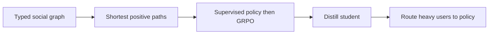
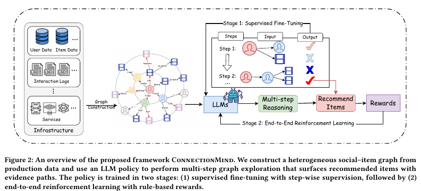

# ConnectionMind: Explainable multistep recommendation with an LLM on a heterogeneous social graph

<!-- source-sha256: 0ab8986076ce4e923163216aac6f95ec7cd0287f6670fce1d64ac12c6cf84817 -->

[简体中文](README.md)

> **Fidelity: core mechanism reproduction.** Runs graph construction, shortest-positive-path SFT, rule-reward GRPO, student distillation and heavy-user hybrid inference on the public Delicious dataset; local negative results retained.

## Paper information

| Field | Details |
|---|---|
| Paper | [Paper or original source](https://arxiv.org/abs/2608.10187) |
| Institution | Michigan State University / Meta Platforms, Inc. |
| First public release | 2026-08-10 (arXiv v1) |
| Author code | No official author code identified as of 2026-08-20. |
| Local adapter or method key | `connectionmind` |
| Local reproduction code | [`src/auto_research/reproductions/connectionmind/`](https://github.com/daiwk/auto-research/tree/main/src/auto_research/reproductions/connectionmind/) |

## Paper method and evidence

Static social embeddings cannot explain which social/interest path supports an item. ConnectionMind builds a typed, weighted, time-stamped user/item/semantic graph. A policy expands a task-relevant subgraph frontier, returning items and evidence paths. SFT follows shortest paths to positive feedback; GRPO rewards formatting, recommendation F1 and shortest-path progress with weights 0.2, 0.5 and 0.3. Production routes the most complex 5%–10% of users to the full LLM and uses a distilled GNN for the rest.



<!-- paper-figure:start -->
### Original paper figure

[](https://arxiv.org/pdf/2608.10187#page=5)

Figure 2 shows graph construction and supervised/RL training for graph exploration. From the [original paper](https://arxiv.org/pdf/2608.10187#page=5); copyright remains with the authors.
<!-- paper-figure:end -->

### Core equation

$$
\mathcal L_{\mathrm{SFT}}=\sum_{(s_d,a_d^*)\in\mathcal D_{\mathrm{SFT}}}-\log p_\theta(a_d^*\mid s_d).
$$

$$
R=\alpha_{\mathrm{fmt}}R_{\mathrm{fmt}}+\alpha_{\mathrm{rec}}R_{\mathrm{rec}}+
\frac{\alpha_{\mathrm{step}}}{D_{\max}+1}\sum_d R_{\mathrm{step}},
$$

Shortest-path SFT pairs state $s_d$ with teacher action $a_d^*$; GRPO updates with within-group relative advantages.

### Reported results

On Delicious, 8B Recall@5/20 is 0.0631/0.1374 and Precision@5/20 0.0930/0.0841; Foursquare Recall@10/50 is 0.0966/0.2084. On Meta's private set, Llama-3.1-8B ConnectionMind improves Recall@10 by 88% over the production GNN, vs 39% for vanilla Llama-3.3-70B. A multi-week A/B with tens of millions of users reports impressions +0.33% ±0.08%, watch time +0.43% ±0.14%, video sessions +0.22% ±0.13%.

## Local reproduction

HetRec 2011 Delicious-2K supplies 180 users, 534 items, 182 social edges among selected users and 64-dimensional tag relations. Chronological leave-two-out; matched graph/split/candidates. SFT uses 977 stepwise shortest-path examples (loss 3.9596→3.8091); GRPO runs 1,440 rollouts, 100% structurally valid. The fixed graph baseline Recall@10/NDCG@10 is 0.1333/0.0828 vs 0.1222/0.0767 for the path-policy/student/10%-heavy-user blend (NDCG −7.44%). The small policy overuses popular paths; scalar relations do not replace 3B/8B semantics and path capacity. [Stable metrics](metrics/delicious2k-seed42.json). No Meta video graph, Llama-3.1 3B/8B, production GNN/serving or online lift reproduced.

```bash
auto-research reproduce --paper connectionmind --dataset-dir data --seed 42
```
