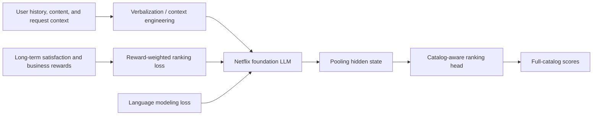
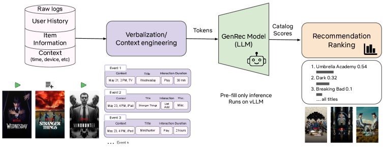

# GenRec: Netflix's LLM-based recommendation ranker

<!-- source-sha256: 4d8aba80ad205574933b38eeb560856a400b0a0f888c775bd1747509c09755ab -->

[简体中文](README.md)

> **Fidelity: Core mechanism.** The local run loads a causal LLM and executes LoRA Phase-2 post-training, textual user history, a full-catalog ranking head, joint language and ranking objectives, and reward-weighted loss. Netflix's private Phase-1 base and online reward models are unavailable and are not claimed to be reproduced by fixed rules.

## Paper information

| Field | Value |
| --- | --- |
| Paper link | [arXiv 2608.10257](https://arxiv.org/abs/2608.10257) |
| Organization | Netflix |
| First published | 2026-08-10 (arXiv v1) |
| Original author code | No author code or model checkpoint found as of 2026-08-13. |
| Adapter | `genrec-netflix` |
| Local reproduction code | [`src/auto_research/reproductions/genrec_netflix/`](https://github.com/daiwk/auto-research/tree/main/src/auto_research/reproductions/genrec_netflix/) |

## Original paper summary

### Background and main changes

Conventional Netflix ranking depends on hand-designed features, feature interactions, and task-specific networks. A new content type or recommendation surface often needs new features, models, and infrastructure. GenRec shifts from feature engineering to context engineering: it represents user history, content metadata, device, and time as text, and lets a shared LLM learn semantics and higher-order interactions.

Phase 1 continues training an open LLM on Netflix content and user data to create an internal foundation model. Phase 2 post-trains it on more frequently refreshed ranking data, labels, and reward signals. The paper focuses on Phase 2.

1. **Textual context:** Encode history, metadata, and request context in natural or lightly structured language. Filter events, compress sequences, and shorten descriptions to control token cost.
2. **Catalog-aware head:** Pool a decoder-only LLM representation and score every item in one forward pass. The head cannot generate items outside the catalog.
3. **Joint objectives:** Train ranking and next-token modeling together to retain text understanding and prompt steering.
4. **Reward-weighted ranking:** Combine multiple reward models, including long-term satisfaction, content-type balance, and new-release stage, into example weights aligned to business goals.
5. **Prefill-only serving:** Produce full-catalog scores after one prefill without token-by-token decoding.



<!-- paper-figure:start -->
### Key figure from the paper

[](https://arxiv.org/html/2608.10257v1#S4.F1)

**Original Figure 1 (architecture):** Context engineering verbalizes interaction logs; a prefill-only vLLM pass scores the full catalog. Image from the [original paper](https://arxiv.org/abs/2608.10257); copyright belongs to the authors. Click the image for its source.
<!-- paper-figure:end -->

### Core equations

The verbalized input is:

$$
x=V\!\left(H,\{M_i\}_{i\in C},\tau\right),
$$

The LLM yields pooled representation $h$. The catalog head scores item vector $e_i$ by $s_i=\phi(h,e_i)$. The total objective is:

$$
\mathcal L=\alpha\mathcal L_{\mathrm{ranking}}+
\beta\mathcal L_{\mathrm{language}}+
\gamma\mathcal L_{\mathrm{misc}},
\qquad \alpha+\beta+\gamma=1.
$$

Combining rewards into example weight $w_n$ gives the ranking loss:

$$
\mathcal L_{\mathrm{ranking}}
=-\frac1N\sum_{n=1}^{N}w_n\log
\frac{\exp s_{n,y_n}}{\sum_{i\in C}\exp s_{n,i}}.
$$

### Offline and online results in the paper

- Offline: approximately **+1.6%** MRR over the mature production ranker using roughly **1/40 of the labeled Phase-2 training examples** and fewer signals.
- Phase 1: about **+10% to 20%** offline ranking improvement over using the open LLM directly.
- Phase 2: about **+35% to 50%** at the Phase-1 cutoff, rising to about **80%** two weeks later due to freshness.
- Context: from approximately 5,000 to 1,700 tokens with little ranking-quality change; serving cost falls to about one-third.
- Online: around **10% of Netflix traffic for 4 weeks**. Short-term home-page engagement **+0.115%**, $P=3.1\times10^{-10}$; long-term core metric **+0.006%**, $P=0.025$.

## Local reproduction

### Comparison

> **Control:** An ID-only GRU discriminative ranker uses the same MovieLens slice, Phase-2 steps, and number of training examples. The GenRec variant uses a larger public causal LLM. This is a mechanism comparison between ID and LLM ranking, not a matched-parameter ablation. Single-seed NDCG@10 improves +35.07%, which is not directly comparable with Netflix's +1.6%.

The run uses time-ordered MovieLens-1M ratings of at least 3, 240 users, 500 items, seed 42, and 120 steps. It loads `HuggingFaceTB/SmolLM2-135M` and injects LoRA into q/v projections. Titles and genres form the text context. The catalog head ranks all 500 items. Every Phase-2 step combines language completion loss with novelty/content-discovery reward-weighted ranking loss.

| Local method | Hit@10 | NDCG@10 | MRR | Head share@10 |
|---|---:|---:|---:|---:|
| ID-only GRU baseline | 0.02500 | 0.01295 | 0.01873 | 0.08167 |
| GenRec LoRA + catalog head + reward weighting | 0.04167 | 0.01749 | 0.01973 | 0.06250 |
| Relative change | **+66.67%** | **+35.07%** | **+5.35%** | **-23.47%** |

This scaled public-data run uses a single seed and `formal_comparison=false`. It verifies trainability and the joint ranking/head-share behavior in this setting, not a reliable general gain.

```bash
pip install -e '.[plum]'
auto-research reproduce \
  --paper genrec-netflix \
  --dataset-dir data \
  --output-dir runs/genrec \
  --device auto \
  --seed 42
```

For a smaller CPU smoke test:

```bash
AUTO_RESEARCH_GENREC_USERS=40 \
AUTO_RESEARCH_GENREC_ITEMS=150 \
AUTO_RESEARCH_GENREC_STEPS=2 \
auto-research reproduce --paper genrec-netflix --dataset-dir data --device cpu --seed 42
```

See [metrics/movielens1m-smollm2-seed42.json](metrics/movielens1m-smollm2-seed42.json). Checkpoints, MovieLens data, and per-example predictions are not uploaded.

## Reproduction limits

- The internal Phase-1 foundation model, thousands of production features, and hundreds of billions of interactions are unavailable. The local run uses public SmolLM2 and MovieLens text and feedback.
- The authors use long-term satisfaction and business reward models. The local run uses auditable popularity-based novelty and genre discovery weights.
- Netflix's vLLM cluster, production latency, batch-scoring surfaces, and online tests are not reproduced. The local run checks the semantics of full-catalog scoring after one prefill.
- No author code or checkpoints were released, so module-by-module numerical parity cannot be verified.
