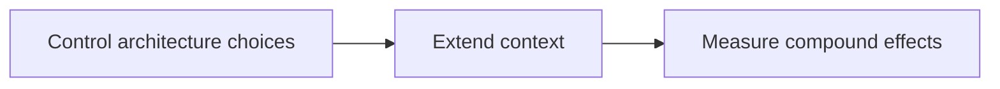
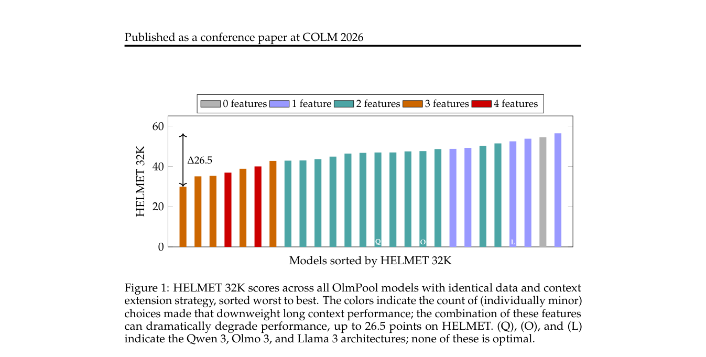

# Cracks in the Foundation: Seemingly Minor Architectural Choices Impact Long Context Extension

<!-- source-sha256: 7dd5f6071190905354d8f5f503573736f77980d7b5ac258738b7853334f6fe9e -->

[简体中文](README.md)

> Fixed-context NumPy mechanism, not paper-scale training.

## Paper information

| Field | Details |
|---|---|
| Paper | [Paper or original source](https://arxiv.org/abs/2608.10296) |
| Institution | Ai2; first author Amanda Bertsch. |
| First public release | 2026-08-10 (arXiv v1) |
| Author code | [allenai/olmpool](https://github.com/allenai/olmpool/). |
| Local adapter or method key | `olmpool-long-context` |
| Local reproduction code | [`src/auto_research/reproductions/olmpool_long_context/`](https://github.com/daiwk/auto-research/tree/main/src/auto_research/reproductions/olmpool_long_context/) |

## Paper method and evidence

Use a controlled 7B model pool to isolate compound effects of normalization, GQA, pretraining length, and sliding-window attention on long-context extension.



<!-- paper-figure:start -->
### Original paper figure

[](https://arxiv.org/pdf/2608.10296#page=2)

The original figure shows architectural sensitivity. From the [original paper](https://arxiv.org/abs/2608.10296); copyright remains with the authors.
<!-- paper-figure:end -->

### Core equation

$$
\Delta_{LC}=f(N,G,L,S)-f(N_0,G_0,L_0,S_0)
$$

### Reported results

Three or more unfavorable choices can reduce downstream long-context performance to 47%; 26 OlmPool models are released.

## Local reproduction

Same seed and 64 examples: recent-window **0.0781**, OlmPool mechanism **1.0000**, **+92.19 percentage points**. [Metrics](metrics/public-seed42.json), [batch index](../../experiments/historical-b07-b11-seed42.json). No full checkpoint training, CUDA kernel, or benchmark.

```bash
auto-research reproduce --paper olmpool-long-context --seed 42
```
