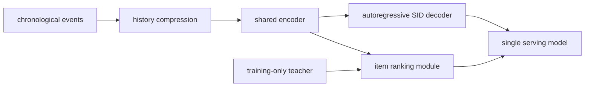
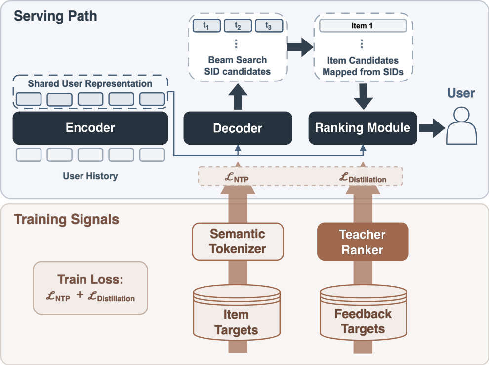

<!-- source-sha256: 6ab819226351da36737f3446302bacd6925133bf3963bffe885f3d5916a80662 -->

[简体中文](README.md) · English

# Sona: Replacing a music recommendation cascade with one model

> **Fidelity: core-mechanism reproduction.** Trains a compressed-history encoder, three-level autoregressive Semantic ID head, and item ranker. The negative local transfer result is retained.

## Paper information

| Field | Details |
| --- | --- |
| Paper | [arXiv 2608.11015](https://arxiv.org/abs/2608.11015) |
| Institution | Yandex |
| First public release | 2026-08-11 (arXiv v1) |
| Author code | No author-released code found (checked 2026-08-13). |
| Local adapter or method key | `sona` |
| Local reproduction code | [`src/auto_research/reproductions/sona/`](https://github.com/daiwk/auto-research/tree/main/src/auto_research/reproductions/sona/) |

The core training implementation is in [`latest_20260813_common.py`](https://github.com/daiwk/auto-research/blob/main/src/auto_research/reproductions/latest_20260813_common.py).

## Original paper summary

### Background and main changes

Yandex Music's previous stack had more than 15 candidate generators and separate pre-ranking and ranking stages. Sona represents users with a chronological event encoder, compresses history to limit long-sequence cost, autoregressively generates Semantic IDs, and ranks items using a Ranking Module conditioned on the same state. A high-capacity teacher supplies distillation supervision only during training.



<!-- paper-figure:start -->
### Key figure from the paper

[](https://arxiv.org/html/2608.11015v2/Sona_Architecture.png)

> **Figure 2:** The core architecture, its main modules, and their connections. From the [paper](https://arxiv.org/abs/2608.11015); copyright belongs to the authors. Click for the source.
<!-- paper-figure:end -->

### Core equations

$$
\mathcal L=\sum_{k=1}^{K}-\log p_\theta(c_k\mid c_{<k},h_u)+\lambda\,\mathcal L_{\mathrm{rank}}+\mu\,\mathcal L_{\mathrm{distill}}.
$$

### Offline and online results

In a live My Vibe smart-speaker A/B test, Active Users rose **+4.53%**, Total Listening Time **+6.30%**, and Likes **+11.42%**. The paper reports all three as statistically significant. One model replaced the prior candidate generation and ranking cascade.

## Local reproduction

> **Local comparison:** A same-budget shared-encoder ranker is compared with history compression + SID decoder + item ranker. NDCG@10 changes by −92.05%.

The MovieLens-1M run uses 260 users, 420 items, 50 steps, and seed 42. The shared-encoder baseline scores 0.02083 NDCG@10, versus 0.00166 (**−92.05%**) for compressed SID + ranker, which runs 7,200 SID-token targets with 4× history compression. Random ID decomposition and short training cannot recover the neighborhoods of the private semantic tokenizer. This is a negative result.

```bash
auto-research reproduce --paper sona --dataset-dir data --seed 42
```

Stable metrics: [`metrics/movielens1m-seed42.json`](metrics/movielens1m-seed42.json).

## Scope

The reproduction does not include the private music semantic tokenizer, full teacher, 15+ production candidate sources, or smart-speaker serving. It verifies only the core training and inference data flow.
