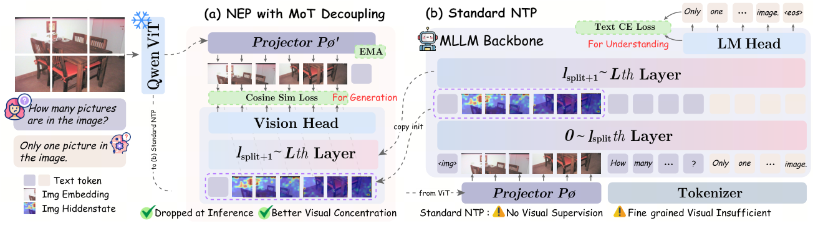

# GAS: Improving multimodal understanding with a removable generation branch

<!-- source-sha256: b6242dace8e24fa13c5f0b877c215ff3c5ba5b6cc8fd5e2995f0312349cb354a -->

[简体中文](README.md)

> **Fidelity: core mechanism reproduction.** Trains a shared visual trunk, independent generation upper layers, continuous next-embedding prediction (NEP) and EMA targets; no Qwen3-VL 2B/4B, 10M generation examples or two-phase 32-GPU training.

## Paper information

| Field | Details |
|---|---|
| Paper | [Paper or original source](https://arxiv.org/abs/2608.12209) |
| Institution | ByteDance |
| First public release | 2026-08-12 (arXiv v1) |
| Author code | No official author code identified (checked 2026-08-13). |
| Local adapter or method key | `gas` |
| Local reproduction code | [`src/auto_research/reproductions/gas/`](https://github.com/daiwk/auto-research/tree/main/src/auto_research/reproductions/gas/) |

## Paper method and evidence

Text-only next-token losses indirectly supervise visual structure; unified generation/understanding models may keep extra deployment cost. GAS shares a lower visual trunk but decouples upper Mixture-of-Transformers paths. The generation branch autoregressively predicts target image embeddings in the same continuous space as the LLM's visual inputs. Generation gradients improve shared visual features without directly changing the understanding-only upper layers. Generation can be removed entirely at deployment.


<!-- paper-figure:start -->
### Original paper figure

[](https://arxiv.org/html/2608.12209v1/overview_cropped.png)

Figure 1 shows the two branches and shared trunk. From the [original paper](https://arxiv.org/abs/2608.12209); copyright remains with the authors.
<!-- paper-figure:end -->

### Core equation

$$
z_i^{\mathrm{tgt}}=P_{\mathrm{EMA}}(\operatorname{ViT}(I_{\mathrm{tgt}}))_i,
\qquad
\hat z_i=f_{\mathrm{gen}}(x_{\mathrm{ctx}},\hat z_{<i}),
$$

$$
\mathcal L=\mathcal L_{\mathrm{NTP}}+\lambda\mathcal L_{\mathrm{NEP}},
\qquad
\mathcal L_{\mathrm{NEP}}=\frac1N\sum_i\left(1-
\frac{\hat z_i^\top z_i^{\mathrm{tgt}}}{\|\hat z_i\|_2\|z_i^{\mathrm{tgt}}\|_2}\right).
$$

### Reported results

Same-backbone from-scratch Overall goes 47.25→48.25 (+1.00 pp), Perception 56.55→58.52. In the 2B table DynaMath goes 46.2→47.9, MathVista 54.4→56.4 and CountBenchQA 87.7→90.1. Training GPU-hours grow 11.6%, but dropping the generation branch, vision head and EMA projector adds no inference parameters or latency. No industrial online A/B.

## Local reproduction

[Core training code](https://github.com/daiwk/auto-research/blob/main/src/auto_research/multimodal/papers.py). Fashion-MNIST real images: 2,000 train/1,000 test, 120 matched steps, seed 42. Understanding-only accuracy is 61.1%; MoT+NEP gives 63.5% (+2.4 pp, +3.93% relative). Visual dependency delta rises 0.509→0.529. Training-only branch has 84,096 parameters and late cosine loss 0.2359. Both deployed models have 105,226 parameters, +0% overhead. [Stable metrics](metrics/fashion-mnist-qa-seed42.json).

A horizontally mirrored same-class target yields a related generation task; shifted cosine NEP operates on continuous patch embeddings. EMA, increasing $\lambda$, branch separation and removal are retained. Small public-data results are not comparable to the authors' 10M-sample 2B/4B matrix.

```bash
auto-research reproduce --paper gas --dataset-dir data --seed 42
auto-research evolve --model micro-vlm --dataset fashion-mnist-qa \
  --direction "Compare GAS MoT decoupling and auxiliary next-embedding supervision" \
  --generations 2 --population 4 --steps 120
```
