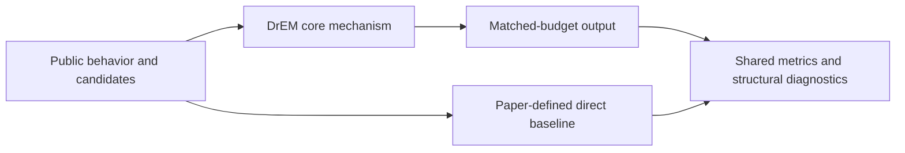
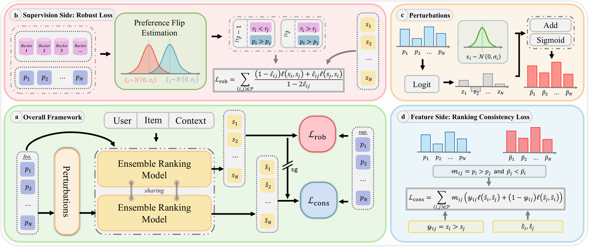

<!-- source-sha256: 317c376f37ed619128b082b67bcd71975c123343475a1968bca2335da04b75de -->

[简体中文](README.md) · English

# DrEM: Doubly robust ensemble ranking under noisy preference predictions

> **Core mechanism reproduction.** The defining public-data mechanism runs locally. Production models, private logs and serving are out of scope; a generic baseline is not a full industrial system.

## Paper information

| Field | Details |
| --- | --- |
| Paper | [arXiv 2608.12778](https://arxiv.org/abs/2608.12778) |
| Institution | Shenzhen University |
| First public release | 2026-08-13 (arXiv v1) |
| Author code | No official author code in the paper when checked on 2026-09-01. |
| Local adapter or method key | `drem` |
| Local reproduction code | [`src/auto_research/reproductions/drem/`](https://github.com/daiwk/auto-research/tree/main/src/auto_research/reproductions/drem/) |

## Original paper summary

### Background and main changes

Map multiple pxtr signals to logits, then filter noisy predictions while preserving preferences and invert pair-label flip risk to correct the training loss. Consistency-based fusion reduces ranking drift under input perturbations.



<!-- paper-figure:start -->
### Key figure from the paper

[](https://arxiv.org/html/2608.12778v1/main-v2.png)

> **Figure 1:** Core architecture, modules and connections. From the [paper](https://arxiv.org/abs/2608.12778); copyright belongs to the authors. Click for the source.
<!-- paper-figure:end -->

### Core equations

$$
\tilde z_c=z_c+\epsilon_c,\qquad \hat y_{ij}=\mathbf 1[s_i>s_j],\qquad \ell_{rob}=\frac{\ell(\hat y)-\rho\ell(1-\hat y)}{1-2\rho}.
$$

### Offline and online results

- Seven days with 5.1% of main traffic per arm: EMER comment rate +1.388%, follow rate +1.197%, and plays +0.691%, with reported p < 0.005.
- These figures are paper online evidence, not local public-data gains.

## Local reproduction

> **Comparison:** Naive three-way weighted fusion versus adding preference-preserving filtering and risk correction. Seed 42 NDCG@10: `0.07726` versus `0.07518`. Proxy relative change is not production pxtr lift or transferable across papers.

All three seeds, means, standard deviations and 95% intervals: [`metrics/public-seeds42-44.json`](metrics/public-seeds42-44.json).

```bash
auto-research reproduce --paper drem --dataset-dir data --seed 42
```

## Scope

Local runs use public MovieLens features or auditable proxy tasks derived from them. Private logs, traffic allocation, production scale and serving cannot be reproduced. Results establish the mechanism only, not online lift or directly comparable absolute paper scores.
