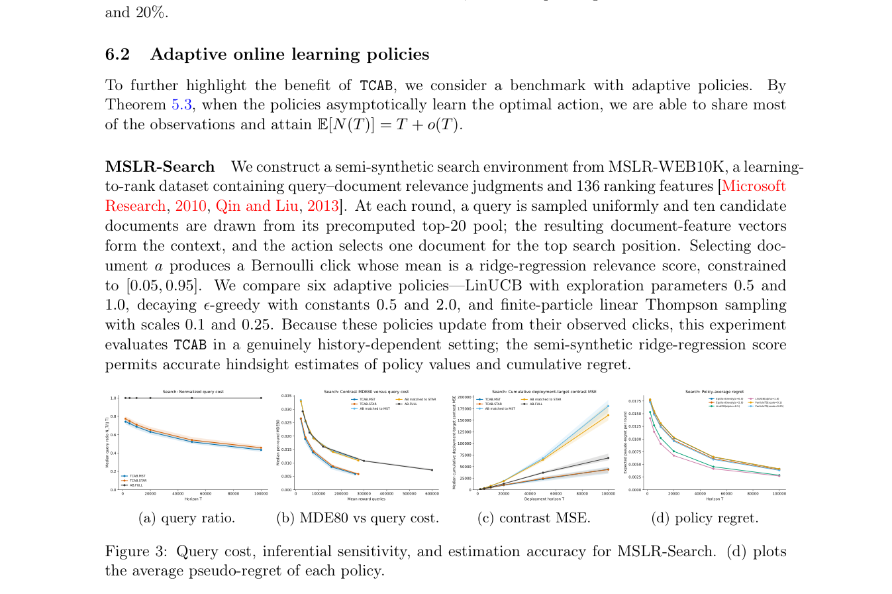

# Fast A/B/n Testing: Exact Multi-Policy Comparison via Tree-Coupled Feedback Sharing

<!-- source-sha256: 4e44170ed798db644200079ceb211363e7fab52b15b9f010f8f5648a0f41bea7 -->

[简体中文](README.md)

> Small NumPy mechanism diagnostic, not industrial A/B/n or full benchmark.

## Paper information

| Field | Details |
|---|---|
| Paper | [Paper or original source](https://arxiv.org/abs/2608.12831) |
| Institution | New York University; first author Yuxiao Wen. |
| First public release | 2026-08-13 (arXiv v1) |
| Author code | No public author code found as of 2026-08-24. |
| Local adapter or method key | `tcab` |
| Local reproduction code | [`src/auto_research/reproductions/tcab/`](https://github.com/daiwk/auto-research/tree/main/src/auto_research/reproductions/tcab/) |

## Paper method and evidence

Use maximal coupling and a minimum spanning tree to share feedback for matching actions while preserving each adaptive policy's marginal trajectory distribution.


<!-- paper-figure:start -->
### Original paper figure

[](https://arxiv.org/pdf/2608.12831#page=15)

Figure illustrates coupled feedback sharing. From the [original paper](https://arxiv.org/abs/2608.12831); copyright remains with the authors.
<!-- paper-figure:end -->

### Core equation

$$
N(T)=T+\sum_{t,e}D_{e,t}
$$

### Reported results

Theory reduces independent A/B/n feedback from JT to T+o(T); experiments improve the cost–precision frontier. Not local online evidence.

## Local reproduction

Same 64 examples and seed: independent A/B/n feedback accuracy **1.0000**, TCAB **1.0000**, **+0.00** percentage points.

```bash
auto-research reproduce --paper tcab --seed 42
```

[Fixed metrics](metrics/public-seed42.json). [Batch index](../../experiments/historical-b07-b11-seed42.json). No paper-scale checkpoint, custom CUDA kernel or full benchmark.
