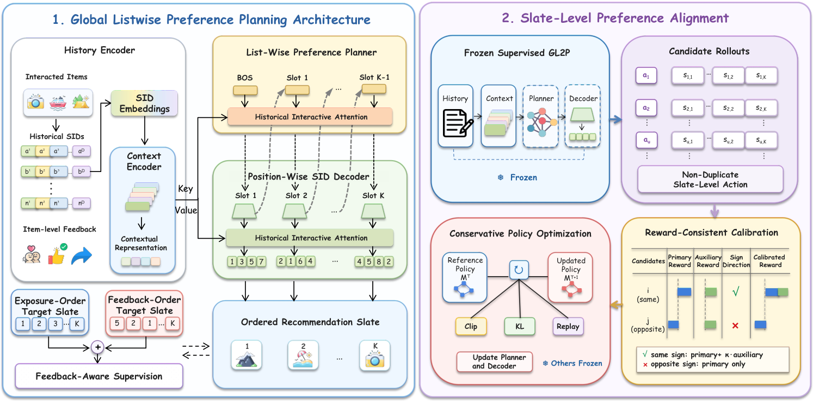

# Once Generated, Ranked: End-to-End Generative Slate Recommendation with Unified Semantic-Collaborative IDs

<!-- source-sha256: f3e863a92f248a1a138b9ca4d98e98108afd69d047724083865391bfe854d5e9 -->

[简体中文](README.md)

> **Fidelity: core mechanism.** Paper results, public-data measurements, and omissions are separate.

## Paper information

| Field | Details |
|---|---|
| Paper | [arXiv 2608.17613](https://arxiv.org/abs/2608.17613) |
| Organization | Kuaishou Technology |
| First public release | 2026-08-18 (arXiv v1) |
| Authors' code | The paper did not provide official or author code when checked on 2026-08-24. |
| Adapter / method | `ogr` |
| Local reproduction code | [`src/auto_research/reproductions/ogr/`](https://github.com/daiwk/auto-research/tree/main/src/auto_research/reproductions/ogr/) |

## Original paper

### Motivation and method

TUSID combines semantic and collaborative codes. GL2P plans the whole slate, then SPA aligns to list-level feedback with conservative policy optimization.


<!-- paper-figure:start -->
### Key figure from the paper

[](https://arxiv.org/html/2608.17613v1/OGR_Generator_Module.png)

> **Figure 1:** Core architecture, modules, and connections. From the [original paper](https://arxiv.org/abs/2608.17613); copyright remains with the authors.
<!-- paper-figure:end -->

### Core equations

$$
J_{SPA}=\mathbb E[R(Y)]-\beta D_{KL}(\pi_\theta\|\pi_{SFT})
$$

### Paper results

The main online result is **Effective Views +1.12%** at 3% production traffic. Offline tables and online metrics use private or paper-specific protocols. The private paper protocol is not directly comparable with local MovieLens measurements.

## Local reproduction

> **Local comparison:** The baseline is the shared transition + content scorer. The treatment adds only ogr on the same users, items, full-catalog candidates, and seed.

MovieLens-100K, 220 users and 360 items, seed 42: NDCG@10 0.0540 → **0.0612 (+13.25%)**; Hit@10 0.1091 → 0.1000. Validation selects mixture weights only; the test set is not used for tuning.

```bash
auto-research reproduce --paper ogr --dataset-dir data --seed 42
```

See the [fixed metrics](metrics/public-seed42.json).

## Reproduction boundaries

The core mechanism runs on MovieLens-100K with the same split, fixed full-catalog candidates, and seed. Private features, the production foundation model, and online traffic are unavailable. The implementation has independent model state and scoring, rather than mapping a paper name to a shared weighted formula. See the adapter's `omitted_core_components` for omissions. Local changes and paper A/B gains are reported separately.
