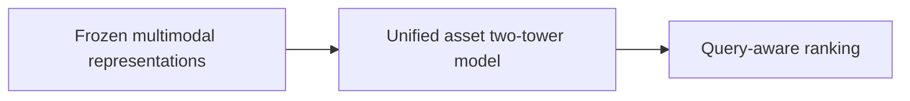
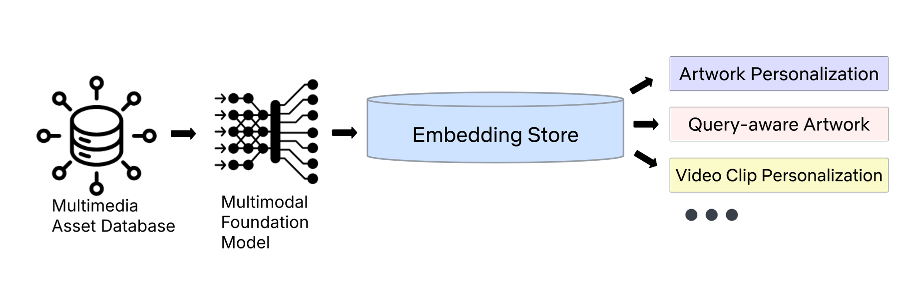

# Multimedia Asset Personalization via Multimodal Embeddings at Netflix

<!-- source-sha256: 8dd59278a851ac846cbb60929fdb512d5790e6f965078970814c5ac4c15a6886 -->

[简体中文](README.md)

> **Fidelity: core mechanism.** Paper results, local public-data measurements, and omissions are separate.

## Paper information

| Field | Details |
|---|---|
| Paper | [arXiv 2608.18322](https://arxiv.org/abs/2608.18322) |
| Organization | Netflix |
| First public release | 2026-08-18 (arXiv v1) |
| Authors' code | The paper did not provide official or author code when checked on 2026-08-24. |
| Adapter / method | `netflix-mediafm` |
| Local reproduction code | [`src/auto_research/reproductions/netflix_mediafm/`](https://github.com/daiwk/auto-research/tree/main/src/auto_research/reproductions/netflix_mediafm/) |

## Original paper

### Motivation and method

Use frozen CLIP/MediaFM representations as shared online features in an asset two-tower model and enhance the search canvas with query similarity. Offline IPS and a winner proxy screen checkpoints.



<!-- paper-figure:start -->
### Key figure from the paper

[](https://arxiv.org/html/2608.18322v1/embedding-store-overview.png)

> **Figure 1:** Core architecture, modules, and connections. From the [original paper](https://arxiv.org/abs/2608.18322); copyright remains with the authors.
<!-- paper-figure:end -->

### Core equations

$$
s(a|u,q)=\alpha\langle u,a\rangle+(1-\alpha)\langle q,a\rangle
$$

### Paper results

Search canvas A/B reports **playthrough rate +0.36%**. Offline tables and online metrics use private or paper-specific protocols. The private paper protocol is not directly comparable with local MovieLens measurements.

## Local reproduction

> **Local comparison:** The baseline is the shared transition + content scorer. The treatment adds only netflix-mediafm on the same users, items, full-catalog candidates, and seed.

MovieLens-100K, 220 users and 360 items, seed 42: NDCG@10 0.0540 → **0.0489 (-9.52%)**; Hit@10 0.1091 → 0.1000. Validation selects mixture weights only; the test set is not used for tuning.

```bash
auto-research reproduce --paper netflix-mediafm --dataset-dir data --seed 42
```

See the [fixed metrics](metrics/public-seed42.json).

## Reproduction boundaries

The core mechanism runs on MovieLens-100K with the same split, fixed full-catalog candidates, and seed. Private features, the production foundation model, and online traffic are unavailable. The implementation has independent model state and scoring, rather than mapping a paper name to a shared weighted formula. See the adapter's `omitted_core_components` for omissions. Local changes and paper A/B gains are reported separately.
