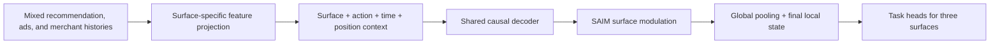
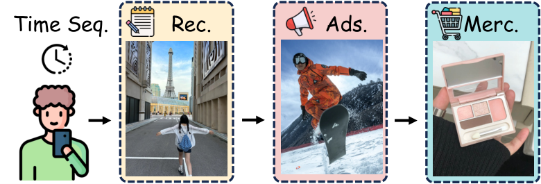

<!-- source-sha256: 5fdbb2ea67fd35502a86f7abaafee55eb9b02e6416c7309ebd78c13fdf27f9ab -->

[简体中文](README.md) · English

# OneModel: Platform-wide ranking across multiple surfaces

> **Fidelity: core-mechanism reproduction.** Runs multi-surface statistics, surface projections, SAIM-style gating, and global/local hierarchical representations. The production Transformer and private features are not reproduced.

## Paper information

| Field | Details |
| --- | --- |
| Paper | [arXiv 2608.18606](https://arxiv.org/abs/2608.18606) |
| Institution | Xiaohongshu |
| First public release | 2026-08-19 (arXiv v1) |
| Author code | No author-released code found (checked 2026-08-24). |
| Local adapter or method key | `onemodel` |
| Local reproduction code | [`src/auto_research/reproductions/onemodel/`](https://github.com/daiwk/auto-research/tree/main/src/auto_research/reproductions/onemodel/) |

## Original paper summary

### Background and main changes

Recommendation, ads, and merchant recommendation typically train separate rankers. This duplicates resources and limits sharing of cross-surface behavior. OneModel projects heterogeneous features to unified event tokens and models mixed long histories with a shared causal decoder. SAIM gates condition the FFN on the surface; the hierarchical representation combines global attentive pooling with recent local state, balancing transfer and specialization.



<!-- paper-figure:start -->
### Key figure from the paper

[](https://arxiv.org/html/2608.18606v2/story.png)

> **Figure 1:** Overall design and components. From the [paper](https://arxiv.org/abs/2608.18606); copyright belongs to the authors. Click for the source.
<!-- paper-figure:end -->

### Core equations

$$
e_i=\phi(W^{(s)}x_i^{(s)}+b^{(s)}),\qquad
z_j=e_{i_j}+\operatorname{Embed}(s_j,a_j,\Delta t_j,pos_j).
$$

SAIM generates a gate from the surface embedding and modulates the shared FFN:

$$
g_t=\sigma(W_g e_s+b_g),\qquad
\operatorname{SAIM}(h_t)=\operatorname{SiLU}(W_1h_t)\odot g_t.
$$

### Offline and online results

Online Xiaohongshu results: Explore Feed time `+0.33%` and engagement `+1.25%`; Feed Ads value `+3.43%` and CTR `+8.18%`; Merchant Recommendation DGMV `+1.1867%` and GPM `+2.1585%`. This is the evidence for inclusion in the repository's industrial queue.

## Local reproduction

> **Local comparison:** A shared global transition ranker is the baseline. The experimental arm adds three surfaces derived from MovieLens genres, surface transitions, sigmoid gating, and global/local fusion. Its NDCG@10 is `0.0870` versus `0.1285`, a **32.29% decrease**, not an improvement.

The negative result shows that artificially dividing the single MovieLens domain into surfaces loses data density. It cannot be extrapolated to the paper's cross-business gains. See [`metrics/movielens-1m-seed42.json`](metrics/movielens-1m-seed42.json).

```bash
auto-research reproduce --paper onemodel --dataset-dir data --seed 42
```

## Scope

The local run uses public MovieLens-1M, not private Xiaohongshu multistream logs, action tokens, a unified Transformer decoder, early gradient isolation, selective backpropagation, or online serving. The core surface gating path executes, but metrics verify only the mechanism and its failure boundary.
