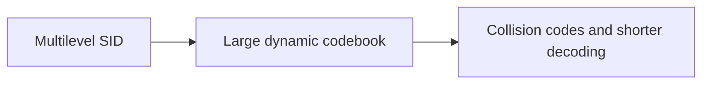
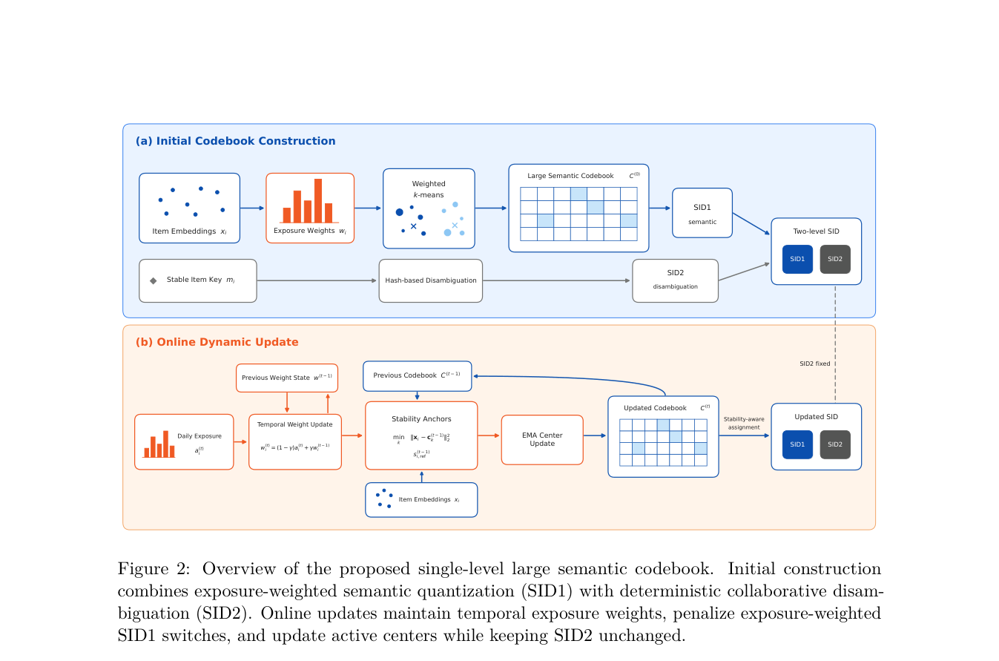

<!-- source-sha256: d20213a9f5051fa745ae3267f5bb9cc713311e233d6ac6e923f0ad6c84d5b509 -->

[简体中文](README.md) · English

# From a Static Multi-Level Small Semantic Codebook to a Dynamic Single-Level Large Semantic Codebook for Generative Recommendation

> **Core mechanism reproduction.** Paper results, local verification and unreproduced scope are separate.

## Paper information

| Field | Details |
| --- | --- |
| Paper | [arXiv 2608.21012](https://arxiv.org/abs/2608.21012) |
| Institution | Kuaishou Technology |
| First public release | 2026-08-21 (arXiv v1) |
| Author code | No official author code in the paper when checked on 2026-08-24. |
| Local adapter or method key | `dynamic-codebook` |
| Local reproduction code | [`src/auto_research/reproductions/dynamic_codebook/`](https://github.com/daiwk/auto-research/tree/main/src/auto_research/reproductions/dynamic_codebook/) |

## Original paper summary

### Background and main changes

Compress a small multilevel semantic codebook into a large, dynamically updated single-level codebook, keeping separate collision codes. This reduces autoregressive steps and uses impression-weighted updates to counter codebook drift.



<!-- paper-figure:start -->
### Key figure from the paper

[](https://arxiv.org/pdf/2608.21012#page=7)

> **Figure 2:** Overall design and components. From the [paper](https://arxiv.org/abs/2608.21012); copyright belongs to the authors. Click for the source.
<!-- paper-figure:end -->

### Core equations

$$
r_i=e_i-c_{s_i},\quad c_k\leftarrow(1-\eta)c_k+\eta\frac{\sum_i w_i e_i\mathbf1[s_i=k]}{\sum_i w_i\mathbf1[s_i=k]}
$$

### Offline and online results

The paper's main online result is **primary consumption +0.79%** with 2.5% traffic for 5 days. Private or paper-specific offline/online protocols are not comparable with MovieLens below.

## Local reproduction

> **Comparison:** Shared transition + content scorer versus adding only `dynamic-codebook` under the same users, items, full catalog and seed. NDCG@10 changes by -18.73% relative.

MovieLens-100K, 220 users / 360 items, seed 42: NDCG@10 0.0540 → **0.0439 (-18.73%)** and Hit@10 0.1091 → 0.0818. Validation alone selects blend; test does not tune.

```bash
auto-research reproduce --paper dynamic-codebook --dataset-dir data --seed 42
```

See [stable metrics](metrics/public-seed42.json).

## Scope

Runs the core mechanism under a fixed full-catalog MovieLens-100K split and seed. Private features, production foundation model and traffic are unavailable; A/B values are paper references only. The local model and scoring state are distinct, not a generic weighted formula with a paper label. See adapter `omitted_core_components`. Local changes are not online A/B lift.
