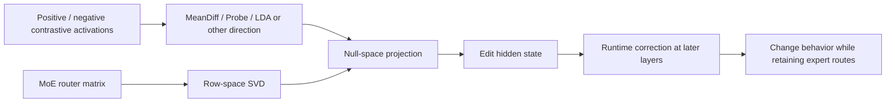
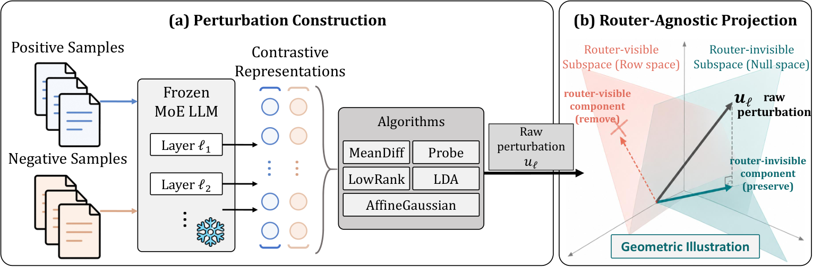

<!-- source-sha256: 43c4ecfebfa8626449838caedcf6c05db9167bc90b1927e8802de268361b03a5 -->

[简体中文](README.md) · English

# RARE: Editing MoE representations without changing expert routing

> **Fidelity: core-mechanism reproduction.** Runs router row-space SVD, null-space projection, routing consistency checks, and downstream correction without loading the paper's six large MoE checkpoints.

## Paper information

| Field | Details |
| --- | --- |
| Paper | [arXiv 2608.21236](https://arxiv.org/abs/2608.21236) |
| Institution | Huazhong University of Science and Technology |
| First public release | 2026-08-21 (arXiv v1) |
| Author code | No official or author-released code found in the paper (checked 2026-08-24). |
| Local adapter or method key | `rare` |
| Local reproduction code | [`src/auto_research/reproductions/rare/`](https://github.com/daiwk/auto-research/tree/main/src/auto_research/reproductions/rare/) |

## Original paper summary

### Background and main changes

Applying dense-LLM activation steering directly to MoE changes router logits. Sending tokens to different experts can invalidate the estimated behavior direction. RARE projects an arbitrary steering direction into the router's null space, then removes router-visible components introduced during propagation at later protected layers. This changes behavior representations without changing the original expert paths.



<!-- paper-figure:start -->
### Key figure from the paper

[](https://arxiv.org/html/2608.21236v1/methodology.png)

> **Figure 3:** The core architecture, its main modules, and their connections. From the [paper](https://arxiv.org/abs/2608.21236); copyright belongs to the authors. Click for the source.
<!-- paper-figure:end -->

### Core equations

Let $Q_l$ be an orthonormal basis for the row space of router $R_l$:

$$
\Pi_l^\perp=I-Q_lQ_l^\top,\qquad
h'_l=h_l+\Pi_l^\perp u_l,\quad R_l(h'_l-h_l)=0.
$$

Later protected layers correct propagation drift using clean activations:

$$
\widetilde h_l=h_l^0+\Pi_l^\perp(h'_l-h_l^0),\qquad
R_l\widetilde h_l=R_lh_l^0.
$$

### Offline and online results

Across six open MoE models, harmfulness steering averages `53.3%` ASR while retaining `67.8%` on MMLU. TruthfulQA MC1 rises from `41.0%` to `58.6%`, and CounterFact efficacy from `16.8%` to `96.3%`. Foundation-model papers are not subject to an industrial online A/B requirement.

## Local reproduction

> **Local comparison:** The baseline is the same steering direction without projection. The experimental arm adds only RARE's null-space projection and analytical correction. Route agreement increases from `0.8237` to `1.0000` (**+21.40%** relative), while steering gain remains `1.75` in both arms.

See [deterministic mini-suite metrics](metrics/routing-mini-suite-seed42.json) for 2048 states, 64 dimensions, and 8 experts.

```bash
auto-research reproduce --paper rare --dataset-dir data --seed 42
```

## Scope

DeepSeek-V2-Lite, Mixtral, Phi, Qwen3, and GPT-OSS were not loaded; JailbreakBench, TruthfulQA, and CounterFact were not run. The local run verifies the exact routing invariance in equation (8), not the paper's downstream results.
