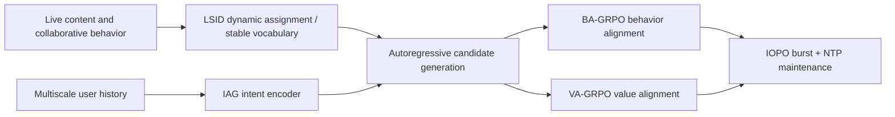
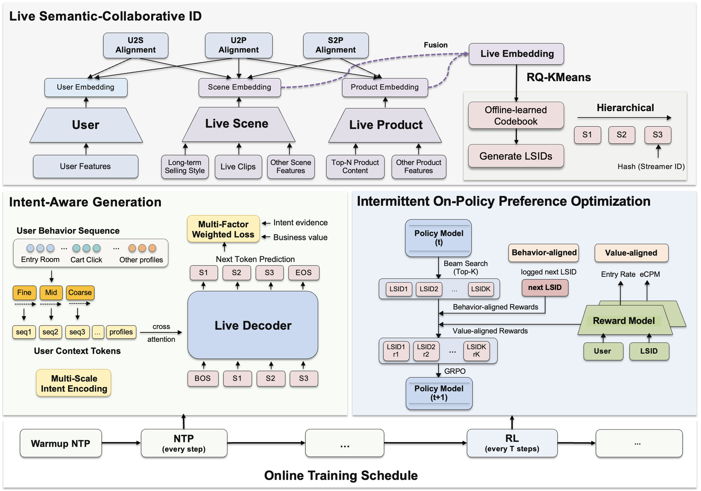

<!-- source-sha256: 4ad4986852ac9702d395edf74e8572dbad3e1f84ef7ef2057cc925bc308ad0ff -->

[简体中文](README.md) · English

# TAGR: Temporally adaptive generative recommendation for livestream ads

> **Fidelity: core-mechanism reproduction.** Runs refreshable LSIDs with a stable vocabulary, multiscale intent, and behavior/value branches. Production online training and ad systems are not reproduced.

## Paper information

| Field | Details |
| --- | --- |
| Paper | [arXiv 2608.24034](https://arxiv.org/abs/2608.24034) |
| Institution | Kuaishou Technology |
| First public release | 2026-08-25 (arXiv v1) |
| Author code | No author-released code found (checked 2026-08-26). |
| Local adapter or method key | `tagr` |
| Local reproduction code | [`src/auto_research/reproductions/tagr/`](https://github.com/daiwk/auto-research/tree/main/src/auto_research/reproductions/tagr/) |

## Original paper summary

### Background and main changes

Livestream content, products, and feedback change quickly. Static semantic IDs, single-timescale histories, and off-policy preference optimization can become stale. TAGR adapts at three levels: LSID periodically refreshes semantic and collaborative assignments without changing the token vocabulary; IAG blends short-, medium-, and long-term intent; IOPO runs on-policy GRPO intermittently and continues NTP between bursts, preventing online RL from overwriting the behavior distribution.



<!-- paper-figure:start -->
### Key figure from the paper

[](https://arxiv.org/html/2608.24034v1/images/fig2-v6.png)

> **Figure 2:** Overall design and components. From the [paper](https://arxiv.org/abs/2608.24034); copyright belongs to the authors. Click for the source.
<!-- paper-figure:end -->

### Core equations

$$
z_u=\operatorname{Fuse}(h_u^{short},h_u^{medium},h_u^{long}),\qquad
p_\theta(c\mid u)=\prod_t p_\theta(c_t\mid c_{<t},z_u).
$$

$$
\mathcal L_{IOPO}=\mathcal L_{NTP}+\lambda_b\mathcal L_{BA-GRPO}+\lambda_v\mathcal L_{VA-GRPO}.
$$

### Offline and online results

The system serves more than 400 million daily active users. Against production DLRM, online livestream entry rate rose **+8.5%**, cart click rate **+7.4%**, and revenue **+16.1%**. This is the concrete evidence for including it in the industrial implementation queue.

## Local reproduction

> **Local comparison:** A blend of first-order transitions and popularity is the baseline. The experimental arm adds two-level LSID, three-timescale intent, and bounded behavior/value gates. On MovieLens-1M, NDCG@10 falls from **0.1123 to 0.0821 (−26.86%)**, while head share falls from **0.7275 to 0.1303**.

The negative result shows that forcing emphasis on freshness or long-tail items can hurt accuracy in the stable movie domain. It cannot be extrapolated to time-varying livestream-ad gains. See [`metrics/movielens-1m-seed42.json`](metrics/movielens-1m-seed42.json).

```bash
auto-research reproduce --paper tagr --dataset-dir data --seed 42
```

## Scope

The local run does not use private Kuaishou logs, an online reward model, real GRPO bursts, ad value labels, or real-time serving. It verifies the three adaptation mechanisms and their failure boundary on non-time-varying public data.
