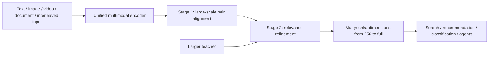
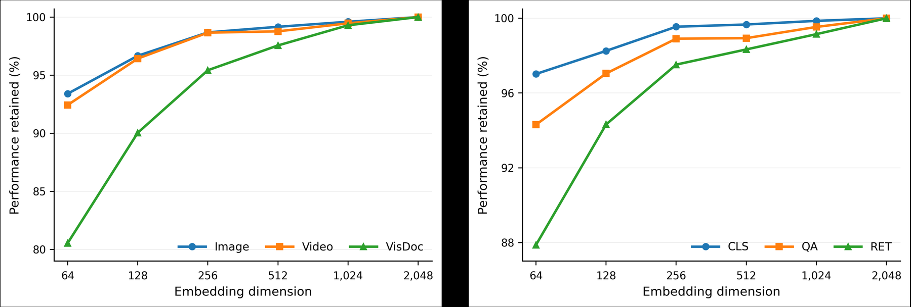

<!-- source-sha256: 64247d3de8d741f2f2438c87d75880429f8a2486ffaa3121bdf32f79851adeb4 -->

[简体中文](README.md) · English

# WeMM-Embedding: WeChat's unified multimodal embedding model

> **Fidelity: core-mechanism reproduction.** Runs two-stage cross-modal alignment, cross-scale teacher refinement, and Matryoshka truncation evaluation. It does not claim to train the 2B/4B/9B checkpoints.

## Paper information

| Field | Details |
| --- | --- |
| Paper | [arXiv 2608.24053](https://arxiv.org/abs/2608.24053) |
| Institution | WeChat Vision, Tencent |
| First public release | 2026-08-25 (arXiv v1) |
| Author code | [Official author code](https://github.com/Tencent/WeMM-Embedding) |
| Local adapter or method key | `wemm-embedding` |
| Local reproduction code | [`src/auto_research/reproductions/wemm_embedding/`](https://github.com/daiwk/auto-research/tree/main/src/auto_research/reproductions/wemm_embedding/) |

## Original paper summary

### Background and main changes

Retrieval systems often maintain separate encoders for text, images, videos, and documents. WeMM maps arbitrary interleaved multimodal inputs into a single space. Stage 1 aligns hundreds of millions of pairs; stage 2 adds curated relevance data, fine-grained supervision, and cross-scale knowledge transfer. Matryoshka representations let users choose an output dimension that fits the budget.



<!-- paper-figure:start -->
### Key figure from the paper

[](https://arxiv.org/html/2608.24053v1/figs/mrl-performance-trend.png)

> **Figure 3:** Overall design and components. From the [paper](https://arxiv.org/abs/2608.24053); copyright belongs to the authors. Click for the source.
<!-- paper-figure:end -->

### Core equations

$$
\mathcal L_{align}=-\frac{1}{B}\sum_i\log\frac{\exp(s(q_i,d_i)/\tau)}{\sum_j\exp(s(q_i,d_j)/\tau)},
$$

$$
\mathcal L=\mathcal L_{align}+\lambda_{rel}\mathcal L_{rel}+\lambda_{KD}\sum_m D_{KL}(P_T\Vert P_S^{(m)}).
$$

### Offline and online results

The 9B model scores **80.6** on MMEB-v2, and 2B already surpasses a previous open 8B baseline. The model improves across 26 internal WeChat tasks and **14 online A/B tests**, and has shipped to Channels, Official Accounts, Moments, and e-commerce recommendation and search.

## Local reproduction

> **Local comparison:** The baseline is the stage-1 shared space. The experimental arm adds relevance and cross-scale teacher refinement. With MovieLens-1M public content and collaborative views, Recall@10 goes from **0.5611** to **0.8389 (+49.50%)**, and MRR from **0.2863** to **0.5089**.

See metrics and 4/8/16-dimensional Matryoshka results in [`metrics/movielens-1m-seed42.json`](metrics/movielens-1m-seed42.json).

```bash
auto-research reproduce --paper wemm-embedding --dataset-dir data --seed 42
```

## Scope

The run does not load the original large checkpoints or private multimodal pairs. MovieLens content and collaborative views verify only the shared space, two-stage refinement, and dimension truncation; they do not reproduce MMEB-v2 or WeChat business results.
