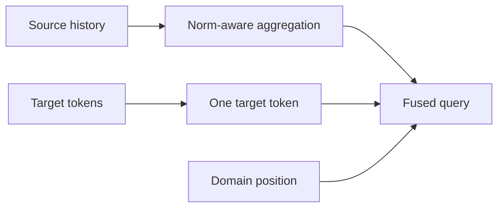
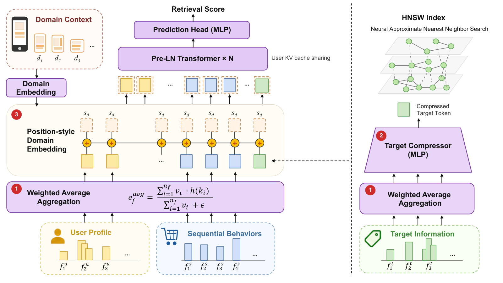

# TransRetrieval: Compressed Transformers for Cross-Domain Ad Retrieval

<!-- source-sha256: c4e21e56d78c153b71d44a5b03573aca08fc268363a1e8c5aa12cd4163286902 -->

[简体中文](README.md)

> **Core mechanism evidence.** Paper and local evaluations are separate.

## Paper information

| Field | Value |
| --- | --- |
| Paper | [arXiv 2608.25528](https://arxiv.org/abs/2608.25528) |
| Affiliations | Renmin University of China / Taobao & Tmall Group, Alibaba |
| First public release | 2026-08-26 (arXiv v1) |
| Authors' code | No public author code found as of 2026-08-28. |
| Adapter / method | `transretrieval` |
| Local code | [`src/auto_research/reproductions/transretrieval/`](https://github.com/daiwk/auto-research/tree/main/src/auto_research/reproductions/transretrieval/) |

## Original paper

### Background and contribution

Reduce source noise, target cost, and domain confusion. Aggregate source histories by token norms, compress target tokens to one, and encode domain as position.



<!-- paper-figure:start -->
### Key figure from the paper

[](https://arxiv.org/html/2608.25528v1/TransRetrieval-model-ready.png)

Original Figure 1: TransRetrieval. From the [paper](https://arxiv.org/abs/2608.25528); copyright belongs to the authors. Not a local result.
<!-- paper-figure:end -->

### Core mechanism

$$
\bar h_s=\frac{\sum_t\lVert h_t\rVert h_t}{\sum_t\lVert h_t\rVert},\qquad z_t=W_t\bar h_t+e_{domain,pos}.
$$

### Paper results

A one-month, 5%-traffic production A/B reports +2.53% revenue and +1.28% RPM ($p<0.0001$).

## Local reproduction

Against Transformer two-tower, add three mechanisms on MovieLens-1M: Hit@10 0.1063→0.1187 (+11.76%), NDCG@10 0.05429→0.05473 (+0.81%). [Metrics](metrics/movielens-1m-seed42.json).

```bash
auto-research reproduce --paper transretrieval --dataset-dir data --seed 42
```

## Reproduction limits

No 40B interactions, 52M ads, or production ANN. 85% target FLOPs reduction is structural, not measured latency.
