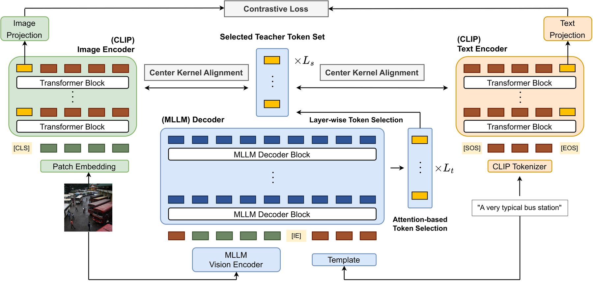

# MLLMCLIP: Distilling General-Purpose CLIP from Multimodal LLMs

<!-- source-sha256: c5a16eedd520f7d48d08c947326f2d41e4173a009c740dd559be27686809b9a1 -->

[简体中文](README.md)

> **Fidelity: public-checkpoint core path.** The main experiment loads a real SmolVLM teacher and CLIP student and trains a CKA projection on public images. The MovieLens/NumPy path is a quick mechanism diagnostic only.

## Paper information

| Field | Details |
|---|---|
| Paper | [arXiv 2608.25575](https://arxiv.org/abs/2608.25575) |
| Organization | KAIST / Sony AI |
| First public release | 2026-08-26 (arXiv v1) |
| Authors' code | No public author code was found on 2026-08-28. |
| Adapter / method | `mllmclip` |
| Local reproduction code | [`src/auto_research/reproductions/mllmclip/`](https://github.com/daiwk/auto-research/tree/main/src/auto_research/reproductions/mllmclip/) |

## Original paper

### Motivation and method

Rich visual semantics from MLLMs are hard to transfer directly to lightweight CLIP. The paper selects teacher tokens adaptively by layer attention and aligns student image/text features with CKA, retaining dual-tower efficiency at deployment.


<!-- paper-figure:start -->
### Key figure from the paper

[](https://arxiv.org/html/2608.25575v1/main3.png)

> **Figure 2:** Core architecture, its modules, and their connections. From the [original paper](https://arxiv.org/abs/2608.25575); copyright remains with the authors.
<!-- paper-figure:end -->

### Core equation

$$
\operatorname{CKA}(X,Y)=\frac{\lVert Y^TX\rVert_F^2}{\lVert X^TX\rVert_F\lVert Y^TY\rVert_F},\qquad \mathcal L=1-\operatorname{CKA}(X,Y).
$$

### Paper results

The paper reports the best average result across 26 compositionality, zero-shot classification, and retrieval benchmarks. No production A/B is reported.

## Local reproduction

### Real checkpoint CUDA path (main result)

Frozen public **SmolVLM2-256M** and **CLIP ViT-B/32** encode POPE adversarial / COCO val2014 images. Only the dimension-matching feature projection trains, with cosine and linear CKA losses. The 320 training images split further into fit/validation for ridge and early-stopped weights; 160 test images are evaluated once. The run records pinned checkpoint revisions, three independent seeds, loss, held-out CKA, neighbor overlap, runtime, and peak VRAM. Checkpoints and caches are not committed.

```bash
AUTO_RESEARCH_DEVICE=cuda python -m \
  auto_research.reproductions.mllmclip.checkpoint \
  --annotations data/pope/coco_pope_adversarial.json \
  --image-root data/pope/images \
  --train-examples 320 --test-examples 160 \
  --steps 60 --seeds 42,43,44 \
  --output runs/mllmclip/checkpoint-seeds42-44.json
```

This path is gated by `python scripts/validate_gpu_evidence.py`: execute on a real A100/A30 and commit a sanitized receipt.

In three-seed A100 validation on 2026-08-28, held-out linear CKA is **0.3494 → 0.3466** and neighbor overlap@5 **0.2642 → 0.2596**; neither shows a stable gain. The earlier A30 single-seed **+5.72%** remains engineering history only. Every image in this POPE subset has the same positive count, making the prior 1-NN result of 1.0 a label-degeneracy artifact. The revision sets it to `null` with `label_diagnostic_valid=false`.

See [three-seed metrics](metrics/pope-checkpoint-a100-seeds42-44.json) and [sanitized A100 receipt](../../gpu-validations/mllmclip-a100-20260828.json), both part of CI gating. [Previous single-seed A30 metrics](metrics/pope-checkpoint-a30-seed42.json) are historical, not performance evidence. Checkpoints, cache, and raw predictions are not committed.

### NumPy diagnostic (not the main result)

> **Local comparison.** Undistilled public content features versus a collaborative-view teacher proxy on the same data. MovieLens proxy Recall@10 rises **0.0194 → 0.8306 (+4171.43%)**, reflecting proxy predictability only, not visual benchmark quality.

See [proxy metrics](metrics/movielens-proxy-seed42.json).

```bash
auto-research reproduce --paper mllmclip --dataset-dir data --seed 42
```

## Limits

The real checkpoint path uses public images and SmolVLM vision features but does not reproduce the full 26-benchmark training scale, original teacher recipe, or full CLIP pretraining. MovieLens is diagnostic-only and not combined with visual results.
