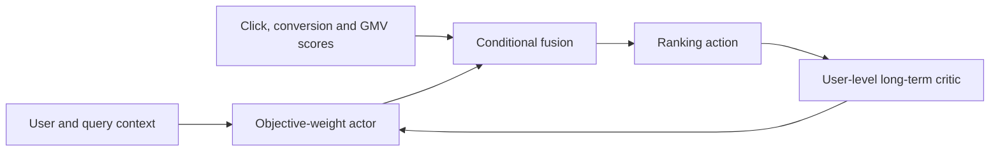
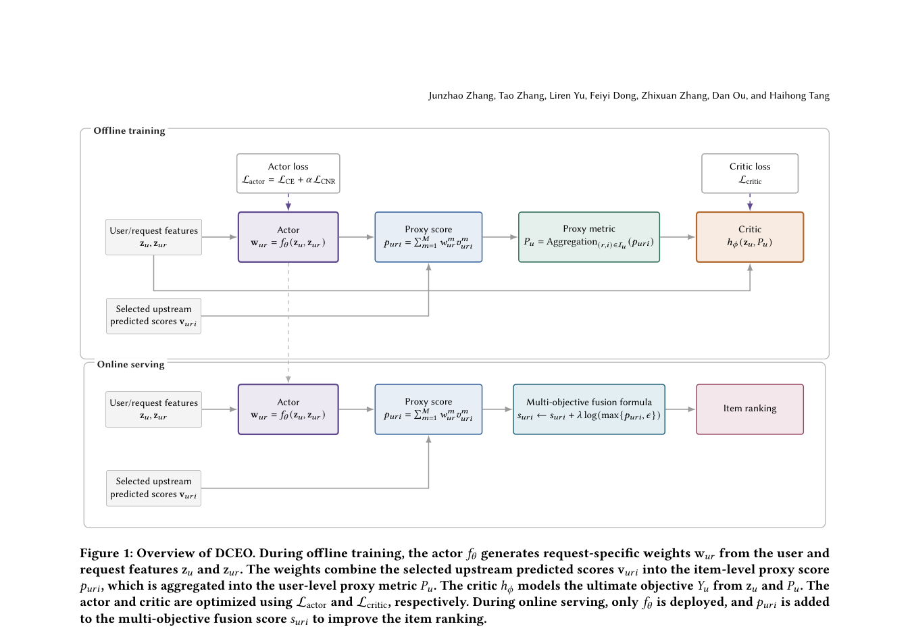

<!-- source-sha256: 6baeaee2455a2bf91fb055e93382bf988f82e7740d2f05fdcc8321410f91790d -->

[简体中文](README.md) · English

# DCEO: Direct causal-effect optimization for long-term user value

> **Core mechanism reproduction.** Context-conditioned objective weights, user-level proxy aggregation and relative causal interventions run. No production critic or online actor serving.

## Paper information

| Field | Details |
| --- | --- |
| Paper | [arXiv 2608.25635](https://arxiv.org/abs/2608.25635) |
| Institution | Taobao & Tmall Group, Alibaba |
| First public release | 2026-08-26 (arXiv v1) |
| Author code | No public author code found on 2026-08-28. |
| Local adapter or method key | `dceo` |
| Local reproduction code | [`src/auto_research/reproductions/dceo/`](https://github.com/daiwk/auto-research/tree/main/src/auto_research/reproductions/dceo/) |

## Original paper summary

### Background and main changes

Fixed weights for click, conversion and GMV cannot adapt to user state or directly represent an action's long-term causal value. The actor outputs context-dependent simplex weights and a user-level critic estimates relative intervention effects. Only the lightweight actor runs online.



<!-- paper-figure:start -->
### Key figure from the paper

[](https://arxiv.org/pdf/2608.25635#page=4)

> **Figure 1:** Training workflow and key optimizations. From the [paper](https://arxiv.org/abs/2608.25635); copyright belongs to the authors. Click for the source.
<!-- paper-figure:end -->

### Core equations

$$
w(x)=\operatorname{softmax}(g_\theta(x)),\quad s(x,i)=\sum_k w_k(x)s_k(x,i),\quad \Delta V=V(u\mid do(a))-V(u\mid do(a_0)).
$$

### Offline and online results

A 41-day Taobao Search production A/B reports GMV **+0.36%**, the quantitative production evidence for inclusion in the industrial implementation queue.

## Local reproduction

The local Evolve search includes `causal_gain × temperature`. Rank 20 candidates on validation by `NDCG@10 + 0.15 × Hit@10`; evaluate only the winner once on held-out test. This avoids calling a fixed `0.75` gain an overall improvement when Hits rise and NDCG falls.

> **Comparison:** Fixed log fusion of the same proxy scores versus the validation-selected context actor (`causal_gain=0.75, temperature=0.75`). MovieLens-1M Hit@10 **0.1469 → 0.1500 (+2.13%)**, NDCG@10 **0.07127 → 0.07095 (-0.45%)**, head share **0.2038 → 0.1988 (-2.45%)**. Search mitigates the fixed configuration's NDCG loss but does not beat the baseline on all metrics.

See [metrics](metrics/movielens-1m-seed42.json).

```bash
auto-research reproduce --paper dceo --dataset-dir data --seed 42
```

## Scope

Proxy outcomes are not actual long-term GMV. The local negative-correlation diagnostic explicitly prevents treating a Hit gain as long-term value improvement.
