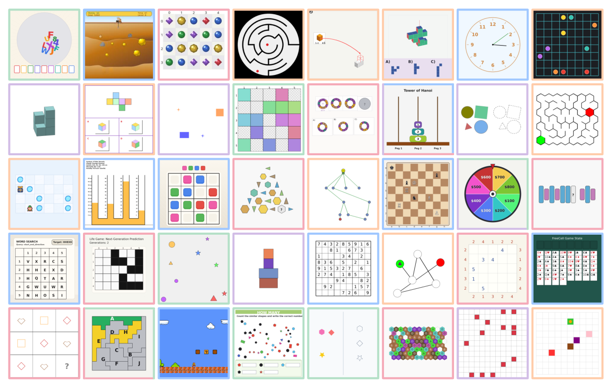

# VBVR-Pro: Executable Visual Reasoning Verifiers

<!-- source-sha256: 9aefb2969c3d50aca759472a0843832c43c3283daf5c507f559dd63d15f6d784 -->

[简体中文](README.md)

> **Core mechanism evidence.** Paper and local evaluation are separate.

## Paper information

| Field | Value |
| --- | --- |
| Paper | [arXiv 2608.26105](https://arxiv.org/abs/2608.26105) |
| Affiliations | Nanyang Technological University / VBVR Community |
| First public release | 2026-08-26 (arXiv v1) |
| Authors' code | [Author project and code](https://www.video-reason.com/?v=pro). |
| Adapter / method | `vbvr-pro` |
| Local code | [`src/auto_research/reproductions/vbvr_pro/`](https://github.com/daiwk/auto-research/tree/main/src/auto_research/reproductions/vbvr_pro/) |

## Original paper

### Background and contribution

A fluent response can mislead a general VLM judge. Per-task executable scorers check intermediate states, constraints, and final states to provide rewards for multimodal generators.


<!-- paper-figure:start -->
### Key figure from the paper

[](https://arxiv.org/html/2608.26105v1/VBVR_pro_data_overview_v3.png)

Original Figure 2: VBVR-Pro. From the [paper](https://arxiv.org/abs/2608.26105); copyright belongs to the authors. Not a local result.
<!-- paper-figure:end -->

### Core mechanism

$$
R(\tau)=\sum_j\lambda_j\mathbf 1[c_j(\tau)=\mathrm{true}],\qquad \max_\theta\mathbb E_{\tau\sim\pi_\theta}[R(\tau)].
$$

### Paper results

Human vote agreement exceeds 0.60 versus GPT-5.5 at 0.54. Across nine trained models the paper reports overall mean gain 0.290. No industrial A/B.

## Local reproduction

Three deterministic verifiers versus noisy scalar VLM-judge analogue on 300 procedural tasks: mean reward 0.5942→1.0000 (+68.30%). [Metrics](metrics/procedural-seed42.json).

```bash
auto-research reproduce --paper vbvr-pro --dataset-dir data --seed 42
```

## Reproduction limits

Verifies deterministic scoring and explainable failures, not seven external benchmarks or 14B/19B training.
