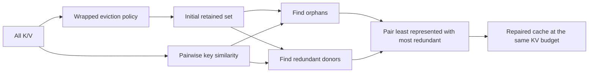
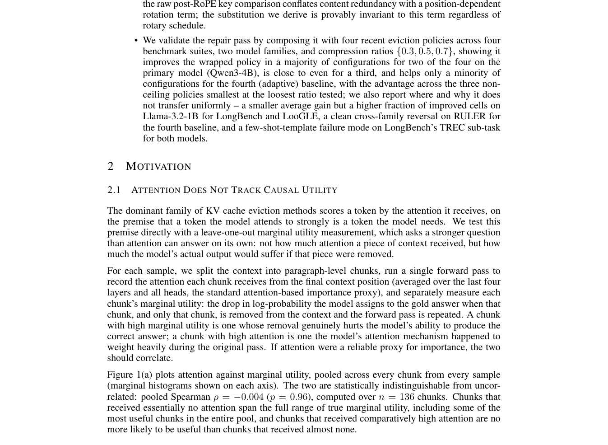

# TwinKV: Fixed-Budget Repair for KV Cache Eviction

<!-- source-sha256: b65790bee18062097a2ac7a8c11788866e6c68bbc6bf67806d73da757a2cbe19 -->

[简体中文](README.md)

> **Reproduction level: core mechanism plus real checkpoint KV validation.** Equation 4, equal-budget swaps, and real Qwen KV tensors are exercised. Attention reconstruction is not a full LongBench score.

## Paper information

| Field | Details |
|---|---|
| Paper | [arXiv 2608.27128](https://arxiv.org/abs/2608.27128) |
| Organization | The Hong Kong University of Science and Technology (Guangzhou) |
| First public release | 2026-08-27 (arXiv v1) |
| Authors' code | No author code was released according to the 2026-08-29 check. |
| Adapter / method | `twinkv` |
| Local reproduction code | [`src/auto_research/reproductions/twinkv/`](https://github.com/daiwk/auto-research/tree/main/src/auto_research/reproductions/twinkv/) |

## Original paper

### Motivation and method

Token-importance eviction can keep near-duplicate keys while dropping an orphan without a substitute. TwinKV repairs a wrapped eviction policy such as StreamingLLM or H2O. At exactly the same budget it pairs dropped orphans without similar retained keys with retained donors that have a near twin.



<!-- paper-figure:start -->
### Key figure from the paper

[](https://arxiv.org/pdf/2608.27128#page=3)

> **Figure 1:** Overview of the method and its key components. From the [original paper](https://arxiv.org/abs/2608.27128); copyright remains with the authors.
<!-- paper-figure:end -->

### Core equations

For token $i$, find its most similar retained twin outside a local window:

$$
s_i=\max_{j\in R,\ |i-j|>w}\cos(k_i,k_j).
$$

An evicted token with $s_i<\tau$ is an orphan. A retained token with $s_i\ge\tau$ is a donor unless protected as sink/recent. Pair orphans by ascending $s_i$ and donors by descending $s_i$:

$$
m=\min(|O|,|D|),\qquad |R'|=|R|.
$$

### Paper results

The paper compares Qwen3-4B and Llama-3.2-1B on LongBench/LooGLE/RULER/MMLU-Pro at compression ratios of 0.3/0.5/0.7. TwinKV generally improves several wrapped policies but has reported failures, including TREC; results are not uniformly monotone. No production online A/B is reported.

## Local reproduction

> **Local comparison.** StreamingLLM sink+recent eviction versus StreamingLLM+TwinKV at equal KV count. Metrics are cosine similarity to full-cache attention, repair latency, KV bytes, and peak VRAM; DIN is not applicable. Mechanism tests enforce **0.00% budget change**.

```bash
auto-research reproduce --paper twinkv --seed 42

python -m auto_research.reproductions.twinkv.checkpoint \
  --output runs/twinkv-wikitext2.json \
  --revision <pinned-model-revision> \
  --dataset-revision <pinned-dataset-revision> \
  --examples 3 --sequence-length 2048 --compression-ratio 0.5 --seed 42
```

See [mechanism metrics](metrics/mechanism-seed42.json) and [A30 checkpoint receipt](../../gpu-validations/twinkv-a30-20260829.json). The documented CUDA smoke test extracts real KV tensors from public Qwen2.5-0.5B on WikiText-2. The default runner also supports Qwen3-4B. Scores measure equal-budget attention reconstruction, not LongBench generation; checkpoints are not uploaded.

At a fixed 50% KV budget, StreamingLLM cosine versus full-cache attention is **0.99786**, falling to **0.91000 (−0.08787)** with repair. The code and budget constraint execute correctly, but `StreamingLLM + threshold=0.85` is unsuitable on these contexts and checkpoint. Wrapped policy, threshold, and recent-token protection are Evolve search candidates; the paper's average improvements do not generalize automatically.

## Evolve integration

The executable `twinkv` micro-LLM operator fixes width, depth, token budget, and optimizer in its first generation, comparing dense causal attention with prefix-local TwinKV. Later trials vary compression ratio, similarity threshold, and window size. The checkpoint runner shares the repair function with Evolve.

## Limits

The checkpoint protocol reconstructs attention at three representative layers from real K/V and public WikiText-2 long contexts; the paper's Qwen3 setting and local smoke checkpoint should not be conflated. It is not full LongBench generation. Exact $n\times K$ repair uses a smaller temporary matrix than naive $n^2$ but no fused CUDA kernel.
