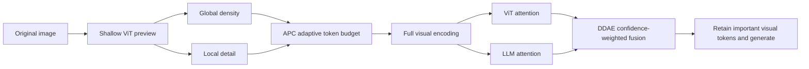
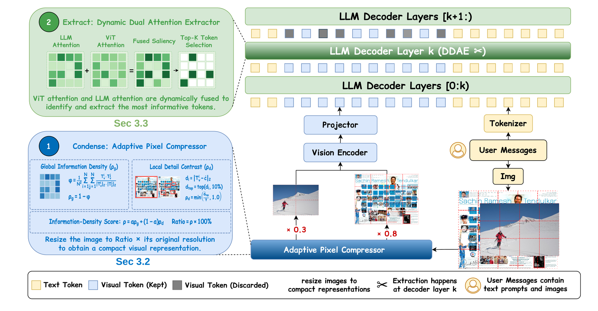

<!-- source-sha256: fd2e2272771705b80eb746235aaf240f909b80d0b503331bbc2951b9f8c3edc9 -->

[简体中文](README.md) · English

# PACE: Unified visual compression and extraction for faster VLMs

> **Fidelity: core mechanisms and real-checkpoint verification on public data.** Runs APC and DDAE formulas and supports an actual Qwen2.5-VL adaptive-resolution path. A small checkpoint test is not the full paper benchmark.

## Paper information

| Field | Details |
| --- | --- |
| Paper | [arXiv 2608.27206](https://arxiv.org/abs/2608.27206) |
| Institution | Sun Yat-sen University |
| First public release | 2026-08-27 (arXiv v1) |
| Author code | [Official author code](https://github.com/jjL357/PACE) |
| Local adapter or method key | `pace-vlm` |
| Local reproduction code | [`src/auto_research/reproductions/pace_vlm/`](https://github.com/daiwk/auto-research/tree/main/src/auto_research/reproductions/pace_vlm/) |

Implementation verified against upstream commit `7755240eb02510507c270457ed1768ddfe80c206`.

## Original paper summary

### Background and main changes

Visual tokens are expensive in prefill, and extraction can retain many tokens irrelevant to the question. PACE treats the stages separately. APC uses a shallow ViT preview to estimate global semantic density and local detail and rescale by image difficulty. DDAE fuses LLM and vision-encoder attention, weighting them by confidence rather than always trusting one attention map.



<!-- paper-figure:start -->
### Key figure from the paper

[](https://arxiv.org/html/2608.27206v1/figures/overview.png)

> **Figure 4:** The overall workflow, stages, and data flow in the paper. From the [paper](https://arxiv.org/abs/2608.27206); copyright belongs to the authors. Click for the source.
<!-- paper-figure:end -->

### Core equations

Given shallow visual features $z_i$, global density uses the complement of pairwise token similarity. Local detail uses the top-$k$ tokens furthest from the background:

$$
D_g=1-\frac{1}{N(N-1)}\sum_{i\ne j}\cos(z_i,z_j),\qquad
D_l=\frac{1}{k}\sum_{i\in\operatorname{TopK}}\lVert z_i-\bar z\rVert_2.
$$

The APC budget is $r=\operatorname{clip}(\alpha D_g+(1-\alpha)D_l,r_{min},1)$. DDAE weights normalized attention $a_L,a_V$ by their dispersion:

$$
w=\operatorname{softmax}([\sigma(a_L),\sigma(a_V)]/\tau),\qquad
a=w_La_L+w_Va_V.
$$

### Offline and online results

With Qwen2.5-VL-7B, keeping about **10%** of visual tokens retains **93.8%** of original performance on average and gives up to about **3.1×** TTFT speedup. The paper also covers a 3B checkpoint and several VQA and document understanding tasks. This is an inference-algorithm paper with no industrial online A/B test.

## Local reproduction

> **Local comparison:** The baseline uses the original resolution for the same Qwen2.5-VL checkpoint; the experimental arm applies PACE APC adaptive resolution. The formal comparison protocol uses RealWorldQA answer accuracy, input tokens, generation latency, and peak GPU memory; DIN does not apply. In the formula mini-suite, a detailed image has **95.00 percentage points** higher retention than a smooth image.

Quick mechanism check:

```bash
auto-research reproduce --paper pace-vlm --seed 42
```

Real CUDA path:

```bash
python -m auto_research.reproductions.pace_vlm.checkpoint \
  --output runs/pace-vlm-realworldqa.json \
  --revision <pinned-model-revision> \
  --dataset-revision <pinned-dataset-revision> \
  --examples 8 --seed 42
```

See [mechanism metrics](metrics/mechanism-seed42.json) and the [auditable A30 checkpoint receipt](../../gpu-validations/pace-vlm-a30-20260829.json). The CUDA smoke run uses public SmolVLM2-500M and a POPE/COCO subset to test APC on real visual features. The default runner still supports Qwen2.5-VL with RealWorldQA; the former is not presented as paper-level results for the latter. Weights and raw predictions are not committed to GitHub.

On 8 examples, answer accuracy is **0.625** at both original resolution and APC resolution. Mean input tokens drop from **878.5 to 481.5 (−45.19%)**, and mean generation latency from **0.2003s to 0.1506s (−24.82%)**. This very small sample verifies the checkpoint path and compression direction, not a statistically significant lossless speedup.

## Evolve integration

The paper maps to `checkpoint_vlm:pace-apc`. The first `vlm-checkpoint` generation can fairly compare it with direct, context-first, and elimination input recipes. Later generations tune image budget, maximum generation length, and prompts. The trial records the source paper ID.

## Scope

The local checkpoint evaluation is a small smoke test. The RealWorldQA path does not cover all 11 benchmarks in the paper. The current runner executes APC; DDAE is verified separately through formulas and unit tests. The authors' roughly 2,000-line model fork and custom kernels are not reproduced.
