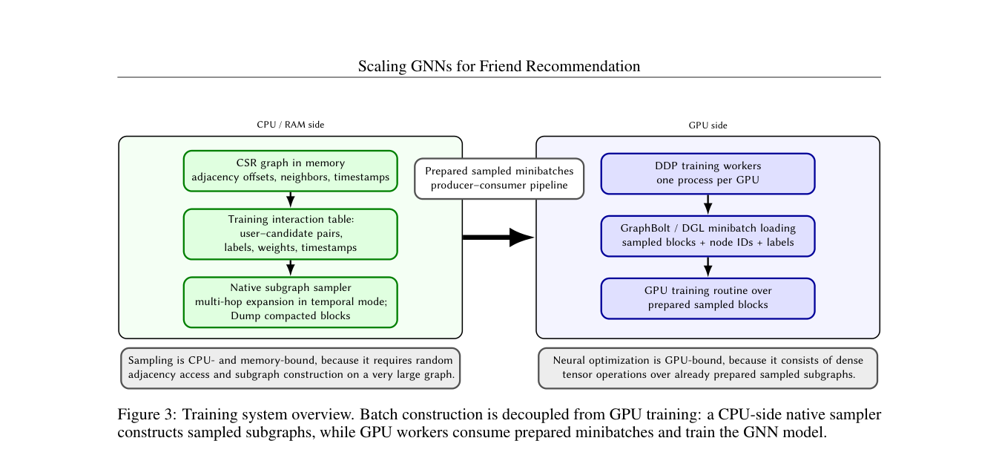

# VK Friend-GNN: Multi-hash embeddings and temporal neighbor sampling

<!-- source-sha256: f50088440252dc943688f6f5b286e12ec53e7572f0c54138641bae7ac7b701ba -->

[简体中文](README.md)

> Core multi-hash and temporal cutoff proxy under matched candidates.

## Paper information

| Field | Details |
|---|---|
| Paper | [Paper or original source](https://arxiv.org/abs/2608.27413) |
| Institution | AI VK. |
| First public release | 2026-08-27 (arXiv v1) |
| Author code | [makut/VK-GNN](https://github.com/makut/VK-GNN). |
| Local adapter or method key | `friend-gnn` |
| Local reproduction code | [`src/auto_research/reproductions/friend_gnn/`](https://github.com/daiwk/auto-research/tree/main/src/auto_research/reproductions/friend_gnn/) |

## Paper method and evidence

Use three independent hashes into a shared table, concatenate/project, and retrieve only historical neighbors via timestamp-sorted CSR and binary search. GATv2 and separate query/candidate heads score links.


<!-- paper-figure:start -->
### Original paper figure

[](https://arxiv.org/pdf/2608.27413#page=6)

Figure shows hashing and temporal neighbors. From the [original paper](https://arxiv.org/abs/2608.27413); copyright remains with the authors.
<!-- paper-figure:end -->

### Core equation

$$
e_u=T_{h_1(u)}\|T_{h_2(u)}\|T_{h_3(u)},\qquad p=\operatorname{lower\_bound}(ts_u,\tau-\Delta).
$$

### Reported results

Paper: 194M users, 28B edges, ID table compression over 98%. Production A/B against a strong baseline: friend additions +16%, unique friend-adding users +11.5%.

## Local reproduction

```bash
auto-research reproduce --paper friend-gnn --dataset-dir data --seed 42
```

Same MovieLens-1M full catalog, popularity baseline vs temporal graph: Hit@10 **0.0656→0.2281 (+247.62%)**, NDCG@10 **0.0387→0.1100**. [Metrics](metrics/movielens-1m-seed42.json). The item-transition graph is not a friendship graph; no VK logs, distributed GATv2 or production lift.
