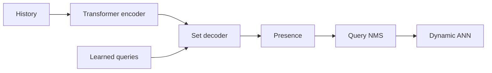
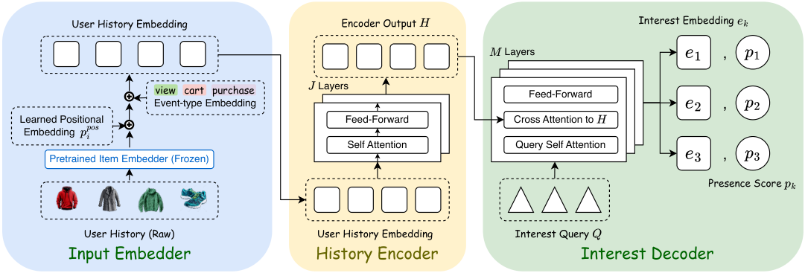

# SetMIR: Multi-Interest Retrieval as Set Prediction

<!-- source-sha256: 94fb1f1b39a0bc0a1623ba8fc93af4c680790f0845e78cdfc8586f66bb6fc69f -->

[简体中文](README.md)

> Core mechanism on public data: interest set, presence, and query-level NMS.

## Paper information

| Field | Value |
| --- | --- |
| Paper | [arXiv 2608.30251](https://arxiv.org/abs/2608.30251) |
| Affiliations | Snap Inc. |
| First public release | 2026-08-31 (arXiv v1) |
| Authors' code | No public author implementation found as of 2026-09-05. |
| Adapter / method | `setmir` |
| Local code | [`src/auto_research/reproductions/setmir/`](https://github.com/daiwk/auto-research/tree/main/src/auto_research/reproductions/setmir/) |

## Original paper

### Background and contribution

Decode unordered interests with K learned queries. Hungarian one-to-one matching discourages collapse; presence identifies required interests and query NMS suppresses duplicate ANN requests.

<!-- paper-figure:start -->
### Key figure from the paper

Original Figure 1: SetMIR. From the [paper](https://arxiv.org/abs/2608.30251); copyright belongs to the authors. Not a local result.
<!-- paper-figure:end -->

### Core mechanism

The set loss is $\min_{\sigma\in S_K}\sum_k \mathcal L(q_k,y_{\sigma(k)})$. Dispatch only queries passing presence and NMS.

### Paper results

The paper reports 33% fewer ANN requests and +3.1% CVR on Snap DPA, with a production retrieval source.

## Local reproduction

Public genre clusters proxy interest queries; presence and similarity NMS run. NDCG@10 0.05401→0.05665 (+4.90%), with [three-seed metrics](metrics/public-seeds42-44.json).

## Reproduction limits

No private DPA history, production Transformer, or ANN dispatch. CPU public-data path only.
