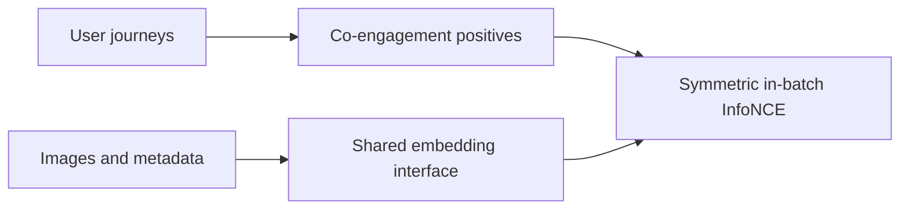
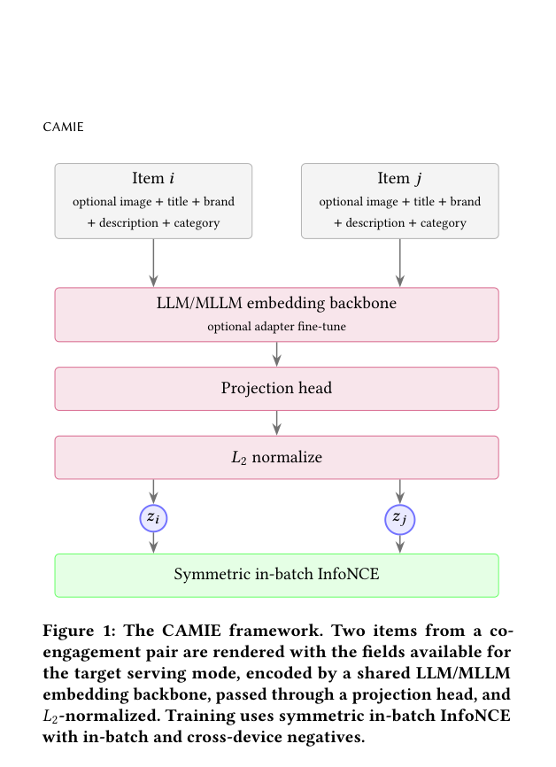

# CAMIE: Align multimodal item embeddings using co-engagement

<!-- source-sha256: 2fbe32c811c71bdce6fc97e75772b43f22bf46ef5527462cf1202871fde6ca7f -->

[简体中文](README.md)

> Core mechanism on public data: content vectors, co-engagement positives, and symmetric retrieval scoring.

## Paper information

| Field | Details |
|---|---|
| Paper | [arXiv 2608.30255](https://arxiv.org/abs/2608.30255) |
| Institution | Snap Inc. |
| First public release | 2026-08-31 (arXiv v1) |
| Author code | No public author implementation found as of 2026-09-05. |
| Local adapter or method key | `camie` |
| Local reproduction code | [`src/auto_research/reproductions/camie/`](https://github.com/daiwk/auto-research/tree/main/src/auto_research/reproductions/camie/) |

## Paper method and evidence

Encode images and metadata with one LLM/MLLM interface. Mine jointly engaged items from user journeys, then use symmetric in-batch InfoNCE to shift content similarity toward behavioral co-conversion. One checkpoint supports both multimodal and text-only retrieval.

<!-- paper-figure:start -->
### Original paper figure

The original figure shows the item encoding and contrastive training pipeline. From the [original paper](https://arxiv.org/abs/2608.30255); copyright remains with the authors.
<!-- paper-figure:end -->

### Core equation

$\mathcal L=-\frac12[\log\frac{e^{q_a^Tk_b/\tau}}{\sum_j e^{q_a^Tk_j/\tau}}+\log\frac{e^{q_b^Tk_a/\tau}}{\sum_j e^{q_b^Tk_j/\tau}}]$.

### Reported results

Author-reported deployed production result: CTR +0.211% and CVR +1.911% on overall traffic.

## Local reproduction

Use public MovieLens content and co-occurrence transitions as proxies. Local NDCG@10 is **0.05121** versus baseline **0.05401**, a **-5.18%** change. [Three-seed metrics](metrics/public-seeds42-44.json) retain the negative result. No private DPA journeys, production MLLM checkpoint, or ANN serving; CPU mechanism only.
