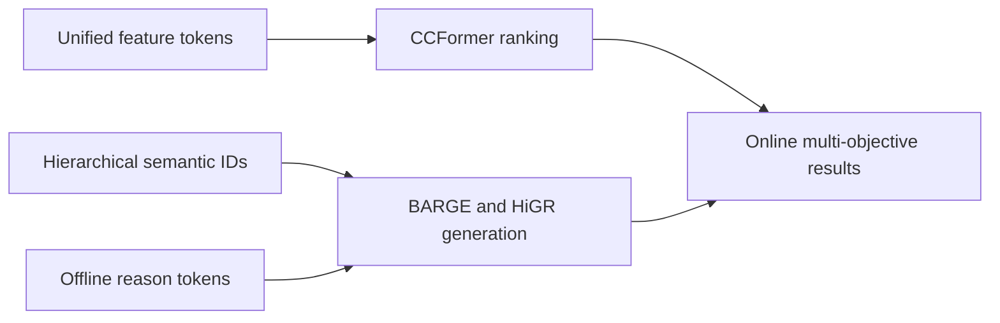
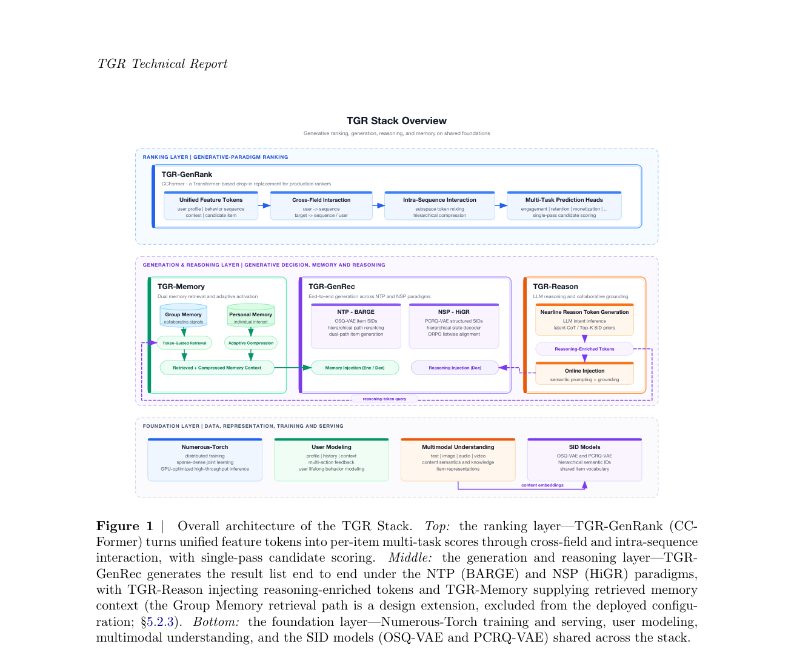

# TGR: unified generation, ranking, and offline reasoning injection

<!-- source-sha256: 85a209a0dddc45805e57b6d91ab957acfa470b5a57ec55b6d8a6176f868ba3bb -->

[简体中文](README.md)

> **Core mechanism on public data.** Combines hierarchical semantic-ID paths, list objectives, and reason-token injection.

## Paper information

| Field | Details |
|---|---|
| Paper | [arXiv 2609.00986](https://arxiv.org/abs/2609.00986) |
| Organization | Tencent |
| First public release | 2026-09-01 (arXiv v1) |
| Authors' code | No public author code was found when checked on 2026-09-05. |
| Adapter / method | `tgr` |
| Local reproduction code | [`src/auto_research/reproductions/tgr/`](https://github.com/daiwk/auto-research/tree/main/src/auto_research/reproductions/tgr/) |

## Original paper

### Motivation and method

TGR combines three industrial recommendation approaches. CCFormer supplies scalable ranking; BARGE and HiGR generate single items or whole-page lists with hierarchical semantic IDs; TGR-Reason injects reason tokens generated offline into online decoding, avoiding costly request-time rollouts.

<!-- paper-figure:start -->
### Key figure from the paper

> **Figure 1:** Core architecture, modules, and their connections. From the [original paper](https://arxiv.org/abs/2609.00986); copyright remains with the authors.
<!-- paper-figure:end -->

### Core equation

The local path accumulates hierarchical-path confidence and combines it with the transition/content list objective: $s_i=\sum_l p(z_i^l\mid H)\prod_{j\le l}(0.6+p(z_i^j\mid H))+\lambda s_i^{list}$.

### Paper results

CCFormer reports CTR +3.57% and ad revenue +1.71%. BARGE, HiGR, and TGR-Reason are also validated through online experiments or full releases.

## Local reproduction

The fixed three-seed MovieLens 100K protocol increases NDCG@10 from 0.05401 to 0.05953. See the [complete artifact](metrics/public-seeds42-44.json).

> **Local comparison:** Baseline NDCG@10=0.05401, treatment NDCG@10=0.05953, or +10.24% relative.

## Reproduction boundaries

The private semantic-ID catalog, production CCFormer checkpoint, and online generation service were not reproduced. This covers only the auditable core mechanism on public data.
