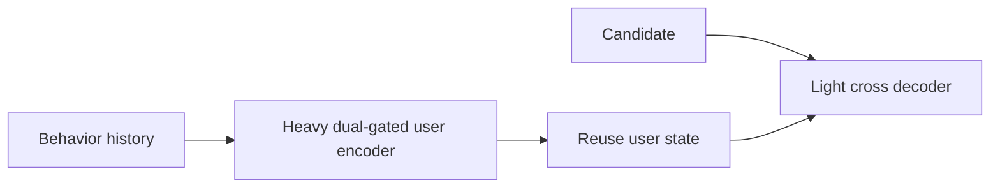
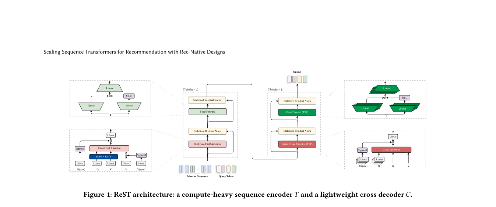

# ReST: A recommendation-native sequence Transformer for industrial ranking

<!-- source-sha256: 325b64d7bd175fd61a72797140d7d0af56fbc484a69877a32582115e2446d854 -->

[简体中文](README.md)

> Public-data dual-gated temporal encoding and reusable user/candidate path.

## Paper information

| Field | Details |
|---|---|
| Paper | [arXiv 2609.01240](https://arxiv.org/abs/2609.01240) |
| Institution | ByteDance. |
| First public release | 2026-09-01 (arXiv v1) |
| Author code | No public author implementation found as of 2026-09-05. |
| Local adapter or method key | `rest` |
| Local reproduction code | [`src/auto_research/reproductions/rest/`](https://github.com/daiwk/auto-research/tree/main/src/auto_research/reproductions/rest/) |

## Paper method and evidence

Dual-gated attention suppresses behavior noise. RoPE and relative time represent both order and elapsed time. A heavy user encoder runs once per request, then a light cross decoder scores each candidate.

<!-- paper-figure:start -->
### Original paper figure

The original figure shows the compute-once, decode-many architecture. From the [original paper](https://arxiv.org/abs/2609.01240); copyright remains with the authors.
<!-- paper-figure:end -->

### Core equation

$h_u=\mathrm{DualGate}(H)$ and $s(u,i)=\mathrm{CrossDecode}(h_u,e_i)$; reuse $h_u$ across the request.

### Reported results

The one-week online A/B reports online AUC +1.31%, core revenue +11.93%, P99 50 ms, followed by full rollout.

## Local reproduction

MovieLens-100K, fixed 220 users/360 items: temporal decay, signal gates and candidate crossing execute on CPU. NDCG@10 **0.05401→0.05372 (-0.53%)**. [Three-seed metrics](metrics/public-seeds42-44.json). No private logs, production checkpoint, shared-prefix serving kernel or CUDA claim. The negative public-data result does not contradict or reproduce online lift.
