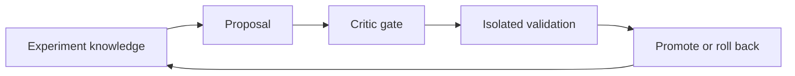
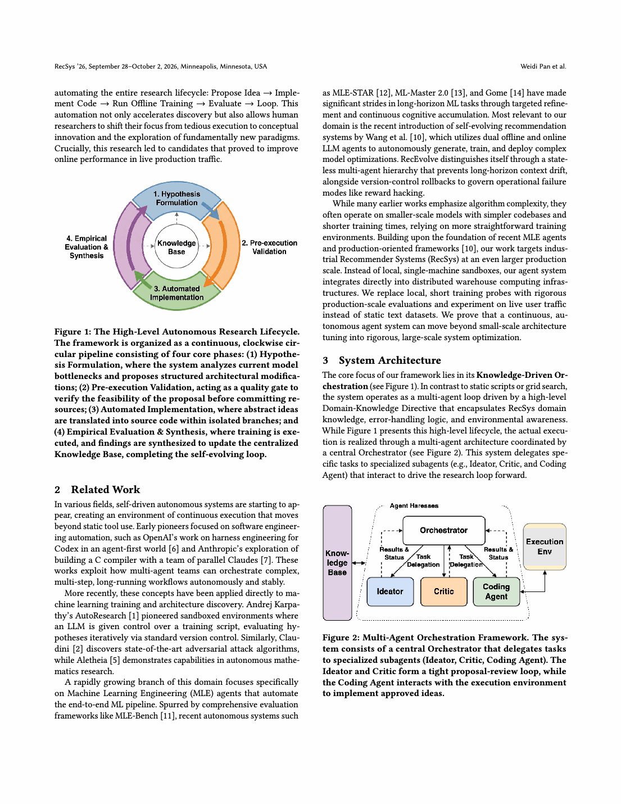

# RecEvolve: Knowledge-Driven Recommender Evolution

<!-- source-sha256: 93b5de6ce91e08fc6555af7a59441f102032212fc1a602c4211672954d5e7743 -->

[简体中文](README.md)

> **Core mechanism evidence.** Paper and local evaluations are separate.

## Paper information

| Field | Value |
| --- | --- |
| Paper | [RecSys 2026](https://arxiv.org/abs/2609.01622) |
| Affiliations | Google |
| First public release | 2026-07-20 (arXiv v1) |
| Authors' code | No public author code found as of 2026-09-06. |
| Adapter / method | `recevolve` |
| Local code | [`src/auto_research/reproductions/recevolve/`](https://github.com/daiwk/auto-research/tree/main/src/auto_research/reproductions/recevolve/) |

## Original paper

### Background and contribution

Propose variants from experiment knowledge and select champions on isolated validation. Version state for rollback and reject reward hacking such as extreme temperature, carrying forward auditable knowledge.

<!-- paper-figure:start -->
### Key figure from the paper

Original RecEvolve figure. From the [paper PDF](https://arxiv.org/pdf/2609.01622); copyright belongs to the authors. Not a local result.
<!-- paper-figure:end -->

### Core mechanism

Compare candidate $c_t$ with champion $c^*$ using independent validation utility $J$ only after the critic gate. If $J(c_t)>J(c^*)$, atomically set $c^*\leftarrow c_t$; otherwise roll back. Reject hacking via $g(c_t)$.

### Paper results

41 autonomous experiments; offline NDCG@50 0.4796→0.5751 (+19.9%). Live satisfaction +3.77%, unique content +7.44%, cold-start discovery time −16.50%.

## Local reproduction

Fixed MovieLens 100K candidate space, actual research control flow. NDCG@10 0.05401→0.05431 (+0.56%) after validation selection. [Three-seed metrics](metrics/public-seeds42-44.json).

## Reproduction limits

Not Google's private two-tower metrics, logs, TPUs, coding-agent infrastructure, or live attribution. Adapter is a recommendation Evolve controller operator.
