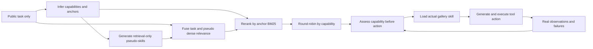
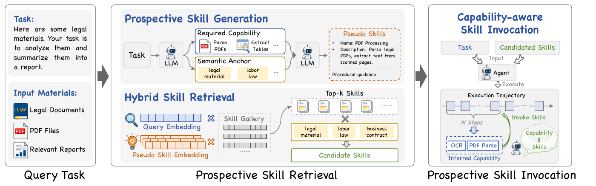

# SkillDreamer: Imagine Before Acting

<!-- source-sha256: 3038f7bf5c79ff0d534f804c4ff624af3e99c3be634383393cbc2eddd5dd0cb8 -->

[简体中文](README.md)

> Reviewed and implemented the substantive v2 revision, not a new October v1. The local arithmetic run uses real-model PSG, HSR and CSI, but is a live-interaction diagnostic, not a SkillUsage or SkillNet-Gym reproduction.

## Paper information

| Field | Details |
|---|---|
| Paper | [Imagine Before Acting: Prospective Skill Identification for LLM Agents (arXiv 2609.01642)](https://arxiv.org/abs/2609.01642); SkillDreamer is the method. |
| Institution | Sichuan University |
| First public release | 2026-08-28 13:19:50 UTC (v1); v2 2026-10-09 04:15:57 UTC |
| Author code | No author implementation found in the paper or official pages as of 2026-10-13. |
| Local adapter | `skilldreamer` |
| Local reproduction code | [`src/auto_research/reproductions/skilldreamer/`](https://github.com/daiwk/auto-research/tree/main/src/auto_research/reproductions/skilldreamer/) |

**Current evidence:** all three arms and seeds 42/43/44 completed on A100 at `47f0e9ce` and were independently verified. [Three-seed GPU receipt](../../gpu-validations/oct13-skilldreamer-a100.json). No-skills mean Pass is about 20.83%; direct retrieval and SkillDreamer both score zero. SkillDreamer executed 348 CSI assessments, loaded actual skills for 44 tasks, and completed 285 calculator calls, but submitted no answers. The receipt validates the defining execution path, not success, improvement, or the original benchmark.

## Paper method and evidence

Task descriptions state goals; skill documents state procedures. Plain similarity can find topical but unhelpful skills, and retrieving one does not imply it is invoked. SkillDreamer makes capability needs explicit during both retrieval and invocation.

- **PSG** asks an LLM to infer one to five distinct capabilities and semantic anchors from the task and generate a procedural pseudo-skill for each. Pseudo-skills are search proxies, not verified executable skills.
- **HSR** combines dense relevance from the task and each pseudo-skill, then reranks each candidate pool with anchor BM25. Scan rankings row-wise across capabilities and deduplicate so one capability cannot monopolize the pool.
- **CSI** reassesses the current subgoal, evidence and unresolved constraints before the next action. It states the needed capability, match/no-match, and a bounded next action. For MATCH or PARTIAL_MATCH, load the real gallery skill before generating the action. Recheck every five executed actions and on failures/new evidence. Do not infer the requirement backward from a chosen tool or treat loading as success.



This is a redraw. See [architecture source](assets/architecture.mmd) and [source provenance](assets/source-provenance.json).

<!-- paper-figure:start -->
### Original paper figure

[](https://arxiv.org/pdf/2609.01642v2#page=3)

[Pinned v2 Figure 2](https://arxiv.org/html/2609.01642v2#S2.F2) shows PSG, HSR and CSI. Runtime checks follow executed actions and do not read gold plans. Original [PDF page 3](https://arxiv.org/pdf/2609.01642v2#page=3), visually checked 250 dpi crop with unchanged text. Copyright remains with the authors under the arXiv perpetual non-exclusive license, not CC BY. [PDF/image SHA-256 and crop](assets/original-figures.json). This is not a local measurement.
<!-- paper-figure:end -->

### Core equations

For task dense score $r_i^q$ and pseudo-skill $j$ dense score $r_{ij}^p$:

$$
d_{ij}=2r_i^q+r_{ij}^p.
$$

Select $K_c=20$ candidates per pseudo-skill, then min–max normalize the three terms within that pool:

$$
h_{ij}=2\bar r_i^q+\bar r_{ij}^p+\overline{BM25(anchor,s_i)}.
$$

Scan each capability's top-$K_r$ rankings by row, deduplicate and retain $K$ skills. Inject periodic CSI context at $n\bmod5=0$ for executed actions, not internal model thoughts.

### Reported results

| Paper metric | Direct/original | SkillDreamer |
|---|---:|---:|
| Qwen-0.6B SkillUsage R@5 | 52.68% | 60.42% |
| Qwen-0.6B SkillRet R@5 | 59.14% | 66.93% |
| GPT-5.5 SkillUsage Pass / Load | 48.1 / 92.9 | 50.6 / 96.4 |
| DeepSeek-V4-Flash SkillUsage Pass / Load | 37.1 / 51.2 | 41.4 / 77.4 |
| Qwen3.6-27B unified SkillUsage Pass | 31.3% | 37.6%; Load 59.5% in both arms |

[Section 3 and Appendix D](https://arxiv.org/html/2609.01642v2#S3) cover galleries with 6,660 and about 34,000 skills and 84 valid SkillUsage execution tasks. Sending the pseudo-skills directly to the agent reduces Pass: imagined procedures are not validated skills. No production A/B or local replication of these values.

## Local reproduction

Compare identical checkpoints without skills, with direct task-dense retrieval, and with real PSG/HSR/CSI. Small arithmetic interactions do not measure paper benchmark ability.

```bash
PYTHONPATH=src python scripts/run_skilldreamer.py \
  --config /path/to/skilldreamer.json --seed 42 --output runs/skilldreamer/seed42.json
```

Provide verified local Instruct `model_dir`, MiniLM `encoder_dir`, provenance-bound public `raw_data`, `device` and fixed `max_queries`, `top_k`, `action_budget`, `max_new_tokens`. The model generates capabilities, anchors and pseudo-skills; HSR actually encodes and reranks with BM25. Invalid PSG gets no fabricated fallback. CSI loads a real `gallery.json` procedure, then generates a new action with it.

### Latest complete A100 execution

[Same-source three-seed metrics](metrics/public-a100-seeds42-44-47f0e9ce.json): every arm used the same 16 evaluation IDs. Keep all generation and tool failures.

| Seed | No-skills Pass | Direct Pass | SkillDreamer Pass | CSI | Tasks with load | Successful calculator calls |
|---|---:|---:|---:|---:|---:|---:|
| 42 | 25% | 0% | 0% | 108 | 14 | 89 |
| 43 | 18.75% | 0% | 0% | 120 | 15 | 99 |
| 44 | 18.75% | 0% | 0% | 120 | 15 | 97 |

Total 1,931 responses and 195,501 generated tokens. Attempts and successful calculator calls are separate. Independent observer `27adb791` transparently forwarded calls and restored wrapping, checked exact algorithm/model/encoder/split and raw/trace hashes, and recomputed seven fields per episode. The runner's raw L2 label is retained, but this constrained arithmetic/gallery execution is classified L1 externally. Seed 42 shared the GPU with a short teacher diagnostic; 43/44 ran with two parallel workers. Do not compare elapsed time, throughput, or savings, and do not pool the older diagnostics or use these evaluation IDs to tune/retry.

### Earlier failures and validation probes

- **A30 at `0f5dca9f` (2026-10-14).** Qwen2.5-0.5B-Instruct, 24 train-derived arithmetic rows, seeds 42/43/44. SkillDreamer ran 16 episodes per seed with 351/326/318 model calls but zero CSI, gallery loads, or tool actions. All 48 episodes missed the defining path and all three arms scored zero. [Failure evidence and raw hashes](metrics/public-a30-failed-0f5dca9f.json). The interrupted `6aabe57a` batch is separate. No pass receipt, and these evaluation IDs cannot select budgets or schema fallbacks.
- **A100 7B format probe, `0f5dca9f` algorithm / `d8603f65` probe.** Eight separate question-only validation cases, 596.9424 seconds, 210 calls, 29,194 tokens. PSG/HSR each ran on seven cases, CSI and actual loads twice each, with zero tool actions and submissions. Seven runtime episodes exhausted 24 calls; both loads were followed by CSI format/decision failure, not normal completion or 256-token truncation. [Negative diagnosis](metrics/validation-negative-d8603f65.md), [sanitized raw-hash artifact](metrics/public-a100-validation-negative-d8603f65.json). CPU review found missing explanation of five nonempty `LABEL: value` lines and four allowed initial DECISION words: an underspecified prompt, not a proven parser bug. Clarify format/placeholders only; retain strict parsing, algorithm, budget, and gold isolation.
- **A100 clarified-format probe, `701f4500` / `5c07ef42`.** Same eight cases and budget; exit 0, 401.4411 seconds, 159 calls, 19,369 tokens, 65 genuine CSI calls and seven load episodes. Of 56 environment steps, 54 attempted calculator calls (48 succeeded, six failed), two used unknown tools, and none finished or submitted. Twenty-eight calls repeated an already completed AST expression. [Independent CPU replay and zero-submission diagnosis](metrics/validation-no-submit-5c07ef42.md), [sanitized artifact](metrics/public-a100-validation-no-submit-5c07ef42.json). SkillDreamer then listed only tool JSON while baseline had explicit calculator and finish instructions; this asymmetry and repeated policy calls are distinct observations, not proven causes. Add equal API text on tools, termination and loading without generating answers, forcing finish, or changing gallery/parser/execution/budget.
- **A100 equal-API probe, `47f0e9ce` / `d5bf41b2`.** The preceding “not run on GPU” status was historical. This one real run used the same eight question-only validation cases, seed 42 and original budget: 163 calls, 19,466 tokens, 58 CSI, seven load episodes, and 50 calculator attempts (46 successful, four errors), **zero finish or submissions**. Inner/outer time 404.9072/405.8046 seconds; one PSG failure retained. [Sanitized evidence and raw hashes](metrics/public-a100-validation-no-submit-seed42-47f0e9ce.json). Strict CPU curation checks raw/partial/trace, source/config/archive and launcher/exit; independently replayed prompt and output fields match for all seven runtime episodes. Public artifacts omit prompts, questions/answers, token IDs, paths and build details. No scorer, accuracy, pass receipt, or causal conclusion from this probe, and it is not part of the 16-ID three-arm evaluation.

### Data, safety and implementation boundaries

Use only the question from public GSM8K-style JSONL. An external scorer compares answers numerically after submission. Model and observations never receive gold answers, plans, or skills. Fix the prefix before seeing relevance, separate validation/test by hash, and do not change hyperparameters from test. Five generic gallery skills cover arithmetic verification, proportions, inventory, money and time, not example answers.

`ArithmeticEnvironment` runs a bounded AST calculator for numeric literals and allowed arithmetic, not model-generated Python or external systems. Record executed actions, skill loads, generation failures, submissions and external Pass. PSG/schema failures get zero reward and remain in the data. Higher loading does not imply stronger policy.

`algorithm.py` implements two-stage PSG, HSR and round-robin, periodic CSI and actual loading. `experiment.py` loads real checkpoints and runs/scores three arms. `gallery.json` holds generic procedures; `paper.yaml` declares missing paper benchmarks and no Evolve operators. `python -m pytest tests/reproductions/test_oct13_agents_jepa.py` tests gold isolation, nonexecution of pseudo-skills, load-before-action and real calculator feedback. [Implementation contract](metrics/implementation-contract.json). No SkillUsage, SkillRet or SkillNet-Gym reproduction, original-size gallery, or original models/encoders. This is `core_mechanism`, `diagnostic_only=true`, `promotion_eligible=false`; actual model metrics are distinct from fixtures.
