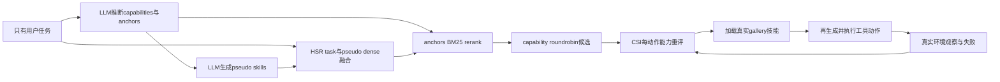

# SkillDreamer：行动前想清楚需要什么能力

> 本轮阅读与实现的是 v2 实质修订；v1 首发在 2026-08-28，**不计作 2026-10 新 v1**。本地保留真实模型 PSG/HSR/CSI，但算术环境只是 live-interaction diagnostic，不冒充 SkillUsage/SkillNet-Gym 能力复现。

## 论文信息

| 项目 | 内容 |
| --- | --- |
| 论文链接 | [arXiv 2609.01642](https://arxiv.org/abs/2609.01642) |
| 公司/机构 | Sichuan University |
| 首次公开日期 | 2026-08-28（arXiv v1） |
| 原文开源代码 | 否：原文与官方页面未找到作者实现仓库（核查日期 2026-10-13） |
| Adapter | `skilldreamer` |
| 本地复现代码 | [`src/auto_research/reproductions/skilldreamer/`](https://github.com/daiwk/auto-research/tree/main/src/auto_research/reproductions/skilldreamer/) |

原始 v1 时间为 2026-08-28 13:19:50 UTC；v2 为 2026-10-09 04:15:57 UTC。正文题名为 *Imagine Before Acting: Prospective Skill Identification for LLM Agents*；SkillDreamer 是方法名。

## 原始论文总结

### 背景与主要改动

任务描述主要说目标，技能文档主要写程序性知识。直接相似度容易优先找到背景相近、但不能解决当前能力缺口的技能；检索到了也未必会在执行时调用。SkillDreamer 在检索和调用两侧显式表达能力需求。

PSG 先由 LLM 从任务推断 1–5 个独立 capability 和语义 anchors，再为每个 capability 生成 procedure-like pseudo skill。pseudo skill 只是检索代理，并非验证过的可执行技能。HSR 融合原任务与各 pseudo 的 dense relevance，再以 anchors 的 BM25 做 candidate 内 min-max reranking。各 capability 的排名矩阵逐行轮询、去重，避免一种能力占满候选。

CSI 在下一动作前重新检查当前 subgoal、证据与未解决限制，说明所需 capability、匹配或不匹配与下一有界动作。MATCH/PARTIAL_MATCH 时先加载真实候选技能，再决定行动；每五个已执行动作插入运行时检查，失败或新证据也触发重评。能力检查不能从已选工具反向编造，也不能把“加载过”当作“做成功”。

### 架构流程



上方为本地重绘示意，源码：[architecture.mmd](assets/architecture.mmd)；来源版本与边界见 [source-provenance.json](assets/source-provenance.json)。

<!-- paper-figure:start -->
### 原论文关键图

[](https://arxiv.org/pdf/2609.01642v2#page=3)

图 2：PSG 先推断 required capability 与 semantic anchor，再生成仅用于检索的 pseudo skill；HSR 同时使用原任务与伪技能，召回真实 skill gallery 的候选；执行时 CSI 按当前子任务重评能力，并按需调用真实技能。右侧周期检查沿执行轨迹进行，不是读取 gold plan。来源：Liu 等，[v2 Figure 2](https://arxiv.org/html/2609.01642v2#S2.F2)，[原 PDF 第 3 页](https://arxiv.org/pdf/2609.01642v2#page=3)。

此图为固定 v2 原文 PDF 的 250 dpi 局部截图，图内文字未改写，已视觉核验；不是本地测量，也不将 v2 更新算作 10 月新 v1。论文标注 arXiv perpetual non-exclusive license，并非 CC BY；图示版权仍归原作者。PDF/图片 SHA256、页码与裁切范围见 [original-figures.json](assets/original-figures.json)。

> **原论文 Figure 2（关键图）**：上文说明所选原图或方法截图的范围；并非本地测量。图片来自[原论文](https://arxiv.org/pdf/2609.01642v2#page=3)，版权归原作者所有；点击图片可查看固定版本来源。
<!-- paper-figure:end -->

### 核心公式

对 task dense score $r_i^q$、pseudo $j$ 的 dense score $r_{ij}^p$：

$$
d_{ij}=2r_i^q+r_{ij}^p.
$$

各 pseudo 先选 $K_c=20$ 候选，再在该集合对三项 min-max 标准化：

$$
h_{ij}=2\bar r_i^q+\bar r_{ij}^p+\overline{BM25(anchor,s_i)}.
$$

逐排名行扫描各 capability 的 top-$K_r$，去重收集 $K$ 技能。CSI 的 periodic context 在 $n\bmod5=0$ 时注入；$n$ 是实际执行动作，不是模型思考次数。

### 论文离线与线上效果

| 原文指标 | Direct/Original | SkillDreamer |
| --- | --- | --- |
| Qwen-0.6B SkillUsage R@5 | 52.68% | 60.42% |
| Qwen-0.6B SkillRet R@5 | 59.14% | 66.93% |
| GPT-5.5 SkillUsage Pass / Load | 48.1 / 92.9 | 50.6 / 96.4 |
| DeepSeek-V4-Flash SkillUsage Pass / Load | 37.1 / 51.2 | 41.4 / 77.4 |
| Qwen3.6-27B 统一SkillUsage Pass | 31.3% | 37.6%，Load均59.5% |

来源：[原文 §3 与附录 D](https://arxiv.org/html/2609.01642v2#S3)。原 benchmark 有 6660/约3.4万技能、SkillUsage 84 个有效执行任务；原结果并非本地再测。pseudo 直接交给 agent 反而降低 Pass，是“想象的 procedure 不是已验证技能”的重要负结果。未报告生产线上 A/B。

## 本地复现

> **本地对照口径**：基线为同模型 no-skills 与原任务 dense direct retrieval，实验组为真实 PSG/HSR/CSI；缩放算术交互对原 benchmark 的相对能力结论不适用。

```bash
PYTHONPATH=src python scripts/run_skilldreamer.py \
  --config /path/to/skilldreamer.json --seed 42 --output runs/skilldreamer/seed42.json
```

配置含已验证本地 Instruct `model_dir`、MiniLM `encoder_dir`、带 provenance 的公开 `raw_data`、`device` 和提前固定 `max_queries`、`top_k`、`action_budget`、`max_new_tokens`。模型真实生成 capability/anchors 与 pseudo，HSR 实际编码/BM25/rerank；没有固定 candidate 代替 LLM generation，PSG 无效也不启发式补造。CSI 加载 `gallery.json` 的实际 procedure 后，必须再生成一条 action，才能使用该技能的内容。

### 数据协议、结果与边界

2026-10-14 固定 `0f5dca9f` 源、Qwen2.5-0.5B-Instruct、24 行 train-derived 算术协议在真实 A30 上完成 seeds 42/43/44。三个种子的 SkillDreamer 臂各 16 个执行 episode，实际模型调用为 351/326/318；但 CSI assessment、真实 gallery 加载和工具动作均为 0，48/48 episode 未完成定义链路。三臂 Pass 均为 0。这是**核心执行失败诊断**，不是 GPU gate 通过或能力验证。

完整失败 episode 和模型调用计数保存在 [失败诊断汇总](metrics/public-a30-failed-0f5dca9f.json) 与其绑定的 immutable raw SHA 中；旧 `6aabe57a` 中断批次未混入。未生成 `passed` GPU receipt，后续只能先用独立 validation 格式探针诊断，不能用这批 16 个 evaluation ID 挑预算或补 schema fallback。

随后固定 Qwen2.5-7B-Instruct、原 `0f5dca9f` 算法和 `d8603f65` probe，在真实 A100 上完成独立8条 question-only validation探针：596.9424秒、210calls、29194tokens，PSG/HSR各7题、实际CSI和gallery load各2次，但工具动作与提交均0。7个runtime episode用尽24次调用，两个load后均因CSI格式/decision失败，而非正常结束或256token截断；仍不签passed。详见 [负结果诊断](metrics/validation-negative-d8603f65.md) 与 [sanitized artifact/raw SHA](metrics/public-a100-validation-negative-d8603f65.json)。

CPU逐条诊断发现原提示没有完整写明解析器要求的五个非空 `LABEL: value` 行及四个DECISION首词，这是提示契约欠明确，**不是已证明的parser bug**。仅补清提示格式及无答案/无技能判断的占位模板，严格parser/enum、算法、预算与gold隔离保持；历史失败始终绑定原实际源。

五行格式澄清后，固定 `701f4500` 算法与 `5c07ef42` runner在A100同8条validation/原预算完成唯一探针：rc0、401.4411秒、159calls、19369tokens，65次真实CSI、7个加载episode。但56次env.step不等于56次成功工具：54次calculator尝试含48次成功、6次错误，另有2次未知工具；**0finish、0提交**。28次调用重复了已成功且结果已反馈的同AST算式。仅据实证明核心入口真实执行，不签passed或能力提升。详见 [native零提交诊断/独立CPU回放](metrics/validation-no-submit-5c07ef42.md) 与 [sanitized artifact](metrics/public-a100-validation-no-submit-5c07ef42.json)。

源与trace另确认Skill当时只列工具JSON，baseline却有明确的calculator计算/finish提交generic说明；同时实际policy也反复计算已有结果、请求不存在的工具。接口不对称与策略停滞分开记录，未证明零提交的因果来源。当前只追加同等公平API文字，明确两工具、提交终止及executor加载语义；不代模型生成答案或强制finish，不改gallery/parser/execute/action预算。该追加文字尚未GPU执行，不能把CPU检查写成模型能力通过。

以公开 GSM8K-style question/answer JSONL 中的 question 为任务，参考答案在独立 external scorer 中按数字比较；模型和环境观察均不接收 gold answer、gold plan 或 gold skill。首N条在读取 relevance 之外预先固定，按固定 hash 分离 validation/test，当前超参数事先固定不看 test 改写。五条本地通用技能为算术验证、比例、库存、金额和时间处理，不含题目答案。

环境复用已审查的 `ArithmeticEnvironment`，真实运行有界 AST calculator，只接受数字和允许的算术运算，不执行模型生成 Python、不访问外部系统。记录 actual executed actions、skill loads、生成失败、提交答案和外部 Pass；PSG/schema 失败计零 reward，不删除失败任务。不因 Load 高就宣称策略更强。

本轮未运行原 SkillUsage/SkillRet/SkillNet-Gym，没有原规模技能库、原模型或编码器；本地为 `core_mechanism` 的 live-interaction diagnostic，固定 `diagnostic_only=true`、`promotion_eligible=false`。合同证据见 [implementation-contract.json](metrics/implementation-contract.json)，真实模型 GPU 三 seed 指标和 receipt 必须来自实际运行。本文不把单测 fixture 当作模型能力结果。

### 代码映射

`algorithm.py` 对应 PSG 双阶段、HSR公式/roundrobin、CSI周期检查与技能加载；`experiment.py` 加载真实 checkpoint、执行三方法并独立评分；`gallery.json` 是通用 procedure 集而非训练/测试 gold plan；`paper.yaml` 显式列出未运行的原 benchmark，Evolve operators 为空。

测试：`python -m pytest tests/reproductions/test_oct13_agents_jepa.py`，验证不能读取 gold、pseudo 不进入执行、gallery body 必须先加载后再行动、真实 calculator 输出回到下一次能力评估。

### 47f/d5 独立 validation 无提交负记录

上文“公平 API 文字尚未 GPU 执行”描述的是该历史时点；随后固定 `47f0e9ce` 算法与 `d5bf41b2` probe 已在真实 A100 上完成同一 8 条 question-only validation、seed42 与原预算的唯一探针。实际 163 calls、19466 tokens、58 次 CSI、7 个加载 episode；50 次 env.step 全为 calculator 尝试，其中 46 次成功、4 次错误，**0 finish、0 提交**。runner 与外层调用耗时分别 404.9072 / 405.8046 秒；另一个 episode 的 PSG 失败保留。

详见 [独立脱敏负记录及原始 SHA](metrics/public-a100-validation-no-submit-seed42-47f0e9ce.json)。严格 CPU 整理逐字核对原 raw/partial/trace、source/config/归档及 launcher/exit；独立冻结源重放 7 个 runtime episode 的提示和全部结果字段一致。公开记录不包含原提示、问题/答案、token IDs、机器路径或 build 信息，原始证据保留本地。该 8 条探针没有 scorer，**不测准确率、不属于 16-ID 完整三臂×三 seed 评测、不生成 passed GPU receipt 或能力晋级证据**；没有隔离 API 文字变化的因果效果，也不强制模型 finish 或重试旧探针。
