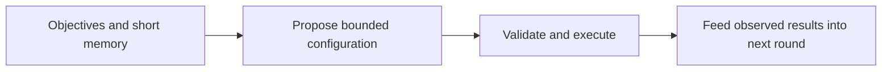
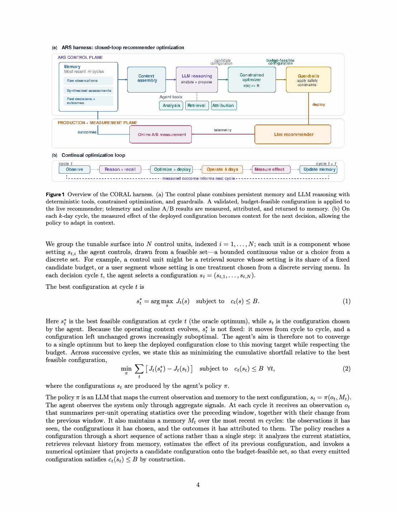

# CORAL: An LLM-native research loop for production recommendation

<!-- source-sha256: 3a706c3a0377f2b17d418a3dcbed22763a9d71285ca83b8e66f8a52cf0a85c2b -->

[简体中文](README.md)

> Bounded proposal, experiment memory, and feedback loop on public data.

## Paper information

| Field | Details |
|---|---|
| Paper | [Paper or original source](https://arxiv.org/abs/2609.02730) |
| Institution | Meta AI. |
| First public release | 2026-09-02 (arXiv v1) |
| Author code | No public author code found as of 2026-09-06. |
| Local adapter or method key | `coral` |
| Local reproduction code | [`src/auto_research/reproductions/coral/`](https://github.com/daiwk/auto-research/tree/main/src/auto_research/reproductions/coral/) |

## Paper method and evidence

Have an LLM propose structured configurations from objectives, budget, and recent experiments. Validate constraints, execute, and write outcomes into the next round's short memory. This is an iterative loop rather than one-shot tuning.

<!-- paper-figure:start -->
### Original paper figure

The original figure shows production research feedback. From the [original paper](https://arxiv.org/pdf/2609.02730); copyright remains with the authors.
<!-- paper-figure:end -->

### Core equation

Project $x_t=\Pi_{\mathcal C}(x_{t-1}+\Delta_t)$ onto $\mathcal C=\{x\mid x_i\ge 0,\sum_i x_i\le B\}$. Keep only three recent $(x,e)$ observations to avoid stale feedback.

### Reported results

Across millions of Meta users, video sessions +0.16%, watch time +0.15%, and low-signal new-user sessions +0.23%, without more serving cost. In another service the second round increased annualized capacity savings by another 44% with neutral engagement.

## Local reproduction

Five budget-allocation rounds on MovieLens-100K; memory of three, validation-only blend. Seed 42 equal allocation baseline NDCG@10 **0.05401**, intervention **0.05021 (-7.02%)**. [All three seeds and traces](metrics/public-seeds42-44.json). Only controller and constraints validated; no private telemetry, production LLM or traffic. Can combine as an Evolve recommendation controller operator.
