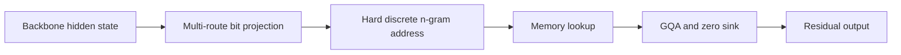
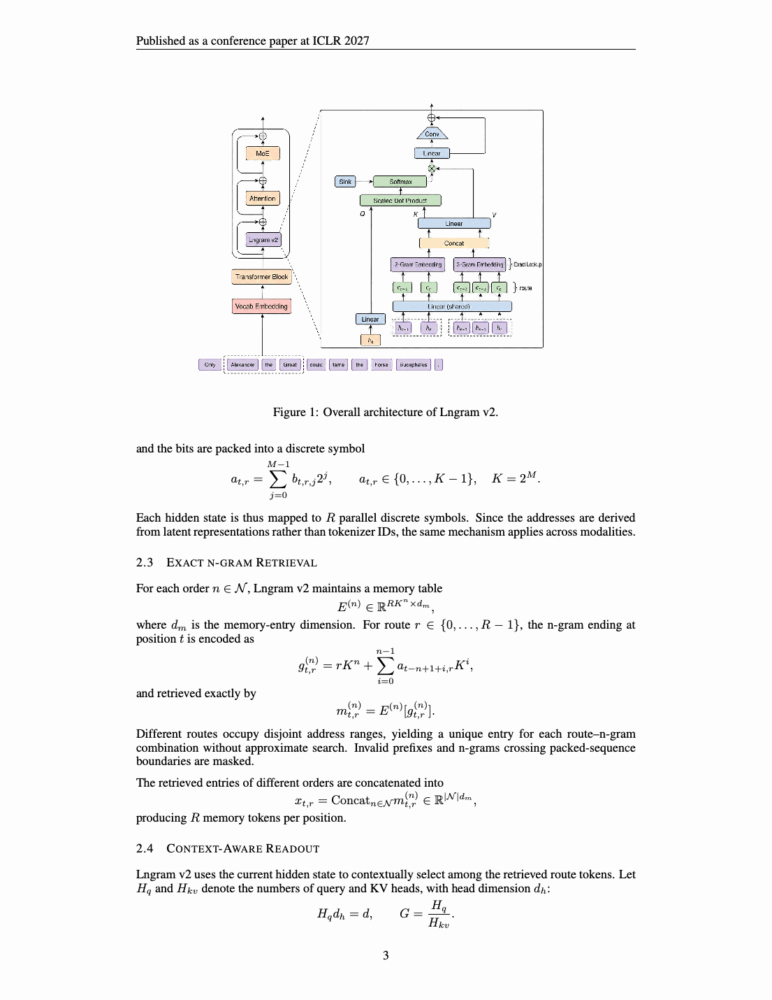

# Lngram v2: latent n-gram memory with interpretable discrete representations

<!-- source-sha256: 9b9f123bda1dfa0f4d73438128a27c77ca39c4af10e9cc8eb0f13506a4ee18ee -->

[简体中文](README.md)

> **Core mechanism plus real VLM checkpoint GPU validation.** Implements multi-route discrete addressing, exact n-gram lookup, counterfactual surrogate gradients, and grouped-query readout with a zero sink.

## Paper information

| Field | Details |
|---|---|
| Paper | [ICLR 2027](https://arxiv.org/abs/2609.03426) |
| Organization | Beijing University of Posts and Telecommunications / Kuaishou Technology |
| First public release | 2026-09-03 (arXiv v1) |
| Authors' code | No public author code was found on 2026-09-06. |
| Adapter / method | `lngram-v2` |
| Local reproduction code | [`src/auto_research/reproductions/lngram_v2/`](https://github.com/daiwk/auto-research/tree/main/src/auto_research/reproductions/lngram_v2/) |

## Original paper

### Motivation and method

Project backbone hidden states into several binary addresses and perform O(1) table lookup with the latest discrete unigram or bigram combination. Grouped-query attention reads multiple route tokens back into the backbone. Hard addresses are interpretable, neighboring counterfactual addresses provide gradients, and a zero sink allows the model to ignore unhelpful memory.

<!-- paper-figure:start -->
### Key figure from the paper

> **Key figure:** Original model architecture and discrete-memory path. From the [original paper](https://arxiv.org/pdf/2609.03426); copyright remains with the authors.
<!-- paper-figure:end -->

### Core equations

For route $r$, the discrete address is $z_t^r=\operatorname{bits}(W_rh_t)$; an order-$n$ query uses $(z_{t-n+1}^r,\ldots,z_t^r)$. Retrieved tokens and the zero sink enter grouped-query attention and are written back as a residual.

### Paper results

Relative to Lngram v1, total memory parameters decrease 82.6% and active parameters per token 95.2%. Semantic recovery from discrete IDs reaches 65.77%–84.27%. The paper validates Keye 2B/30B multimodal models.

## Local reproduction and GPU evidence

See the [three-seed CPU mechanism results](metrics/public-seeds42-44.json) and [A100 backward-pass receipt](../../gpu-validations/lngram-v2-a100-20260906.json) using real SmolVLM2-256M-Video-Instruct multimodal hidden states.

> **Local comparison:** The baseline is the original checkpoint without latent memory. The treatment checks the hidden-state mechanism and gradients only. There are no same-budget post-training task results, so relative gain is not applicable.

## Reproduction boundaries

No full Keye 2B/30B pretraining or paper-scale corpus. GPU evidence covers execution, gradients, and memory feasibility on real public VLM hidden states. The mechanism can serve as an LLM or multimodal evolve memory operator.
