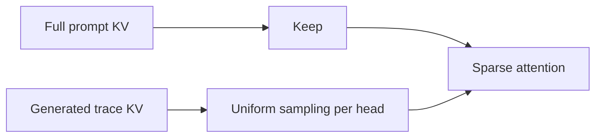
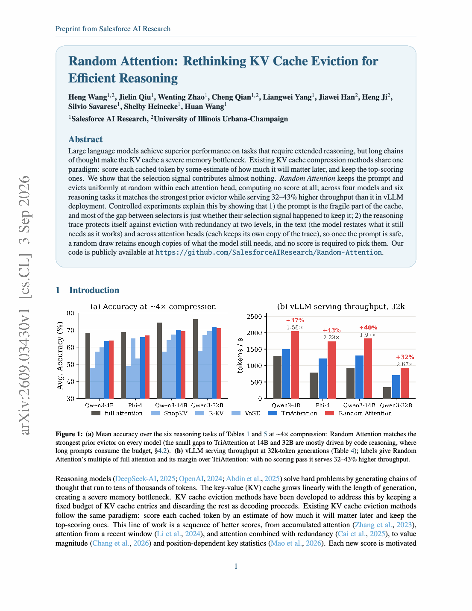

# Random Attention: KV-cache eviction without importance scoring

<!-- source-sha256: 64ff7d771e52bfb5f966547285e1dfc0f67a6835f02cf7559c1d4316e6b69565 -->

[简体中文](README.md)

> **Core mechanism plus real-checkpoint GPU validation.** Keeps the full prompt and independently samples the generated trace uniformly for each head.

## Paper information

| Field | Details |
|---|---|
| Paper | [Salesforce AI Research preprint](https://arxiv.org/abs/2609.03430) |
| Organization | Salesforce AI Research / University of Illinois Urbana-Champaign |
| First public release | 2026-09-03 (arXiv v1) |
| Authors' code | [Public implementation](https://github.com/SalesforceAIResearch/Random-Attention) |
| Adapter / method | `random-attention` |
| Local reproduction code | [`src/auto_research/reproductions/random_attention/`](https://github.com/daiwk/auto-research/tree/main/src/auto_research/reproductions/random_attention/) |

## Original paper

### Motivation and method

Conventional KV eviction first estimates token importance. Random Attention protects the prompt and retains a fixed budget from generated tokens with independent uniform samples per head. It avoids the scoring pass and does not force all heads to share a ranking rule.

<!-- paper-figure:start -->
### Key figure from the paper

> **Key figure:** Overview of the paper's method and results. From the [original paper](https://arxiv.org/pdf/2609.03430); copyright remains with the authors.
<!-- paper-figure:end -->

### Core equation

For head $h$, retain $K_h=P\cup\operatorname{UniformSample}(T,B-|P|)$, where $P$ is the full prompt and $T$ the generated trace. Heads sample independently, without token importance scores.

### Paper results

Across four models, six tasks, and 32k context, the paper reports maintained reasoning quality under the same KV budget. Its vLLM integration improves throughput by 32%–43% versus the strongest importance-based eviction baseline.

## Local reproduction and GPU evidence

See the [three-seed CPU mechanism results](metrics/public-seeds42-44.json) and the [A100 receipt](../../gpu-validations/random-attention-a100-20260906.json) for a real Qwen3-4B checkpoint and fixed public-domain long-text probe. Validation uses a strict equal-budget prompt-plus-recent baseline.

> **Local comparison:** On CPU seed 42, attention cosine is 0.97996 for the equal-budget recent baseline and 0.46664 for random selection, a relative -52.38%. The real-checkpoint A100 diagnostic is 0.99996 and 0.94002, respectively. Neither establishes task-accuracy improvement.

## Reproduction boundaries

The paper's six-task matrix and official vLLM-kernel throughput were not reproduced. Local GPU execution verifies selection and attention reconstruction on actual KV tensors and can serve as an LLM evolve attention operator.
