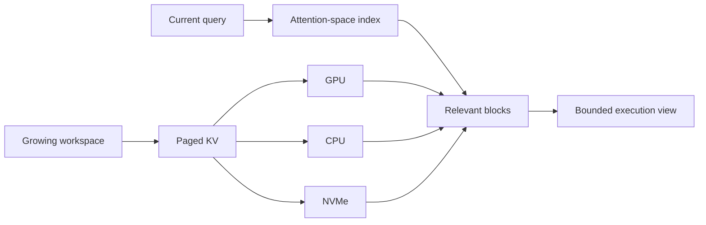
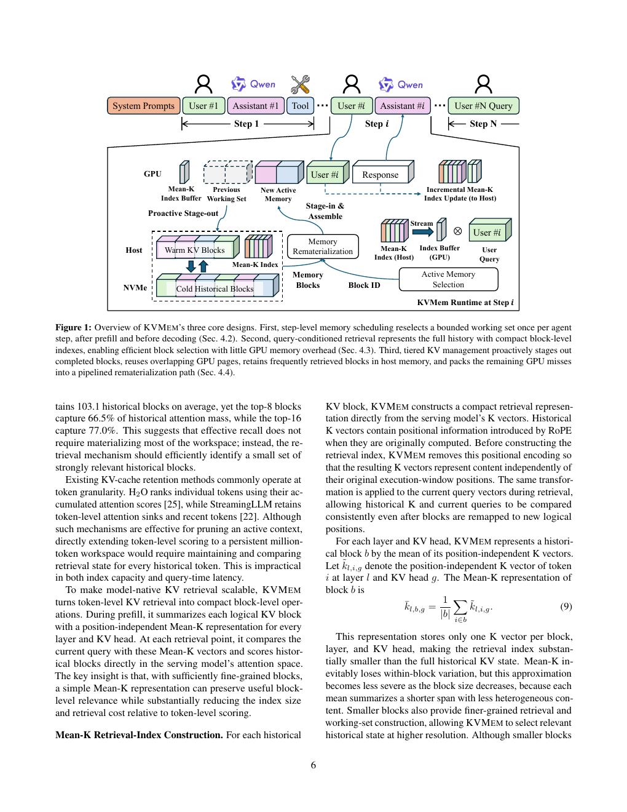

# KVMEM: Virtualizing a million-token agent workspace with paged KV

<!-- source-sha256: 92a0834b6fbe22a96be3e493611900a37ea9b63cb073bd234aead5f7494fdbf5 -->

[简体中文](README.md)

> **Fidelity: Query-dependent block selection and real-checkpoint CUDA smoke test.** Implements a query-conditioned KV view with a fixed GPU memory budget.

## Paper information

| Field | Value |
| --- | --- |
| Paper link | [arXiv 2609.04852](https://arxiv.org/abs/2609.04852) |
| Organization | Shanghai University of Finance and Economics |
| First published | 2026-09-04 (arXiv v1) |
| Original author code | Yes: [official author code](https://github.com/kvmem/kvmem-qw3). |
| Adapter | `kvmem` |
| Local reproduction code | [`src/auto_research/reproductions/kvmem/`](https://github.com/daiwk/auto-research/tree/main/src/auto_research/reproductions/kvmem/) |

## Original paper summary

### Background and main changes

Long-lived agent history can exceed both GPU memory and the native window. Summaries lose evidence; text retrieval repeats prefill. KVMEM pages precomputed KV across GPU, host memory, and NVMe. An index in the model's attention space selects relevant blocks and materializes an execution view within the native window.

<!-- paper-figure:start -->
### Key figure from the paper

**Original system diagram:** Tiered KV storage, indexing, and on-demand materialization. Image from the [original paper](https://arxiv.org/abs/2609.04852); copyright belongs to the authors. Click the image for its source.
<!-- paper-figure:end -->

### Core equation

The local implementation scores block $b$ with index vector $\bar{k}_b$ using $s_b=\langle q,\bar{k}_b\rangle/\sqrt d$, then concatenates selected KV within the block budget. The address space and execution window remain separate.

### Offline and online results in the paper

The paper evaluates LongMemEval, MemoryAgentBench, AgentLongBench, and histories of up to one million tokens. On DeepSWE, Qwen3.8-27B improves from 43.8% with a compression baseline to 48.4%. It also reports around 50 tokens/s on a 24GB consumer GPU.

## Local reproduction

See the [CPU fixture](metrics/synthetic-workspace-seeds42-44.json) and [A100 results for a real public checkpoint](../../gpu-validations/kvmem-a100-20260907.json).

The [WikiText-2 test artifact](metrics/wikitext2-task-a100-seed42.json) compares the same task. Mean NLL/accuracy are 1.9174/0.5729 for full attention, 2.1585/0.5677 for KVMem, and 4.2391/0.3906 for recent-only. Python KVMem averages 77.66 seconds total, retains the full backing cache, and does not reduce peak GPU memory. This verifies actual attention replacement and task behavior, not production kernel performance.

> **Control:** Recent-only and query-conditioned selection use the same block budget. See the receipt for relative changes where defined. No claim of original-system throughput.

## Reproduction limits

### 2026-09-08 validation correction

The initial checkpoint validation omitted query normalization and RoPE, and averaged GQA query heads before softmax. The old similarity results are withdrawn. The corrected A100 run uses six nonoverlapping WikiText-2 passages with 2048-token context and 32 next-token predictions. Accuracies are 0.5677 for KVMem, 0.5729 for full, and 0.3906 for recent-only. Python KVMem is slower than full attention and keeps the backing cache, so no speed or memory saving is claimed. See [task results](metrics/wikitext2-task-a100-seed42.json).

Asynchronous GPU/CPU/NVMe scheduling, NVFP4, MTP, and the full million-token system were not reproduced.
