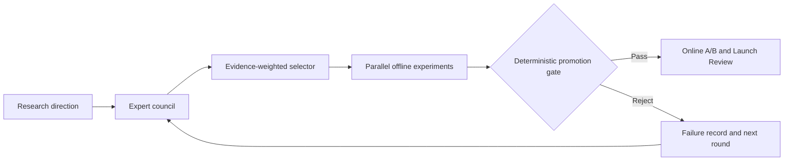
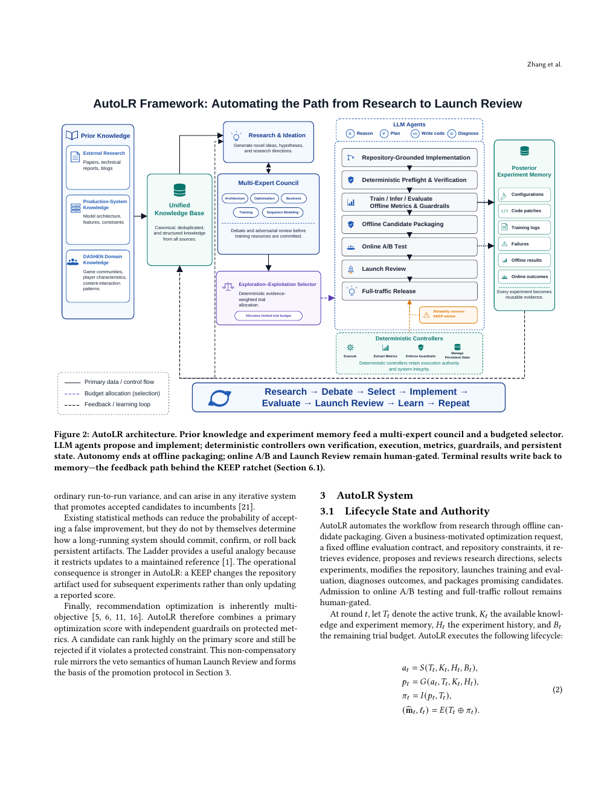

# AutoLR: From Research Ideas to Launch Review

<!-- source-sha256: 171131b7a42cb45847e06f0e9cb72240a34dd7af9ad1eccc63fc48fa936364a3 -->

[简体中文](README.md)

> **Reproduction level: offline controller core.** Applies budget ranking, independent metric gates, a persistent ledger, and human review packaging to submitted candidates and reviews. It does not perform live LLM literature research, arbitrary code generation, or production deployment.

## Paper information

| Field | Details |
|---|---|
| Paper | [NetEase technical report](https://arxiv.org/abs/2609.04871) |
| Organization | NetEase, Inc. |
| First public release | 2026-09-04 (arXiv v1) |
| Authors' code | No official or author implementation is linked by the paper (checked 2026-09-07). |
| Adapter / method | `autolr` |
| Local reproduction code | [`src/auto_research/reproductions/autolr/`](https://github.com/daiwk/auto-research/tree/main/src/auto_research/reproductions/autolr/) |
| Checkpoint experiment entry point | [`autolr_product.py`](https://github.com/daiwk/auto-research/blob/main/src/auto_research/reproductions/autolr_product.py) |

## Original paper

### Motivation and method

AutoLR links literature review, proposal debate, implementation experiments, offline evaluation, A/B, and Launch Review in a durable state machine. An LLM reasons over proposals and generates code; a deterministic controller retains ownership of budgets, metric extraction, guardrails, and transitions so noisy wins do not compound through KEEP decisions.

<!-- paper-figure:start -->
### Key figure from the paper

> **Figure 2:** Research, debate, experiments, launch evidence, and human authority boundaries. From the [original paper](https://arxiv.org/abs/2609.04871); copyright remains with the authors.
<!-- paper-figure:end -->

### Core formula

Candidate $i$ receives $q_i=\lambda e_i+(1-\lambda)u_i-\gamma d_i$, balancing evidence $e$, uncertainty or exploration value $u$, and expert disagreement risk $d$. Only gated evidence can change the durable incumbent.

### Paper results

An audit of several months finds 1,586 completed offline evaluations and nine Launch Reviews. Descriptive sums of positive relative changes across heterogeneous records are +5.75% content-consumption penetration, +10.83% consumption duration, and +5.55% effective plays. The authors explicitly distinguish these from pooled treatment effects.

## Local reproduction

A real Qwen checkpoint completes three bounded research rounds on public Amazon Beauty 2014 5-core. Each round generates a parameter proposal, calls two reviewers, verifies real backpropagation, and trains through validation. None beats the fixed baseline, which remains incumbent; test runs once at the end. See [sanitized results](metrics/amazon-beauty-checkpoint-seeds42-44.json) and [A100 execution receipt](../../gpu-validations/autolr-checkpoint-a100-20260910.json).

The 2026-09-09 correction invalidates old results from score mixing. In `autolr_product.py`, a real checkpoint generates two-tower dimension, learning rate, and Category Adapter proposals from research evidence and the executed-validation ledger. Separate model calls review fidelity and budget; a candidate must pass one backpropagation/finite-value check before full training at the fixed three-seed budget. Every round recovers its ledger from disk. Test runs only after final selection and online access is never granted.

`reproduce("autolr", Path("data"), 42, ledger_path=Path("runs/autolr-ledger.json"))` saves and restores the offline ledger. If no candidate qualifies, the baseline remains and no uplift is manufactured; `online_authorized` always remains false.

The [MovieLens metrics](metrics/movielens-100k-seeds42-44.json) record candidate selection, disagreement penalty, NDCG, and Recall for seeds 42/43/44.

> **Local comparison.** Both sides use the same fixed budget. Relative NDCG/Recall changes are in the artifact and undefined for a zero baseline. Internal Launch Review is not simulated.

## Limits

Production code and DASHEN data are unavailable. The model can only propose allowlisted parameters, not inject commands or arbitrary code. This is a controlled offline research loop, not a claim of autonomous architecture invention or online release authority.
