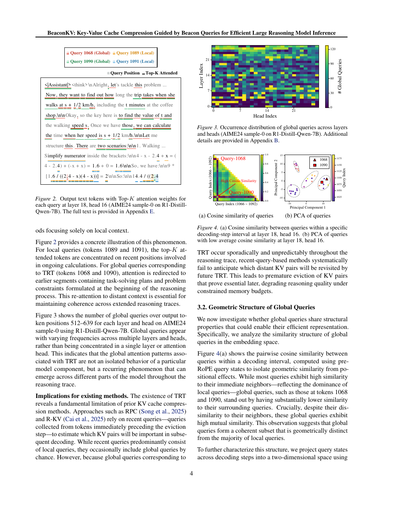

# BeaconKV: Beacon queries for inference KV compression

<!-- source-sha256: 6314a23bfa59fb13ab1786c01fc0cc600ceed4a55cdecd0a3c7fdbb2ab9037ed -->

[简体中文](README.md)

> **Fidelity: selection algorithm plus real checkpoint CUDA smoke.** No local speed or memory-savings claim.

## Paper information

| Field | Details |
|---|---|
| Paper | [Paper or original source](https://arxiv.org/abs/2609.04971) |
| Institution | Hanyang University |
| First public release | 2026-09-04 (arXiv v1) |
| Author code | No public author repository identified (checked 2026-09-07). |
| Local adapter or method key | `beaconkv` |
| Local reproduction code | [`src/auto_research/reproductions/beaconkv/`](https://github.com/daiwk/auto-research/tree/main/src/auto_research/reproductions/beaconkv/) |

## Paper method and evidence

Reasoning may revisit early plans through Thought Revisiting Tokens; recent queries alone miss these dependencies. BeaconKV uses farthest-point sampling to cover historical query clusters. Representative queries vote on key importance while a recent window is always retained. Under cache budget, rank historical key $k_j$ by $I_j=\max_{b\in B}\langle b,k_j\rangle$.

<!-- paper-figure:start -->
### Original paper figure

The method diagram shows how beacons estimate the future value of distant K/V. From the [original paper](https://arxiv.org/abs/2609.04971); copyright remains with the authors.
<!-- paper-figure:end -->

### Reported results

Across four open reasoning models and multiple benchmarks, the paper reports up to 5.8× KV compression and over 4.3× throughput improvement with broadly retained full-cache accuracy.

## Local reproduction

[CPU fixture metrics](metrics/synthetic-long-context-seeds42-44.json) · [A100 checkpoint receipt](../../gpu-validations/beaconkv-a100-20260907.json). The matched recent-only vs beacon comparison uses the same checkpoint, input and budget, with differences in the receipt where defined.

### Corrected task validation (2026-09-08)

The prior checkpoint check omitted query normalization and RoPE and averaged GQA query heads before softmax. Its similarity is invalid. The corrected A100 test uses Qwen3-4B, six non-overlapping WikiText-2 test segments, 2,048 context tokens, 32 teacher-forced targets and a 512-token working set. Full attention gives NLL/accuracy 1.9174/0.5729, BeaconKV 2.1430/0.5469, recent-only accuracy 0.3906. The Python selector averages 12.34 seconds vs full attention's 1.38 seconds. Full backing cache remains and peak memory is unchanged. [Task artifact](metrics/wikitext2-task-a100-seed42.json). No engine-level KV pages, CUDA kernels or 32K throughput reproduction.
