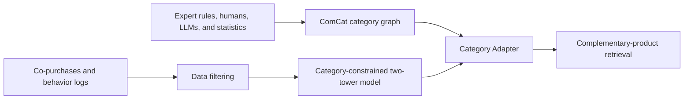
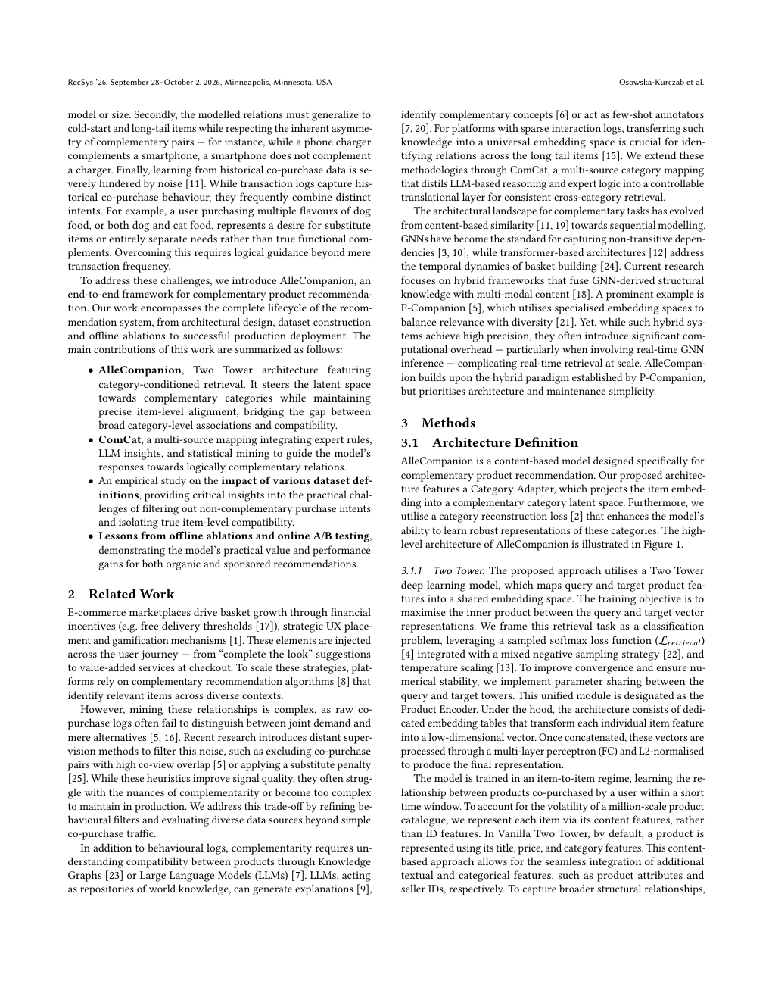

# AlleCompanion: Learning complementary recommendation from noisy co-purchases

<!-- source-sha256: 5ab00e411b1d23b56bcf5ba51338e1b8edb7e141a1bf7421343814b3738cfd2a -->

[简体中文](README.md)

> **Fidelity: Trainable CPU retrieval core.** Shared content/category encoding, a Category Adapter, mixed-negative retrieval loss, and category reconstruction all backpropagate. MovieLens adjacency is not product complementarity; no ComCat or online effect is reproduced.

## Paper information

| Field | Value |
| --- | --- |
| Paper link | [RecSys 2026](https://arxiv.org/abs/2609.05063) |
| Organization | Allegro.com |
| First published | 2026-09-04 (arXiv v1) |
| Original author code | No official or author code was provided in the paper (checked 2026-09-07). |
| Adapter | `allecompanion` |
| Local reproduction code | [`src/auto_research/reproductions/allecompanion/`](https://github.com/daiwk/auto-research/tree/main/src/auto_research/reproductions/allecompanion/) |

## Original paper summary

### Background and main changes

Co-purchases are not necessarily complements. Two cameras can often be browsed together, yet a lens is a better complement for a camera. ComCat combines expert rules, human feedback, LLM reasoning, and statistical mining to form category relations. A category-constrained two-tower model and Category Adapter limit candidates to plausible complementary categories.

<!-- paper-figure:start -->
### Key figure from the paper

**Original Figure 1 (architecture):** The complete ComCat, category adapter, and recommendation-serving path. Image from the [original paper](https://arxiv.org/abs/2609.05063); copyright belongs to the authors. Click the image for its source.
<!-- paper-figure:end -->

### Core equation

The local formulation uses a controlled category prior residual: $s(u,i)=\langle e_u,e_i\rangle+\alpha c_{cat(u),cat(i)}+\beta r(u,i)$, where $c$ comes from the category graph and $r$ represents consistency between content and behavior transitions.

### Offline and online results in the paper

The paper reports two weeks of platform-wide Allegro traffic. Web/app organic attributed GMV improves 8.05%/9.35%; cart GMV improves 21.25%/15.73%. The system serves more than 20 million monthly active users.

## Local reproduction

2026-09-08 correction: the earlier fixed weighted scores are withdrawn. `CategoryTwoTower` in `src/auto_research/reproductions/sep7_models.py` is trained for 80 steps per seed. Its control is the same-budget two-tower model without the Category Adapter. It uses only training adjacency, and computes each candidate category at inference without reading the test target category. Rerun the three-seed diagnostic with `PYTHONPATH=src python scripts/regenerate_sep7_fidelity.py`.

NDCG, recall, category consistency, and settings for MovieLens seeds 42/43/44: [metrics/movielens-100k-seeds42-44.json](metrics/movielens-100k-seeds42-44.json).

A matched 200-step three-seed next-product experiment also runs on Amazon Beauty 2014 5-core with 1,000 users and at most 2,000 items. See [metrics/amazon-beauty-5core-seeds42-44.json](metrics/amazon-beauty-5core-seeds42-44.json). The last two actions per user are held out chronologically. The catalog uses training frequencies only; content uses titles, descriptions, and brands, without reviews or `also_bought` edges. The Category Adapter is a negative result: test Hit@10 is 0.004/0.003/0.009 versus 0.074/0.076/0.082 for the shared towers. This proxy has no explicit target category and is not ComCat complementarity; it cannot refute the paper.

> **Control:** Both arms use the same public data and candidate budget. Relative changes are in the metrics artifact and undefined when baseline is zero. Local results are not comparable with Allegro online GMV.

## Reproduction limits

ComCat mappings, Allegro behavior data, and production serving are not public. The local run implements an auditable core mechanism, not the production system.
