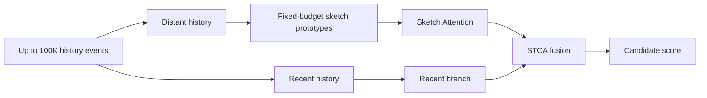
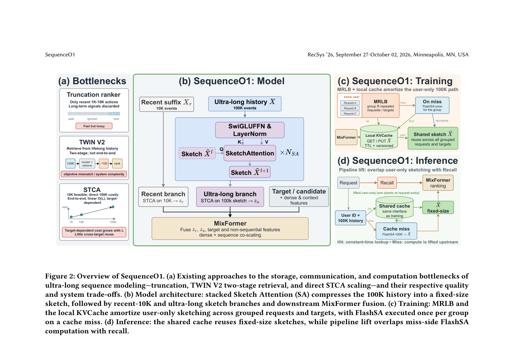

# SequenceO1: Sketch Attention for compressing very long user sequences

<!-- source-sha256: 719887001033357307155bb2f619e504b31986432cc61a8be43b4b3f78ec21fc -->

[简体中文](README.md)

> **Core mechanism on public data.** Runs fixed-budget prototype sketches and a recent-history branch. MovieLens has no 100K-event histories.

## Paper information

| Field | Details |
|---|---|
| Paper | [arXiv v1](https://arxiv.org/abs/2609.08443) |
| Organization | ByteDance / Douyin |
| First public release | 2026-09-08 (arXiv v1) |
| Authors' code | No public author repository was found on 2026-09-12. |
| Adapter / method | `sequenceo1` |
| Local reproduction code | [`src/auto_research/reproductions/sequenceo1/`](https://github.com/daiwk/auto-research/tree/main/src/auto_research/reproductions/sequenceo1/) |

## Original paper

### Motivation and method

Attending directly to entire histories cannot efficiently serve 100K-scale behavior sequences. SequenceO1 compresses distant history to a fixed number of prototypes and retains a recent-behavior branch. STCA combines the two in parallel, controlling cost while retaining long-term interests.

<!-- paper-figure:start -->
### Key figure from the paper

> **Figure 2:** Overall workflow, key stages, and data flow. From the [original paper](https://arxiv.org/abs/2609.08443); copyright remains with the authors.
<!-- paper-figure:end -->

### Core equations

Compress distant features $H_o$ to fixed-budget prototypes $P=\operatorname{Sketch}(H_o,B)$. The local score is $0.65z(s_{recent})+0.35z(\max_{p\in P}p^\top e_i)$, so the distant branch's scoring cost does not grow with history length.

### Paper results

A one-month A/B test on Douyin and Douyin Lite reports significant gains, including +0.1968% 30-day activity, +1.4999% time, and +2.3256% completions overall. Full-traffic deployment followed (Section 4.3, Table 4).

## Local reproduction and limits

See [three-seed MovieLens 100K results](metrics/movielens-100k-seeds42-44.json). Four prototypes are initialized farthest-first on training history, followed by one assignment/update. MRLB, FlashSA, and production caching are not implemented, and no non-executable evolve label is registered.

> **Local comparison:** On the same full-catalog test ranking, baseline NDCG@10 is 0.05401 versus 0.05104 for the treatment, a -5.48% relative change. The short-sequence proxy does not establish online gains.
