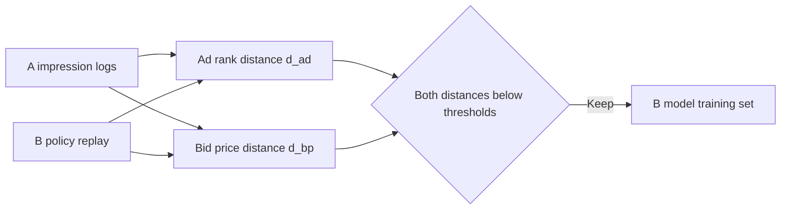
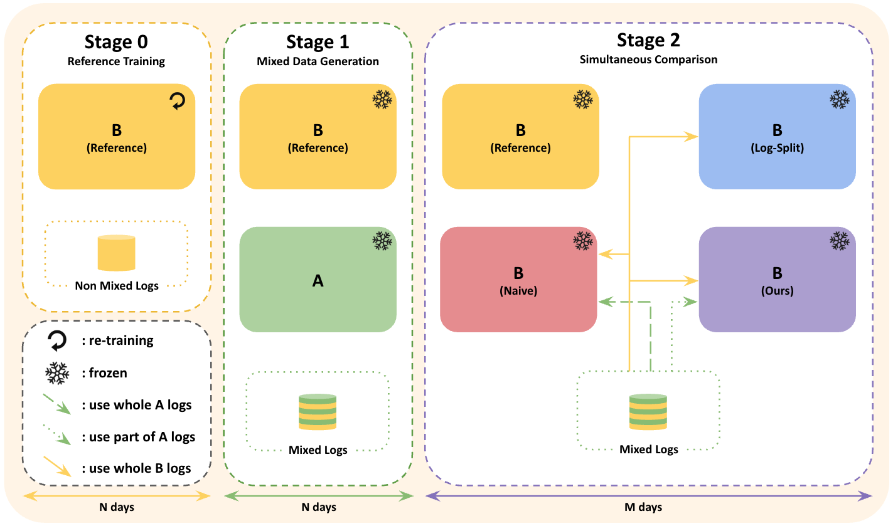

# BAFF: bid-aware filtering to prevent interference in RTB A/B logs

<!-- source-sha256: 83a73ccc9f890343e96da156362142298f47f0df4ae60892216503bfc311343f -->

[简体中文](README.md)

> **Controlled-simulation core mechanism.** Runs the exact paper filter $F(k,l)$ and measures parameter bias from shared logs against B-only training. Simulation is not online lift.

## Paper information

| Field | Details |
|---|---|
| Paper | [arXiv v1](https://arxiv.org/abs/2609.08725) |
| Organization | Dable |
| First public release | 2026-09-08 (arXiv v1) |
| Authors' code | No public author repository was found on 2026-09-12. |
| Adapter / method | `baff` |
| Local reproduction code | [`src/auto_research/reproductions/baff/`](https://github.com/daiwk/auto-research/tree/main/src/auto_research/reproductions/baff/) |

## Original paper

### Motivation and method

In RTB experiments, A and B affect each other's auction opportunities. Training B directly on pooled logs creates treatment interference. BAFF checks where A's ad falls in B's ranking and how its bid differs, retaining A records only when they have approximately no effect on B's decision.

<!-- paper-figure:start -->
### Key figure from the paper

> **Figure 1:** Overview of the paper's method and key components. From the [original paper](https://arxiv.org/abs/2609.08725); copyright remains with the authors.
<!-- paper-figure:end -->

### Core equations

$d_{ad}=\operatorname{rank}_B(a_A)/K$ and $d_{bp}=\max(bp_A-bp_B,0)/bp_A$. Retain only if the respective values are below $k,l$.

### Paper results

Against naive mixing, the online CPC treatment-effect gap falls from 9.85 to 0.44 and the CTR gap from 1.94 to 0.40 percentage points (Section 5.4, Tables 6–7). These measure accuracy after reducing interference, not business KPI lift.

## Local reproduction and limits

The [three-seed artifact](metrics/controlled-rtb-seeds42-44.json) covers 2,400 controlled auctions. The simulation executes strict two-axis filtering and ridge parameter-bias diagnostics without private Dable DSP logs, a production CTR model, or a market-side reference experiment.

> **Local comparison:** The baseline pools all A/B logs and the treatment runs $F(0.5,0.5)$. The artifact records per-seed relative parameter-bias changes, which can be negative. Business uplift percentages are not applicable.
