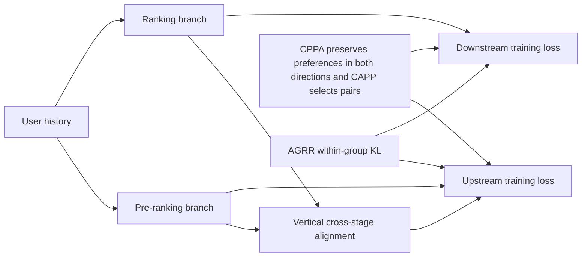
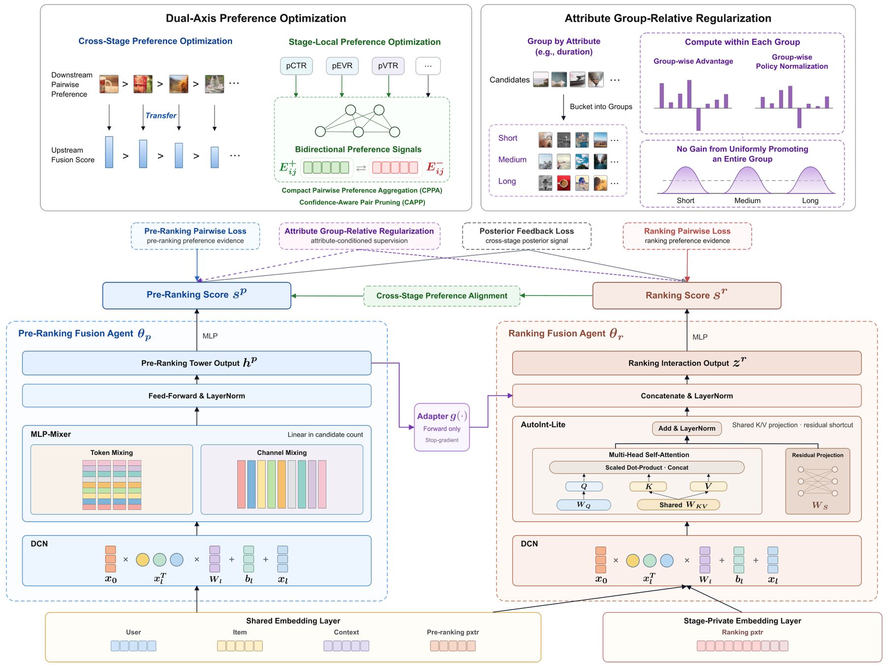

<!-- source-sha256: 32a5a002039ae41aaa953489d84d7edcf0a5635062bacf7e396af72c5dfbb3c2 -->

[简体中文](README.md) · English

# UniRec: Unifying industrial pre-ranking and ranking

> **Component diagnostic, not full reproduction.** The v3 CPPA/CAPP, AGRR within-group KL and cross-stage preference objective were implemented and checked with forward passes, gradients and negative controls. The old fixed-weight NumPy `unirec` adapter is explicitly a `concept_demo`. Historical measurements and negative results are retained.

## Paper information

| Field | Details |
| --- | --- |
| Paper | [arXiv v1](https://arxiv.org/abs/2609.11052) |
| Reviewed version | [v3 full text](https://arxiv.org/html/2609.11052v3), a revision, not a new paper |
| Company | Kuaishou |
| First public release | 2026-09-10 (arXiv v1) |
| Timestamp and revision | v1 at 03:54:17 UTC; v3 revised 2026-10-16 at 09:30:30 UTC and announced October 19. The revision is not a separate paper. |
| Original source code | No UniRec implementation found on 2026-10-19. [RecFlow](https://github.com/RecFlow-ICLR/RecFlow) is a dataset, not method code. |
| Adapter | `unirec` |
| Standalone component key | `unirec-v3-components` has no full adapter; old `unirec` is a concept demo. |
| Local reproduction code | [`src/auto_research/reproductions/unirec/`](https://github.com/daiwk/auto-research/tree/main/src/auto_research/reproductions/unirec/) |

## Original paper summary

### Background and main changes

Pre-ranking and ranking have different candidate scopes, feature quality, and latency constraints. Copying ranking fusion weights does not guarantee consistent upstream order. UniRec jointly trains two-stage fusion with partially shared embeddings and separate DCN/Mixer and AutoInt-Lite towers. Downstream preferences supervise upstream training only; they are not online inputs to pre-ranking. v3 retains multi-objective conflicts through CPPA, prunes pairs by confidence with CAPP, and uses within-group AGRR KL to counter distribution drift from attributes such as video length.



<!-- paper-figure:start -->
### Key figure from the paper

[](https://arxiv.org/html/2609.11052v3/unirec_architecture.png)

> **Figure 3:** UniRec v3's two-stage fusion towers, shared embeddings, two-axis preference objectives and within-group AGRR KL. This is not the old fixed NumPy scorer. From the [paper](https://arxiv.org/abs/2609.11052); copyright belongs to the authors. Click for the source.
<!-- paper-figure:end -->

### Core equations

For each non-tied objective preference $y_{ij}^{m}=\mathrm{sign}(p_i^m-p_j^m)$, separately accumulate $E_{ij}^{+}=\sum_m w_m\mathbf1[y_{ij}^{m}>0]$ and $E_{ij}^{-}=\sum_m w_m\mathbf1[y_{ij}^{m}<0]$. CPPA is

$$
L=\sum_{ij}E_{ij}^{+}\mathrm{softplus}(-\delta_{ij})+E_{ij}^{-}\mathrm{softplus}(\delta_{ij}).
$$

Do not take a majority vote before applying the loss; conflicting objective penalties must both remain. CAPP selects non-self top-K pairs per row by $|E^+_{ij}-E^-_{ij}|$, applying softplus only to these directed pairs. Local ties use original candidate index for stable ordering.

AGRR computes reward from unpruned evidence as in Eq. 14, with epsilon inside the sum over j. It uses population standard deviation, a floor and clipping within attribute-quantile groups to obtain $A_i$. Construct $q(i|g)=\mathrm{softmax}(A_i/\tau)$ and minimize $KL(q\|\mathrm{softmax}(s))$ equally over eligible groups. This is not group-centered scoring or an unbounded likelihood with signed advantages. Cross-stage loss applies only to survivors, stopping gradients on the ranking side. The paper does not fix a standard deviation estimator or quantile boundary ties; both local conventions are disclosed.

### Offline and online results

v3 Section 5.5/Table 2: 5% randomized online traffic, observed over nine weeks, with final-week changes of +0.616% app usage time, +0.675% total watch time, +0.755% video watch time and +0.189% active users, followed by full rollout. The earlier “20%/one week” summary was corrected to v3; do not mix versions. Public RecFlow rank_GAUC of 0.6330 is paper-reported, not a local run.

## Local reproduction and limits

Historical MovieLens 100K results for seeds 42/43/44 are in [`metrics/movielens-100k-seeds42-44.json`](metrics/movielens-100k-seeds42-44.json). Blend selection used validation only and test was isolated, but the scorer ran neither joint training nor CPPA/CAPP/AGRR KL. It is a public-data concept diagnostic, not a paper capability comparison even with multiple seeds. Historical values are unchanged.

New components are in `v3_objectives.py`:

```bash
PYTHONPATH=src python scripts/run_oct19_evening_unirec_components.py \
  --device cpu --seeds 42,43,44 --output runs/unirec-v3-new.json
```

The same script takes `--device cuda` and does not fall back to CPU. Diagnostics check individual-objective scalar losses/gradients against CPPA, CAPP equivalence without pruning, an incorrect majority-vote control, AGRR KL and group-shift invariance, and frozen downstream gradients. These are small-tensor mathematical checks, not a two-tower or real recommendation gain. No Evolve mapping.

A100 ran seeds 42/43/44 at pinned source `73a1e8b8`. CPPA maximum loss difference from independent reference was about $2.85\times10^{-14}$ and gradient difference $3.56\times10^{-15}$. AGRR, stop-gradient and update checks passed. See [per-seed metrics](metrics/component-cuda-seeds42-44.json) and [GPU receipt](../../gpu-validations/unirec-v3-components-a100-20261019.json). CAPP reduces differentiable loss pairs, not the quadratic evidence construction and top-K selection cost. The full algorithm is not claimed to be O(KN).

## Cost gate

**Too costly to reproduce (review DONE).** The paper's RecFlow has 42K users, 9.3M requests and 1.9B stage records. It also needs seven-head DSSM/DIN pretraining, fusion training with frozen pXTR, private million-request logs and production A/B. Under the single-A100/A30 or Mac budget, no full dataset download, full experiment or automatic retry is planned. This is based on paper scale, not measured OOM or runtime.

> **Local comparison:** On the same full-catalog test ranking, baseline NDCG@10 is 0.05401 and the experimental arm is 0.04721, or -12.58% relative. This is a negative result on the public substitute task.
