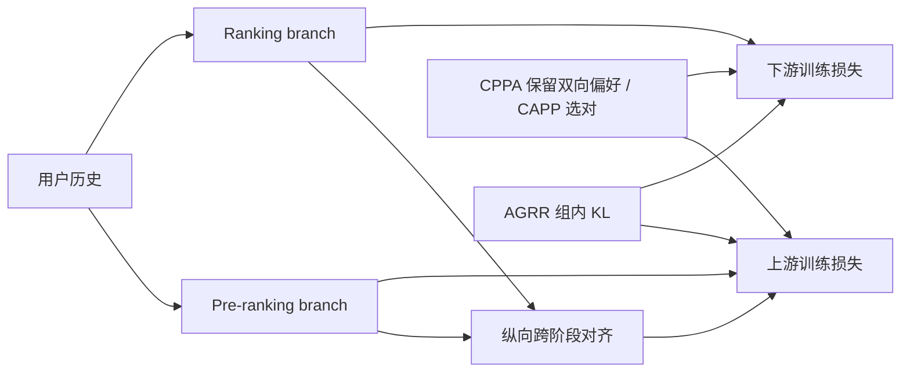
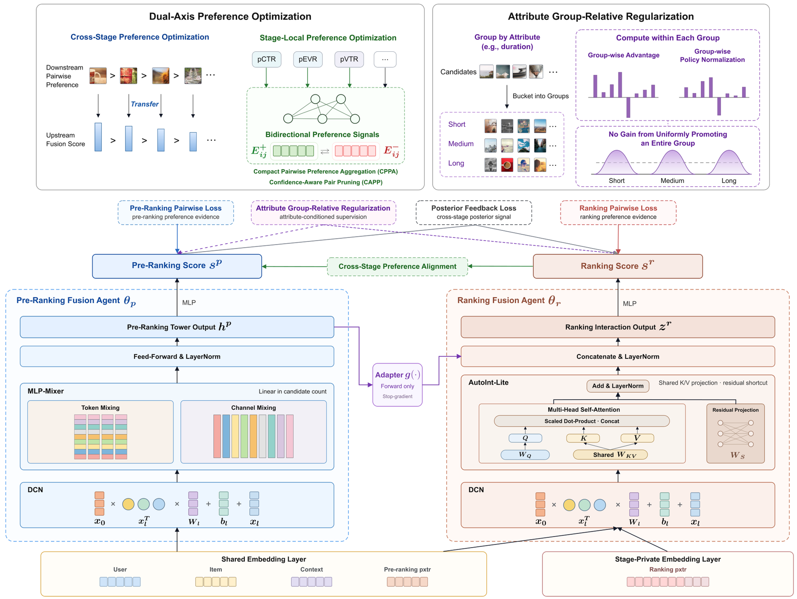

# UniRec：统一工业预排与精排

> **复现级别：组件诊断，非完整论文复现。** 新增 v3 的 CPPA/CAPP、AGRR 组内 KL 与跨阶段偏好目标，验证前向、梯度和负对照。旧 `unirec` NumPy adapter 是固定权重启发式，现明确降为 `concept_demo`；历史测量与负结果完整保留。

## 论文信息

| 项目 | 内容 |
| --- | --- |
| 论文链接 | [arXiv v1](https://arxiv.org/abs/2609.11052) |
| 本轮核验版本 | [v3 全文](https://arxiv.org/html/2609.11052v3)，版本更新而非新论文 |
| 公司/机构 | Kuaishou |
| 首次公开日期 | 2026-09-10（arXiv v1） |
| 精确时间与版本 | v1 03:54:17 UTC；v3 更新 2026-10-16 09:30:30 UTC，10 月 19 日公告；不是新论文身份 |
| 原文开源代码 | 否：未找到 UniRec 作者实现（2026-10-19）；正文 [RecFlow](https://github.com/RecFlow-ICLR/RecFlow) 是数据集，不是方法代码 |
| Adapter | `unirec` |
| 独立组件键 | `unirec-v3-components`（无完整 adapter；旧 `unirec` 为概念演示） |
| 本地复现代码 | [`src/auto_research/reproductions/unirec/`](https://github.com/daiwk/auto-research/tree/main/src/auto_research/reproductions/unirec/) |

## 原始论文总结

### 背景与主要改动

预排和精排的候选范围、输入质量和延迟约束不同，直接复制精排的融合权重不能保证上游排序一致。UniRec 以部分共享 embedding、独立 DCN/Mixer 与 AutoInt-Lite 塔联合训练两阶段融合模块；下游偏好只作为上游训练监督，不作为预排线上输入。v3 明确保留多目标冲突的 CPPA、置信剪枝 CAPP，以及以组内 KL 抑制视频时长等属性引起的分布漂移。



<!-- paper-figure:start -->
### 原论文关键图

[](https://arxiv.org/html/2609.11052v3/unirec_architecture.png)

> **原论文 Figure 3（关键图）**：UniRec v3 的双阶段融合塔、共享 embedding、双轴偏好目标和 AGRR 组内 KL；不是旧 NumPy 固定融合评分器的结构。图片来自[原论文](https://arxiv.org/abs/2609.11052)，版权归原作者所有；点击图片可查看来源。
<!-- paper-figure:end -->

### 核心公式

对每个目标的非平局偏好 $y_{ij}^{m}=\mathrm{sign}(p_i^m-p_j^m)$，分别累计 $E_{ij}^{+}=\sum_m w_m\mathbf1[y_{ij}^{m}>0]$ 和 $E_{ij}^{-}=\sum_m w_m\mathbf1[y_{ij}^{m}<0]$。CPPA 为

$$
L=\sum_{ij}E_{ij}^{+}\mathrm{softplus}(-\delta_{ij})+E_{ij}^{-}\mathrm{softplus}(\delta_{ij}).
$$

不能先多数表决再算 loss；相反目标的惩罚必须同时保留。CAPP 对每行按 $|E^+_{ij}-E^-_{ij}|$ 取非自身 top-K，只对这些有向 pair 执行 softplus；局部 tie 以候选原索引稳定处理。

AGRR 从未剪枝证据按 Eq.14 求 reward，epsilon 在对 j 求和内部；在属性分位组内用 population std、下界和 clip 得到 $A_i$，再构造 $q(i|g)=\mathrm{softmax}(A_i/\tau)$，最小化合格组等权平均的 $KL(q\|\mathrm{softmax}(s))$。这不是组中心化评分或带正负优势的无界似然。跨阶段项只作用于 survivor 集合，精排方向 stop-gradient。论文未固定标准差估计器和完全相等的分位边界 tie，本地这两项约定显式公开。

### 论文离线与线上效果

v3 Section 5.5/Table 2：5% 随机线上流量、持续观察九周，报告最后一周指标：App 使用时长 +0.616%、总观看时长 +0.675%、视频观看时长 +0.755%、活跃用户 +0.189%，随后全量部署。本文旧版摘要中的“20%/一周”说明已按 v3 更正，不能混合不同版本口径。公开 RecFlow 的 rank_GAUC 为 0.6330；这是原文数字，不是本地实跑结果。

## 本地复现与边界

旧 MovieLens 100K、seeds 42/43/44 结果见 [`metrics/movielens-100k-seeds42-44.json`](metrics/movielens-100k-seeds42-44.json)。blend 系数只在 validation 选择，test 隔离，但 scorer 未执行联合训练、原文 CPPA/CAPP 或 AGRR KL，因此只能是公开数据概念诊断；多 seed 不把它变成论文能力比较。本轮不重写历史数值。

新增代码为 `v3_objectives.py`，可执行：

```bash
PYTHONPATH=src python scripts/run_oct19_evening_unirec_components.py \
  --device cpu --seeds 42,43,44 --output runs/unirec-v3-new.json
```

GPU 路径由同一脚本 `--device cuda` 执行，不回退 CPU。诊断比较逐目标标量 loss/梯度与 CPPA、CAPP 无剪枝等价、错误多数表决负对照、AGRR KL/组平移不变性及冻结下游梯度；只验证小张量数学行为，不验证双塔架构或真实推荐提升。未映射 evolve。

真实 A100 seeds 42/43/44 已按 `73a1e8b8` 固定源码执行，CPPA loss 独立参考最大差约 $2.85\times10^{-14}$，梯度最大差约 $3.56\times10^{-15}$，AGRR/停止梯度与更新检查均通过：[逐 seed 指标](metrics/component-cuda-seeds42-44.json)、[GPU 收据](../../gpu-validations/unirec-v3-components-a100-20261019.json)。CAPP 只减少可微 loss 的 pair 数，证据构造与 top-K 筛选本身仍有二次开销，不声称整个算法为 O(KN)。

## 成本门槛

**成本过高，不复现（审查 DONE）。** 原文 RecFlow 包含 42K 用户、9.3M 请求和 1.9B 阶段记录；还需预训七头 DSSM/DIN、冻结 pXTR 后训练融合塔，另有百万请求私有日志及生产 A/B。当前预算为单张 A100/A30 或 Mac，不下载这套完整数据、不重跑完整实验、不进入自动重试队列。该结论来自论文规模，不是本地 OOM 或耗时测量。

> **本地对照口径**：同一 test 全物品排序下，基线 NDCG@10 为 0.05401，实验组为 0.04721，相对变化 -12.58%；这是公开替代任务的负结果。
