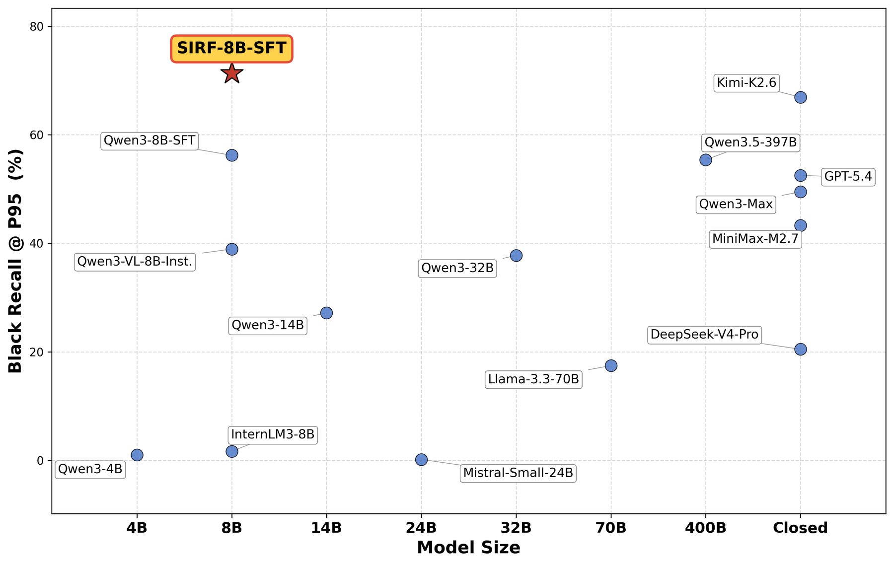

# SIRF: a foundation model that internalizes industrial content-risk rules

<!-- source-sha256: 6854e99090a7e88a45f811594599636fb4a86f68787c0abe0c680557ed9e325d -->

[简体中文](README.md)

> **Concept diagnostic.** Implements rule-relation synthesis, trigger/exemption learning, and P95 threshold selection. A linear model stands in for 8B LLM continued pretraining.

## Paper information

| Field | Details |
|---|---|
| Paper | [arXiv v1](https://arxiv.org/abs/2609.11752) |
| Organization | Xiaohongshu |
| First public release | 2026-09-10 (arXiv v1) |
| Authors' code | No public author repository was found when checked on 2026-09-14. |
| Adapter | `sirf` |
| Local reproduction code | [`src/auto_research/reproductions/sirf/`](https://github.com/daiwk/auto-research/tree/main/src/auto_research/reproductions/sirf/) |

## Original paper

### Motivation and method

SIRF synthesizes long-tail policy examples with EntiGraph, MAGA rewriting, and account-level chain-of-thought. Continued pretraining writes complex trigger/exemption rules into model weights. A single verdict and adjustable threshold support decisions on a seconds-scale serving path.

~~~mermaid
flowchart LR
  S[Platform rules] --> E[EntiGraph, MAGA and account CoT]
  E --> C[About 70M continued-pretraining tokens]
  C --> F[SFT verdict model]
  F --> T[High-precision threshold and online verdict]
~~~

<!-- paper-figure:start -->
### Key figure from the paper

> **Figure 1:** Original method design and key components. From the [paper](https://arxiv.org/abs/2609.11752); copyright remains with the authors.
<!-- paper-figure:end -->

### Core computation

The local model represents rules with triggers, exemptions, and interactions. After training, it scans thresholds on held-out policy cases and reports maximum Black Recall at Precision≥95%.

### Paper results

Against a matched Qwen3-8B-SFT control, Black Recall@P95 rises 15.1 percentage points. The adjudication layer releases about 20% more incorrectly penalized cases. In the account-freeze scenario, wrongful penalties decline by about 70% relative, at a cumulative million-user scale. The full text also reports a significant rise in weekly active penetration in randomized treatment/control A/B, disclosing only a high-single-digit to low-double-digit range.

## Local reproduction

> **Local comparison:** Against matched linear features, adding rule interactions increases Black Recall@P95 by 65.81% relative over three seeds, about 33.84 absolute percentage points. These are not results for the 8B model or online traffic.

See the [three-seed results](metrics/policy-cases-seeds42-44.json). The paper's online results and local synthetic-data measurements are kept separate.

### Reproduction boundaries

No private account data, 8B continued pretraining, EntiGraph/MAGA language generation, or online serving were reproduced. Local results cannot verify the reported business lift.
