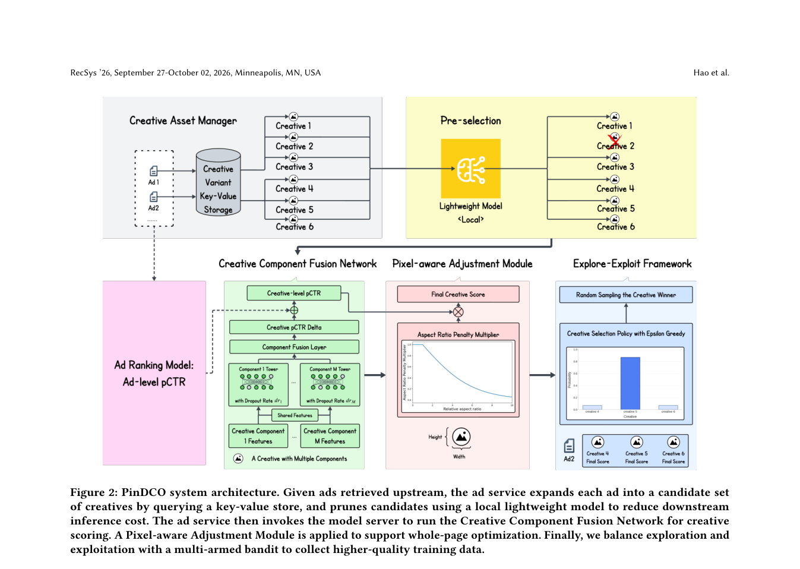

<!-- source-sha256: db2a112418cb67e5b29a7b20d4a7562f60be0f3bb5343cbd48b8958333e4d76c -->

[简体中文](README.md) · English

# PinDCO: Large-scale dynamic creative optimization for page-wide value

> **Public-data core mechanism.** Runs component-specific towers, incremental fusion from ad scores, pixel penalty and candidate filtering. MovieLens content features are not Pinterest creative or production traffic.

## Paper information

| Field | Details |
| --- | --- |
| Paper | [arXiv v1](https://arxiv.org/abs/2609.11943) |
| Institution | Pinterest |
| First public release | 2026-07-21 (arXiv v1) |
| Author code | No public author code found on 2026-09-15. |
| Local adapter or method key | `pindco` |
| Local reproduction code | [`src/auto_research/reproductions/pindco/`](https://github.com/daiwk/auto-research/tree/main/src/auto_research/reproductions/pindco/) |

## Original paper summary

### Background and main changes

Generative creatives multiply candidate images, titles and layouts per ad. PinDCO uses specialized towers for heterogeneous components and predicts lift relative to the base ad logit. PAM penalizes creatives that occupy too many feed pixels by relative aspect ratio. Lightweight filtering, caching and dynamic batching control serving cost, while ε-greedy traffic collects less biased new-creative feedback.

<!-- paper-figure:start -->
### Key figure from the paper

> **Figure 2:** Core architecture, modules and connections. From the [paper](https://arxiv.org/abs/2609.11943); copyright belongs to the authors. Click for the source.
<!-- paper-figure:end -->

### Core equations

CCFN learns an incremental creative logit relative to the ad baseline. PAM computes $S=O\,P(r)$ and $P(r)=\mathrm{clip}(1-\tanh(k(r-1)),0,1)$. A taller creative wins only when its incremental benefit offsets the pixel penalty.

### Offline and online results

Pinterest production A/B reports a **3.09%** relative ad CTR gain and positive page-level metrics, followed by deployment to Pinterest Ads (abstract and Section 4.2).

## Local reproduction

See [fixed MovieLens 100K results for seeds 42/43/44](metrics/movielens-100k-seeds42-44.json). Public content features provide component vectors; content norm is an auditable proxy when pixels are absent. Validation alone selects the blend and test stays isolated.

> **Comparison:** Baseline NDCG@10=0.05401 versus 0.05323 for PinDCO, -1.44% relative.

## Scope

No Pinterest private creatives, user/context features, ad baseline, online bandit traffic, cache or serving cluster are reproduced. No CUDA path is advertised. No Evolve integration because the shared evaluator cannot run the full creative-candidate protocol.
