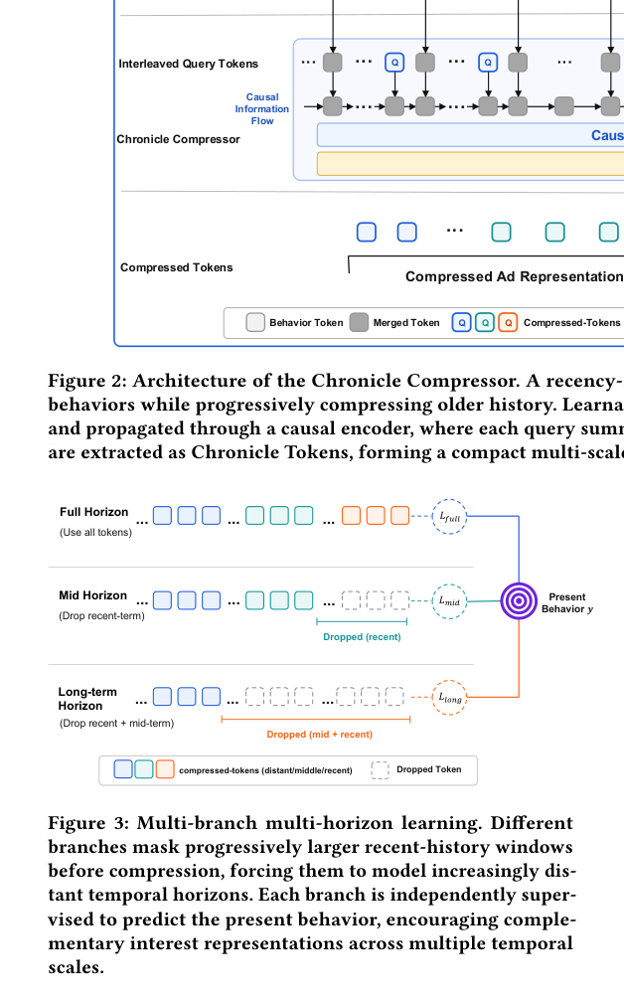

# ChronicleRec: time-anchored compression of lifelong user interests

<!-- source-sha256: 998d48685d87fe8c2d0ecac08a5b4199443ed74d4148399fff7e5d81b589f764 -->

[简体中文](README.md)

> **Core mechanism on public data.** Implements denser merging of recent history, causal query anchors, multi-horizon branches, and alignment to recent targets. It does not replicate Tencent's private MixFormer and caching system.

## Paper information

| Field | Details |
|---|---|
| Paper | [arXiv v1](https://arxiv.org/abs/2609.12375) |
| Organization | Tencent |
| First public release | 2026-09-11 (arXiv v1) |
| Authors' code | No author-released code was found when checked on 2026-09-15. |
| Adapter | `chronicle-rec` |
| Local reproduction code | [`src/auto_research/reproductions/chronicle_rec/`](https://github.com/daiwk/auto-research/tree/main/src/auto_research/reproductions/chronicle_rec/) |

## Original paper

### Motivation and method

Retrieving a very long history for each candidate repeats work, while compressing it to unordered tokens can lose chronology. ChronicleRec increases merge stride from near to middle to distant history. It inserts query tokens into the timeline and uses a causal encoder, so each token summarizes only history before its anchor. Branches mask different amounts of recent behavior; alignment pretraining predicts recent intent from compressed history. Resulting Chronicle Tokens are candidate independent and can be cached and reused.

~~~mermaid
flowchart LR
  H[Lifelong behavior] --> G[Multi-granularity merging, denser for recent history]
  G --> Q[Insert queries into timeline]
  Q --> C[Causal encoding]
  C --> B[Multi-horizon branches]
  B --> A[Chronicle Alignment]
  A --> T[Cacheable Chronicle Tokens]
  T --> R[Downstream ranking]
~~~

<!-- paper-figure:start -->
### Key figure from the paper

> **Figure 3:** Branches mask recent history of different lengths and predict current behavior to learn complementary timescales. From the [original paper](https://arxiv.org/abs/2609.12375); copyright remains with the authors.
<!-- paper-figure:end -->

### Core equations

A window token is $u_w=\sum_{i\in S_w}m_iE_i/\max(\sum_i m_i,1)$. Read only query positions after causal encoding to obtain $C$. Branch $j$ masks $\delta_j$ recent behaviors and aligns to recent intent with $\mathcal L_{align}=\sum_j\bar w_j\operatorname{BCE}(\hat y_j,y)$.

### Paper results

Multi-ChronicleRec GAUC is 0.5580 on KuaiRand, close to Full-Attn at 0.5601 and above VISTA at 0.5518. Tencent AdLive GAUC is 0.8034. A seven-day Weixin Moments Ads A/B test reports GMV **+1.61%**, 95% CI **[+0.678%, +2.547%]** (Sections 4.2 and 4.9).

## Local reproduction

The [fixed MovieLens 100K protocol](metrics/movielens-100k-seeds42-44.json) uses seeds 42/43/44. Alignment reads only train history and validation targets. Final test is evaluated after model selection.

> **Local comparison:** Baseline NDCG@10=0.05401 and treatment NDCG@10=0.04053, a -24.96% relative change.

## Reproduction boundaries

Short public sequences do not represent production histories of 2K–4K events or longer. Local linear alignment substitutes for the four-layer causal Transformer; AdLive, MixFormer, and asynchronous KV caching are not reproduced. The implementation claims only the CPU public-data core mechanism.
