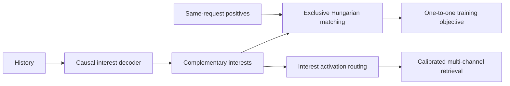
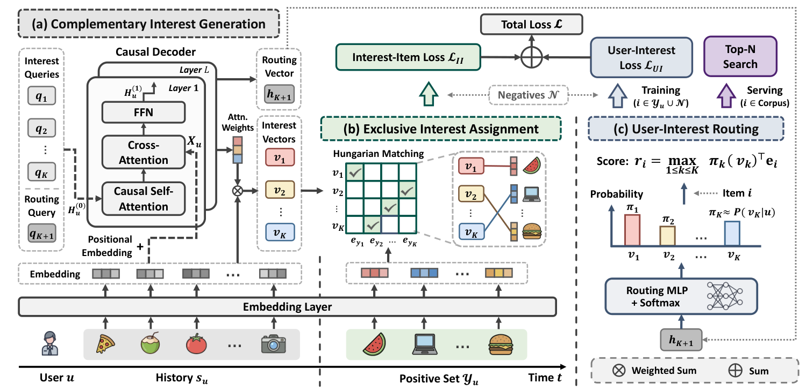

<!-- source-sha256: 620b4ce75675c1f267f1b8831632887134916faad549d7095f3b9ee18424c963 -->

[简体中文](README.md) · English

# MIMA: Learning complementary interests through exclusive multi-positive assignment

> **Public-data core mechanism.** Groups multiple positives, runs minimum-cost one-to-one assignment, updates complementary interests and calibrates activation. Public sequence features replace the production causal Transformer.

## Paper information

| Field | Details |
| --- | --- |
| Paper | [arXiv v1](https://arxiv.org/abs/2609.12842) |
| Institution | Alibaba International Digital Commerce Group |
| First public release | 2026-09-11 (arXiv v1) |
| Original source code | No public author implementation found on 2026-09-15. |
| Adapter | `mima` |
| Local reproduction code | [`src/auto_research/reproductions/mima/`](https://github.com/daiwk/auto-research/tree/main/src/auto_research/reproductions/mima/) |

## Original paper summary

### Background and main changes

Single-positive training in multi-interest retrieval often updates the same closest interest, causing collapse. MIMA groups co-occurring items from one request as positives, generates interests with a causal decoder, and uses Hungarian matching to enforce one-to-one supervision. Routing estimates each interest's activation probability, making channel scores comparable.

<!-- paper-figure:start -->
### Key figure from the paper

> **Figure 2:** Core architecture and connections. From the [paper](https://arxiv.org/abs/2609.12842); copyright belongs to the authors. Click for the source.
<!-- paper-figure:end -->

### Core equations

For interest $i_k$ and positive $p_j$, use cost $C_{kj}=-i_k^\top p_j$ and solve $\pi^*=\arg\min_\pi\sum_k C_{k,\pi(k)}$. At inference calibrate interest-channel scores by $\log a_k$. The mini-suite exhaustively solves small matrices for the exact one-to-one optimum of the same objective as Hungarian matching.

### Offline and online results

Industrial offline HR@100/500/1000 improved by 7.98%/12.24%/13.03% relative to the best baseline. Seven-day production A/B reported **+5.60%** transactions, **+5.44%** transaction value and a 5.12-percentage-point rise in exclusive exposures (Section 5.5, Tables 5–6).

## Local reproduction

See [`metrics/movielens-100k-seeds42-44.json`](metrics/movielens-100k-seeds42-44.json) for MovieLens 100K seeds 42/43/44. Training positives come only from history, with no validation/test answers read. Only validation selects the blend.

> **Comparison protocol:** Baseline NDCG@10=0.05401 versus 0.04589 for the experimental arm, a relative change of -15.03%.

## Scope

Public data lacks production same-request multi-purchase logs; nearby events substitute. The private Alibaba catalog, production causal Transformer checkpoint and online retrieval stack are not reproduced. No Evolve mapping is claimed without an executable candidate protocol.
