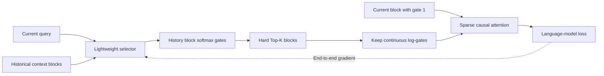
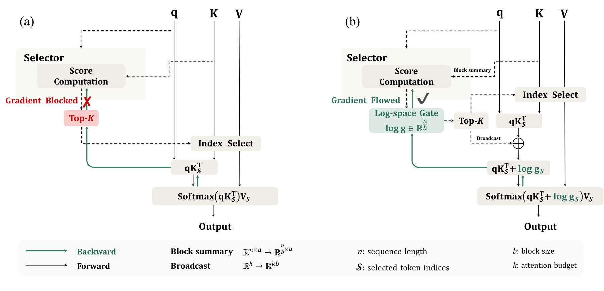

<!-- source-sha256: f610fe532c3a4701ec0167221668c0c9e272d62ffb639f982e4c873e5c8d833d -->

[简体中文](README.md) · English

# SAS: End-to-end learning of sparse attention rankings from language-model loss

> **Public-data core mechanism.** The selector is trained with a frozen backbone. The path runs softmax-normalized gates, history-block Top-K, a mandatory current block, and log-gates inside attention softmax. This PyTorch reference is not a Triton speed implementation.

## Paper information

| Field | Details |
| --- | --- |
| Paper | [arXiv v1](https://arxiv.org/abs/2609.13141) |
| Institutions | Tencent HY LLM Frontier / HKUST (Guangzhou) / HKUST |
| First public release | 2026-09-11 (arXiv v1) |
| Original source code | Yes: [official repository](https://github.com/Tencent-Hunyuan/Simple-Attention-Sparsification) |
| Adapter | `sas-attention` |
| Local reproduction code | [`src/auto_research/reproductions/sas_attention/`](https://github.com/daiwk/auto-research/tree/main/src/auto_research/reproductions/sas_attention/) |

## Original paper summary

### Background and main changes

Hard Top-K changes only selected indices; LM loss cannot directly train a selector through discrete indices. SAS does not distill dense attention. It scores historical blocks continuously, retains continuous gates for Top-K blocks, and adds `log(gate)` to attention logits during training. Final token prediction therefore learns which context affects prediction. A shared softmax normalizes history gates. The current block always has gate 1, preventing drift in the aggregate weight of past context.

<!-- paper-figure:start -->
### Key figure from the paper

> **Figure 1:** Overall design and components. From the [paper](https://arxiv.org/abs/2609.13141); copyright belongs to the authors. Click for the source.
<!-- paper-figure:end -->

### Core equations

For history-block selector scores $s$, compute $g=\operatorname{softmax}(s)$ and fix current-block $g_0=1$. Select $\mathcal S=\operatorname{TopK}(s)$, then use

$$
o=\operatorname{softmax}\left(qK_{\mathcal S}^{\top}/\sqrt d+\log g_{\mathcal S}\right)V_{\mathcal S}.
$$

Top-K indices remain discrete, but retained gates are continuous so LM loss reaches the selector through attention softmax. Paper ablations identify all three as important: log-gates inside softmax, history-block normalization, and continuous ranking information.

### Offline and online results

- At a 1024-token budget with Qwen3-4B, MATH500 rises from SeerAttention-R's 84.67 to **90.65** and GPQA-Diamond from 39.84 to **50.41** (Table 2).
- At 2048 tokens with Qwen3-4B, BFCL multi-turn goes from 29.00 to **32.50** (Table 4).
- Single-GPU steady-state decode on Qwen3-4B: **5.6×** over dense at 512K context and batch 1, and about **13×** at 64K and batch 8 (Figure 7).

## Local reproduction

See [`metrics/wikitext-2-seeds42-44.json`](metrics/wikitext-2-seeds42-44.json) for WikiText-2 seeds 42/43/44. Train the shared tiny decoder for 30 steps, copy those weights for SAS, freeze the backbone, and train only the selector for 24 steps. Validation is observational; test is read only after fixing configuration.

| Public CPU metric, three-seed mean | Dense | SAS |
|---|---:|---:|
| Test perplexity | 139.652 | 139.677 |
| Causal positions participating in attention | 100% | 53.85% |

> **Comparison protocol:** Dense test PPL 139.652 versus SAS 139.677, +0.018% relative; lower is better.

SAS test PPL is **+0.018%** versus dense, essentially tied in this tiny setting, not a meaningful gain. Mean selector gradient norm is $4.65\times10^{-5}$, confirming final LM loss reaches it. The 46.15% position reduction is a routing count, not wall-clock speedup.

## Scope

The local reference materializes a dense attention matrix to verify selection and gradients. It does not reproduce Qwen3-4B/8B/14B, OLMo3-7B, OpenR1-Math-220k, LongBench, BFCL or VitaBench, or integrate the authors' Triton/FlashAttention kernels and SGLang benchmark. The adapter is a CPU L2 core mechanism with no GPU receipt requirement, and cannot claim the paper's 5.6×/13× as local speed. A CUDA kernel path would require separate A100/A30 measurement before upgrade.
