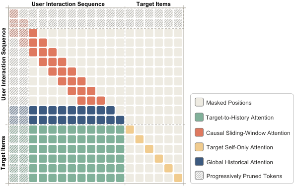

<!-- source-sha256: ce8aae1ac67432a8e5e3857df42efcec71504419a6c7de099335ea2bbcb3d407 -->

[简体中文](README.md) · English

# LazFormer: Scaling Transformers for Industrial Recommendation via Transferable Generative Pre-training

> **Public-data core mechanism.** Private logs, production checkpoints and serving are not reproduced.

## Paper information

| Field | Details |
| --- | --- |
| Paper | [arXiv v1](https://arxiv.org/abs/2609.14978) |
| Institution | Alibaba International Digital Commerce Group |
| First public release | 2026-09-14 (arXiv v1) |
| Original source code | No public author repository found as of 2026-09-16. |
| Adapter | `lazformer` |
| Local reproduction code | [`src/auto_research/reproductions/lazformer/`](https://github.com/daiwk/auto-research/tree/main/src/auto_research/reproductions/lazformer/) |

## Original paper summary

### Background and main changes

Start with transferable generative pretraining. Adapt to ranking using a ranking residual adapter, dense recent and sparse distant tokens, and hybrid sparse attention. A two-week A/B test reports IPV +5.21% and GMV +9.85%.

<!-- paper-figure:start -->
### Key figure from the paper

> **Figure 2:** Overall method and components. From the [paper](https://arxiv.org/abs/2609.14978); copyright belongs to the authors. Click for the source.
<!-- paper-figure:end -->

### Core mechanism

The local implementation reduces the method to deterministic candidate scoring. GESE explicitly combines relevance, set diversity, faithfulness and a contextual selector. LazFormer separates the transferable pretrained mapping from the ranking residual adapter, selecting the blend coefficient only on validation.

### Offline and online results

Online claims come from the paper's production A/B. The local run reports offline metrics on the same public candidate set and split across arms; these are not the same kind of gain.

## Local reproduction

### Online versus local results

The paper's online results are separate from local MovieLens metrics. See [`metrics/movielens-100k-seeds42-44.json`](metrics/movielens-100k-seeds42-44.json) for seeds 42/43/44. For the first seed, unified NDCG@10 is 0.05401 for baseline and 0.05048 for the experimental arm, a relative change of -6.53%.

> **Comparison protocol:** Same public candidates and split. NDCG@10 baseline 0.05401 versus 0.05048 for LazFormer, -6.53% relative.

## Scope

Only core state transitions on public data are verified. No private training data, large-model generator, production feedback or online serving was reproduced. There is no registry-only Evolve mapping.
