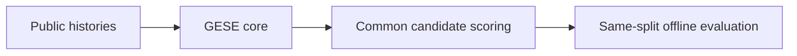
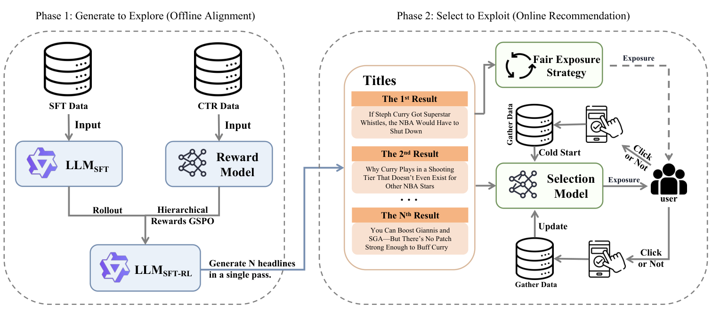

# Generate to Explore, Select to Exploit: Aligning LLM-based Headline Generation with Personalized Recommendation

<!-- source-sha256: 17a292cd7cd5cb6b8214ef94f0c73d2e06080c0b6428755a683c64ef101e57ea -->

[简体中文](README.md)

> **Public-data core mechanism.** No private logs, production checkpoint, or serving stack.

## Paper information

| Field | Value |
| --- | --- |
| Paper | [arXiv v1](https://arxiv.org/abs/2609.15094) |
| Organization | Baidu |
| First public release | 2026-09-14 (arXiv v1) |
| Authors' code | No public author repository found as of 2026-09-16. |
| Adapter | `gese` |
| Local code | [gese](https://github.com/daiwk/auto-research/tree/main/src/auto_research/reproductions/gese/) |

## Original paper

### Background and contribution

Explore sets of diverse, faithful headlines, then select a personalized headline using current context. The paper's production A/B reports +2.57% CTR and +0.87% dwell time, not local results.

<!-- paper-figure:start -->
### Key figure from the paper

Original architecture from the [paper](https://arxiv.org/abs/2609.15094); copyright belongs to the authors.
<!-- paper-figure:end -->

### Scoring and evidence

The local deterministic candidate scorer combines relevance, set diversity, faithfulness, and contextual selection. The source also describes LazFormer separately: transferable pretrained mapping and a ranking residual adapter, with mixing selected only on validation. Offline matched-public-set results are not production A/B.

## Local reproduction

[MovieLens-100K results](metrics/movielens-100k-seeds42-44.json) use seeds 42/43/44. On the first seed and the same candidate set and split, NDCG@10 is 0.05401 baseline vs. 0.04421 experiment, −18.15% relative.

## Reproduction limits

Public-data mechanism only, not private training, a large headline generator, production feedback, or serving. No registry-only Evolve mapping.
