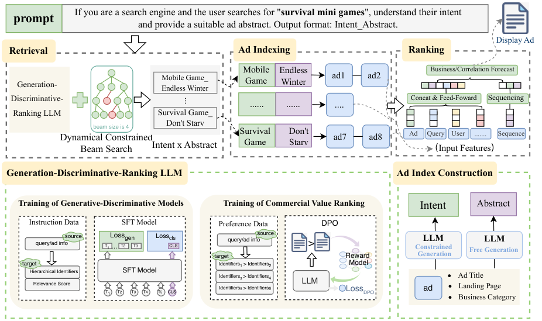

# One-Step Retrieval Framework for Real-Time Sponsored Search Ads Using Hierarchical Text Representations

<!-- source-sha256: 96c120054a49eec148d1b1482c20ea1a3bd2a17d13923866b0922facc99f3f4a -->

[简体中文](README.md)

> **Core mechanism on public data.** MovieLens 100K exercises hierarchical identifiers, joint scoring, and constrained retrieval, without Tencent's private ads logs or production index.

## Paper information

| Field | Details |
|---|---|
| Paper | [arXiv v1](https://arxiv.org/abs/2609.18296) |
| Organization | Tencent |
| First public release | 2026-09-16 (arXiv v1) |
| Authors' code | No public author repository was found as of 2026-09-19. |
| Adapter | `angle` |
| Local reproduction code | [`src/auto_research/reproductions/angle/`](https://github.com/daiwk/auto-research/tree/main/src/auto_research/reproductions/angle/) |

## Original paper

### Motivation and method

The semantic hierarchy combines intent and summary IDs. Training joins generation, discrimination, and ranking objectives. Request-time beam constraints allow only valid identifiers.

~~~mermaid
flowchart LR
  H[Public history] --> I[Intent and summary hierarchy]
  I --> J[Joint generative, discriminative, and ranking scores]
  J --> B[Dynamically constrained beam]
  B --> E[Offline evaluation on the same split]
~~~

<!-- paper-figure:start -->
### Key figure from the paper

> **Figure 1:** Core architecture, modules, and connections. From the [original paper](https://arxiv.org/abs/2609.18296); copyright remains with the authors.
<!-- paper-figure:end -->

### Core computation

The local score `s = s_gen + 0.15 s_dis` retains generative relevance and hierarchical-ID discrimination. Request-specific valid IDs constrain the beam; the fusion coefficient is selected only on validation.

### Paper results

On Weixin Top Stories, online A/B measured consumption +1.81%, GMV +2.16%, clicks +1.50%, conversion +1.44%, and impressions +2.49%. These production results are not local MovieLens measurements.

## Local reproduction

See the [local results at seeds 42/43/44](metrics/movielens-100k-seeds42-44.json).

> **Local comparison:** Baseline and treatment use the same MovieLens 100K candidates, temporal split, and evaluation. Local relative changes are in the metrics file, not substituted with online percentages.

## Reproduction boundaries

MovieLens 100K exercises hierarchical identifiers, joint scores, and constrained retrieval. No private Tencent ads logs or production index are used.
