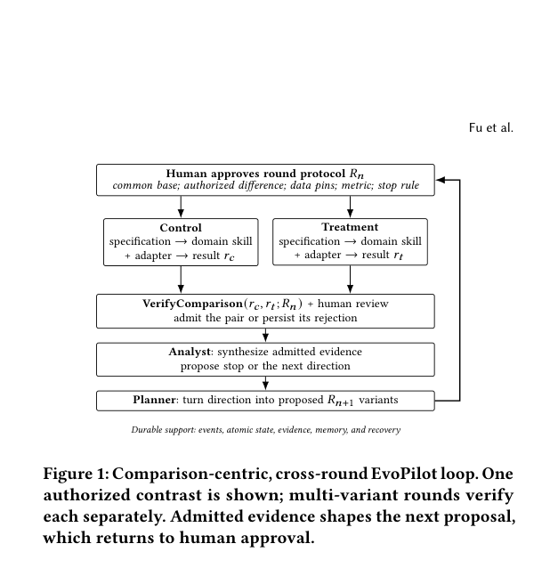

# Verify, Don't Trust: Agentic Model Development for Video Discovery Retrieval at Scale

<!-- source-sha256: 461d4284afa1aa1a754016383d87aca09361b2b6abf0f9dfca423a3b156fdbae -->

[简体中文](README.md)

> **Core mechanism on public data.** Reproduces EvoPilot's comparison protocol and fail-closed verifier, including a matched interaction-head comparison on one MovieLens split. It does not reproduce Meta's production VDD system.

## Paper information

| Field | Details |
|---|---|
| Paper | [arXiv v1](https://arxiv.org/abs/2609.21257) |
| Organization | Meta Platforms |
| First public release | 2026-09-18 (arXiv v1) |
| Authors' code | No public author repository was found as of 2026-09-21. |
| Adapter | `evopilot` |
| Local reproduction code | [`src/auto_research/reproductions/evopilot/`](https://github.com/daiwk/auto-research/tree/main/src/auto_research/reproductions/evopilot/) |

The core mechanism is in `src/auto_research/reproductions/latest_20260921.py`.

## Original paper

### Motivation and method

A completed training job is not evidence by itself. EvoPilot treats a **matched control–treatment comparison** as the evidence unit. The protocol fixes the shared base, data version, evaluator, effective output depth, and sole permitted treatment difference. It reads actual run state from artifacts, fails closed on mismatches, and still requires human review before accepting a conclusion.

~~~mermaid
flowchart LR
  P[Human-approved comparison protocol] --> C[Isolated control]
  P --> T[Isolated treatment]
  C --> A[Artifact attestation]
  T --> A
  A --> V{VerifyComparison}
  V -->|Mismatch| R[Reject conclusion and log failure]
  V -->|Exact match| H[Human review and evidence acceptance]
  H --> N[Next research round]
~~~

<!-- paper-figure:start -->
### Key figure from the paper

> **Figure 1:** Overall method and key components. From the [original paper](https://arxiv.org/abs/2609.21257); copyright remains with the authors.
<!-- paper-figure:end -->

### Core equation

The paper writes evidence acceptance as `A(c,t;R) = 1[Verify_R(c,t)] · 1[Review_R(c,t)]`. Local `verify_comparison` checks both terminal states, shared base, data, evaluator, effective output depth, artifact provenance, and whether the actual difference is exactly the approved treatment. Missing or extra changes reject the comparison.

### Paper results

An original unmatched comparison erroneously showed a 22-percentage-point offline hit-rate drop. After correcting output depth, the matched comparison gained 3.20 points. A subsequent seven-day randomized online experiment raised VDD-slice GSRR by 0.66% relative. These are Meta production results, not local MovieLens metrics.

## Local reproduction

> **Local comparison:** The matched two-tower proxy baseline had `Hit@10=0.10909` and the interaction-head treatment had `Hit@10=0.10455`, a `-4.17%` relative change. Protocol verification passed, but the negative result is retained and does not reproduce the production lift.

See [`metrics/movielens-100k-seeds42-44.json`](metrics/movielens-100k-seeds42-44.json) for seeds 42/43/44. The artifact also records rejection of a pair with mismatched output depths and acceptance of a matched pair differing only in the interaction-head toggle.

## Reproduction boundaries

MovieLens exercises the comparison protocol, artifact attestation, fail-closed pair verifier, and validation-only interaction-head comparison. It does not reproduce Meta VDD private video logs, tens-of-billions-scale index, remote workflows, or online traffic.
