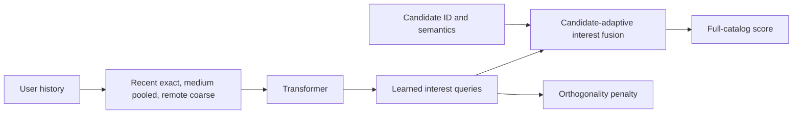
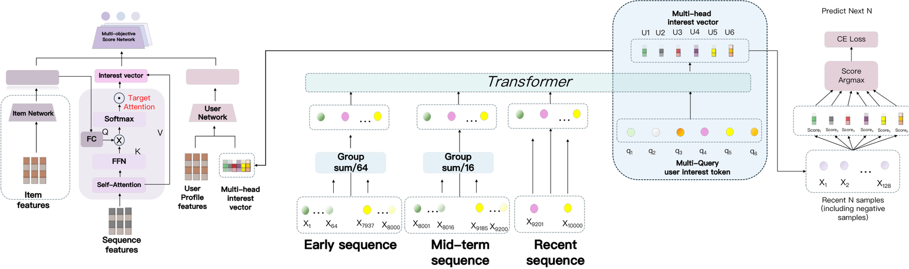

# MuSeR: Hierarchical long-sequence and multi-interest retrieval

<!-- source-sha256: 6b73d6f1b1132735b434c181db62fb17597029f3a58fcc196633da263a724143 -->

[简体中文](README.md)

> Concept test: trained temporal compression, Transformer, learnable interests, candidate-adaptive fusion, and orthogonality. Public item tags replace ERNIE→BGE multimodal features.

## Paper information

| Field | Details |
|---|---|
| Paper | [arXiv v1](https://arxiv.org/abs/2609.23677) |
| Institution | Baidu. |
| First public release | 2026-09-20 (arXiv v1) |
| Author code | No author MuSeR repository found as of 2026-09-26. |
| Local adapter or method key | `muser` |
| Local reproduction code | [`src/auto_research/reproductions/muser/`](https://github.com/daiwk/auto-research/tree/main/src/auto_research/reproductions/muser/) |

## Paper method and evidence

Keep recent activity verbatim and pool medium- and long-range history at increasingly coarse strides before a lightweight Transformer. Learn multiple queries over sequence states, then select interests for each candidate with a similarity softmax. The paper aligns BGE-encoded distilled ERNIE content summaries with ID embeddings, trains with next-K contrastive loss and interest orthogonality, and deploys asynchronous long-term caching, online short-term updates, and hierarchical retrieval. See [Figures 2–3 and Table I](https://arxiv.org/html/2609.23677v1).

<!-- paper-figure:start -->
### Original paper figure

Figure 2 shows the original architecture, not the tag-based local variant. From the [original paper](https://arxiv.org/abs/2609.23677); copyright remains with the authors.
<!-- paper-figure:end -->

### Core equation

For compressed states H and query q_m, use `u_m=softmax(q_m Hᵀ/√d)H`. Candidate e_i gets `α_m=softmax_m(cos(u_m,e_i)/τ)` and score `Σ_m α_m cos(u_m,e_i)/τ`. Positive/negative cross-entropy plus `λΣ_{m≠n}(u_mᵀu_n)²` prevents collapse; both terms are optimized locally.

### Reported results

The paper reports Recall@K/NDCG@K on Amazon 2023 Instruments, Scientific, Game, and private Baidu logs. Baidu APP A/B reports DAU +0.26% and total session time +0.89%, both p<0.05. Not local measurements.

## Local reproduction

Use the first 500,000 KuaiRand-Pure logs and user_id<10000: 48,075 positives, 12,462 training prefixes, and 2,140 validation penultimate plus 2,140 test final positive events. All arms train 800 steps on seeds 42/43/44; rank all 7,583 items for 1,000 fixed sampled examples per split, masking history. Not Amazon or online traffic.

| Full-catalog test, three-seed mean | Recall@10 | NDCG@10 |
|---|---:|---:|
| Hierarchical compression + multiple interests + public tags | 0.0257 | 0.0129 |
| Recent history + single interest + ID | 0.0100 | 0.0053 |
| No hierarchical compression | 0.0247 | 0.0132 |
| No public-tag fusion | 0.0110 | 0.0054 |

Matched-budget recent-history baseline to full local variant: +156.7% relative Recall@10 but just +0.0157 absolute. Hierarchical ablation is small; the tags/interests combination is exploratory and cannot be attributed to ERNIE/BGE. [Per-seed metrics](metrics/kuairand-pure-seeds42-44.json).

Run auto-research reproduce --paper muser --dataset-root data (first download needs network). No ERNIE summary/distillation, BGE text/video embeddings, hundred-thousand-event behavior histories, async caching, HNSW hierarchical beam, latency, or production traffic. Three seeds on a small slice are not online significance.
