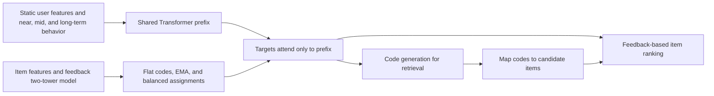
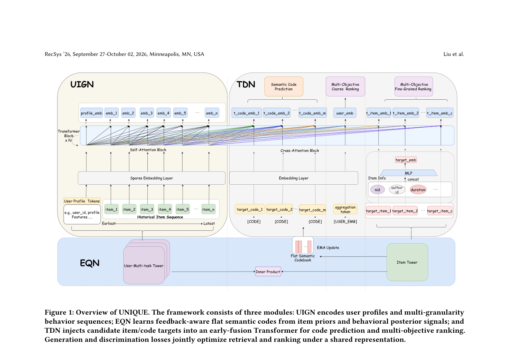

<!-- source-sha256: 7fad4a3c81f0a159b002fcae6cf3d4b0f7924da5365a793591aab834497d5fad -->

[简体中文](README.md) · English

# UNIQUE: Unified retrieval and ranking

> **Scaled public-data mechanism experiment (proof of concept).** Feedback-aware flat quantization, EMA and frequency balancing, a multigranular user prefix, target attention isolation, and joint code generation and impression ranking all run. Baidu production features, multi-objective heads and serving infrastructure are absent, so this is not a complete reproduction.

## Paper information

| Field | Details |
| --- | --- |
| Paper | [arXiv v1](https://arxiv.org/abs/2609.23718) |
| Institution | Beihang University |
| First public release | 2026-09-20 (arXiv v1) |
| Original source code | No author implementation found as of 2026-09-26. |
| Adapter | `unique` |
| Local reproduction code | [`src/auto_research/reproductions/unique/`](https://github.com/daiwk/auto-research/tree/main/src/auto_research/reproductions/unique/) |

## Original paper summary

### Background and main changes

Retrieval and ranking usually train separately, making it hard for retrieval to use ranking feedback. Multilevel residual quantization can accumulate error. UNIQUE assigns each item to **one flat code**. A feedback-supervised two-tower model encodes items, nearest-neighbor assignment is corrected for use frequency, and EMA updates the codebook. Static user attributes, recent and mid-term behaviors, and long-term interest summaries form a prefix. Item and code candidates attend only to that prefix, not each other. Shared representations train both code distributions and several ranking objectives. Inference nominates codes first, then ranks their mapped items.

See Figure 1 for the full EQN/UIGN/TDN design and Tables 2–5 for offline and online experiments in the [official full text](https://arxiv.org/html/2609.23718v1). The redraw describes the core mechanism, not private features or online serving in this repository.

<!-- paper-figure:start -->
### Key figure from the paper

> **Figure 1:** The main architecture, modules and connections. From the [paper](https://arxiv.org/abs/2609.23718); copyright belongs to the authors. Click for the source.
<!-- paper-figure:end -->

### Core equations

With normalized item code input `z_i`, flat assignment is `c_i=argmin_j ||z_i-e_j||² (p_j M)^τ`. Locally `τ=0.5`, with straight-through estimate `z_i+sg(e_{c_i}-z_i)`. Target tokens use `softmax(q_t K_prefixᵀ/√d)V_prefix`, without inter-target attention. The loss combines impression-click BCE, code cross-entropy, feedback two-tower BCE, and quantization. The scaled local model adds an auxiliary normalized play-time loss.

### Offline and online results

The paper uses KuaiRand-Pure and Baidu internal settings. Mobile Baidu A/B reports `+0.96%` total watch time, `+1.08%` distribution volume and `+0.70%` retention. These **paper production results** cannot be transferred to local metrics without the corresponding system and traffic.

## Local reproduction

> **Comparison protocol:** Same early-fusion ranker, data and training budget. Removing joint code generation gives mean test CTR-AUC `0.5282` over three seeds versus `0.5270` for the full scaled arm, `-0.23%` relative. No stable improvement was observed.

Filter the first 500,000 rows of raw KuaiRand-Pure logs to `user_id<10000`, retaining 107,850 impressions. There are 16,279 train impressions; each user's last two impressions provide 1,709 validation and 1,917 test impressions. History uses only earlier positive feedback, left-padded with the earliest observed item when short. Train each variant and seed for 300 steps. CTR-AUC uses a fixed random draw of 400 real impressions. For up to 100 positives, first predict four codes, rank their mapped candidates and exclude seen items. The slice and feature set are smaller than the paper's.

| Three-seed test mean | CTR-AUC | Candidate coverage of top four codes | Code perplexity | Mean pool |
|---|---:|---:|---:|---:|
| Joint retrieval and ranking | 0.5270 | 0.0833 | 60.29 | 649.29 |
| No joint generation | 0.5282 | Not applicable | 60.41 | Not applicable |
| No balancing correction | 0.5198 | 0.3300 | 23.26 | 2077.65 |

Without balancing, more items collapse into a few popular codes, so coverage looks higher but the candidate pool roughly triples. **That is not more efficient retrieval.** Joint reranked Recall@10 is just `0.01/0/0` across seeds. These weak results do not support paper-level gains. See [local metrics](metrics/kuairand-pure-seeds42-44.json).

Run `auto-research reproduce --paper unique --dataset-root data`. The repository loader gets public KuaiRand-Pure by default, requiring network access on the first run.

## Scope

- Only public item IDs, tags, clicks/long views and play time are used; no Baidu text, publisher features, detailed feedback or multi-scenario objective heads.
- The log slice does not reconstruct an industrial code-to-item index, live freshness, P99 serving latency or A/B. Balancing does not imply high-quality retrieval.
- Three seeds are a small mechanism diagnostic without paper-scale tuning. The paper's online gains cannot be attributed to this local model.
